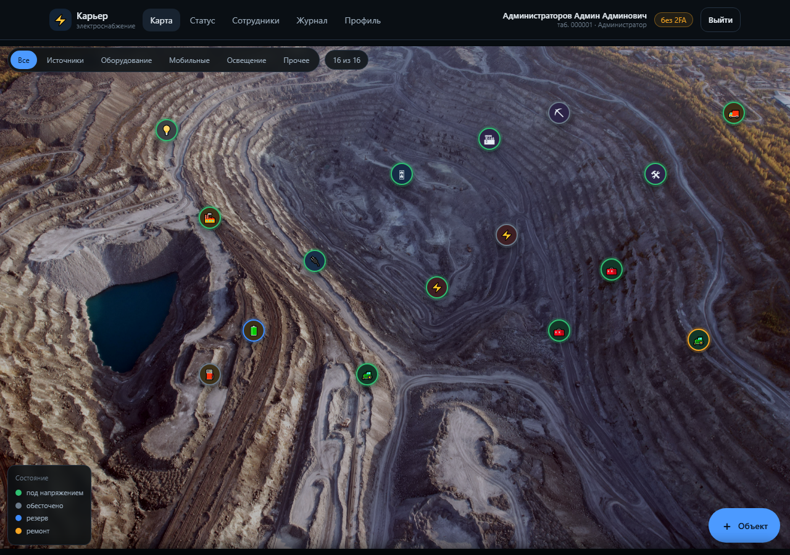
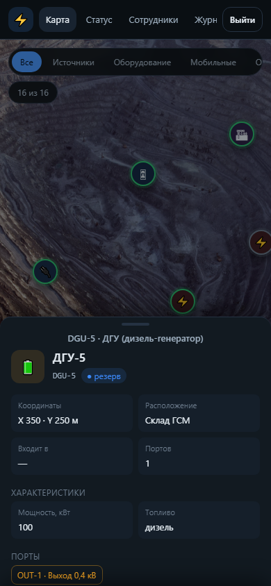

# Спринт 2 «Реестр объектов и карта» — отчёт

Ветка: `feature/sprint-2-registry-map` · Дата: 03.11.2026 · Спринт 1 не изменён



---

## 1. Что сделано

| Блок | Результат |
|---|---|
| Схема БД | Новая схема `gis`: `pits`, `asset_types`, `assets`, `asset_ports`, `map_layers` |
| Миграция | Alembic `0002_sprint2_gis` (схемы `auth`/`audit` не тронуты) |
| Справочник типов | 15 типов с иконками, цветами, шаблонами портов и схемами атрибутов |
| Объекты | 16 объектов с координатами в метрах и портами, созданными по шаблону типа |
| API | CRUD реестра, фильтры, путь питания, активная подложка, расширение справочника |
| Права | Оператор видит объекты, но не может создавать/менять/удалять (403 на сервере) |
| Карта | Leaflet `CRS.Simple`, подложка 2048×1152 px → 1024×576 м, маркеры по типам |
| Bottom sheet | Шторка снизу (46vh / 88vh), карточка объекта, путь питания, удаление |
| Админ-режим | Кнопка «＋ Объект» → клик по карте → форма → объект создан с координатами |
| Навигация | После входа — сразу карта (`/`), статус доступа переехал на `/status` |

## 2. Модель данных (схема `gis`)

| Таблица | Назначение |
|---|---|
| `pits` | карьер (пока один: «Западный №1») |
| `map_layers` | подложка: `image_url`, `width_px/height_px`, `meters_per_pixel`, `origin_x/y`, поворот |
| `asset_types` | тип: иконка, цвет, `port_template` (JSONB), `attr_schema`, `required_attrs`, `is_mobile_default` |
| `assets` | объект: `x/y` в метрах, `attrs` JSONB, статус, `is_mobile`, вложенность `parent_asset_id`, `version`, soft delete |
| `asset_ports` | порты `IN/OUT/IO` с номинальным напряжением |

Ключевое: **координаты в метрах**, подложка привязана масштабом. Заменим картинку — объекты останутся на своих местах.

## 3. Справочник типов (15)

| Код | Тип | Категория | Порты |
|---|---|---|---|
| `substation` | Подстанция 35/6 кВ | источник | 4 отходящих 6 кВ |
| `bkru` | БКРУ | оборудование | 2 ввода, 3 отходящих |
| `ksr` | КСР | оборудование | ввод 6 кВ, 2 отходящих 0,4 |
| `yaku` / `yaku_1t` | ЯКУ / ЯКУ-1Т | оборудование | ввод + отходящая |
| `ktp` | КТП | оборудование | ввод 6 кВ, 4 отходящих 0,4 кВ |
| `dmo` | ДМО (дробильный комплекс) | мобильный | ввод 0,4 + 2 привода |
| `dmp` | ДМП | мобильный | ввод 0,4 + привод |
| `bmp` | БМП (буровой комплекс) | мобильный | ввод 0,4 + 2 привода |
| `gen_diesel` / `gen_petrol` | ДГУ / бензиновый генератор | источник | выход 0,4 кВ |
| `ekg` | ЭКГ | оборудование | ввод 6 кВ |
| `cuckoo` | Кукушка | мобильный | выход 0,4 кВ |
| `mast` / `pump` | Мачта освещения / насос | освещение / прочее | ввод 0,4 кВ |

У `dmo`/`dmp`/`bmp`: `is_mobile_default = true`, обязательный атрибут `power_kw`, поле `drive_type`. Новый тип добавляется через `POST /api/asset-types` без релиза.

## 4. API

| Метод | Путь | Право |
|---|---|---|
| GET | `/api/asset-types` | любой вход |
| POST/PATCH | `/api/asset-types[/{id}]` | `settings.edit` |
| GET | `/api/assets?type_code=&status=&is_mobile=&q=` | любой вход |
| POST | `/api/assets` | `asset.create` |
| GET | `/api/assets/{id}` | любой вход |
| PATCH | `/api/assets/{id}` | `asset.create`, `expected_version` → 409 при гонке |
| DELETE | `/api/assets/{id}` | `asset.delete` (мягкое удаление) |
| GET | `/api/assets/{id}/power-path` | любой вход |
| GET | `/api/map/layers/active` | любой вход |

`GET /assets/{id}/power-path` пока строит цепочку по вложенности и, если сверху нет источника, добавляет синтетическую ПС:

```json
{ "source": {"code":"PS-356","name":"ПС-35/6 кВ «Карьер»","role":"source"},
  "chain": [{"code":"BKRU-1","role":"feed"}, {"code":"KTP-14","role":"asset"}],
  "note": "Предварительная цепочка по вложенности. Полный расчёт по графу — Спринт 3." }
```

Валидация при создании: тип существует, обязательные атрибуты заполнены, координаты внутри карты (`asset.out_of_bounds`), код уникален (`asset.duplicate_code`), версия совпадает (`conflict.version`).

## 5. Карта и интерфейс

* `Leaflet` + `CRS.Simple`, `ImageOverlay` с привязкой `[[0,0],[576,1024]]` метра.
* Маркеры — `divIcon`: иконка типа, цвет типа, обводка по статусу, размер растёт при выборе.
* Фильтры по категориям, легенда статусов, счётчик «N из M».
* Bottom sheet: два положения, тянется за ручку, закрывается свайпом или тапом по фону.
* Карточка: тип, код, статус, координаты, расположение, входимость, порты, атрибуты, путь питания, удаление (с подтверждением вторым нажатием).
* Админ: «＋ Объект» → клик по карте → координаты подставляются автоматически → форма (тип, название, код, мощность) → создание.
* Мобильная вёрстка: карта заполняет экран (cover-fit), шапка в одну строку, шторка 46vh.



## 6. Проверки

| Проверка | Итог |
|---|---|
| `alembic upgrade head` | `0002_sprint2_gis` применена |
| `pytest -q` | **20 passed** (9 из Спринта 1 + 11 новых) |
| `scripts/smoke.ps1` | **26 проверок, 0 провалов** — авторизация Спринта 1 не сломалась |
| `tsc -b` | без ошибок |
| `vite build` | 370 КБ JS, 38 КБ CSS |
| Headless Chrome: карта | 16 маркеров, 0 ошибок в консоли |
| Headless Chrome: карточка | шторка открывается, данные и путь питания на месте |

Новые тесты: справочник типов и их атрибуты, границы подложки, фильтры, порты объекта, путь питания, создание/правка/удаление, гонка версий (409), выход за границы карты, обязательные атрибуты, дубликат кода, права оператора (403 на создание и удаление).

## 7. Решения и компромиссы

1. **Путь питания — по вложенности.** Полный граф связей (`links`) появится в Спринте 3; текущий ответ помечен `note`, чтобы никто не принял его за расчёт.
2. **`/api/assets/{id}/power-path` синтетический источник.** Если у объекта нет родителя-источника, возвращается ПС-35/6 «Карьер» с `synthetic: true` — фронт это показывает.
3. **Удаление мягкое** (`deleted_at`), объект исчезает из списков и с карты, история сохраняется.
4. **Оптимистическая блокировка** через `expected_version`: без неё две вкладки админа затирали бы правки друг друга.
5. **Подложка приглушена фильтром** (`brightness .72`), чтобы маркеры и статусы читались и днём, и ночью.
6. **`h-full` не сработал** внутри flex-контейнера — карта на телефоне схлопывалась в полоску; исправлено на `absolute inset-0` + `invalidateSize` + cover-fit.

## 8. Что осталось за рамками

* Связи `links` и настоящий расчёт питания, однолинейная схема — Спринт 3.
* Перетаскивание маркеров и перемещение «кукушек» (право `asset.move`) — Спринт 5.
* Загрузка собственной подложки через админку (сейчас файл в `public/`).
* Кластеризация маркеров: при 16 объектах не нужна, при 500+ понадобится.

## 9. Следующий шаг

Спринт 3: таблицы `lines`/`links`, редактор связей, валидация топологии, расчёт «под напряжением», однолинейная схема и снимки версий.
