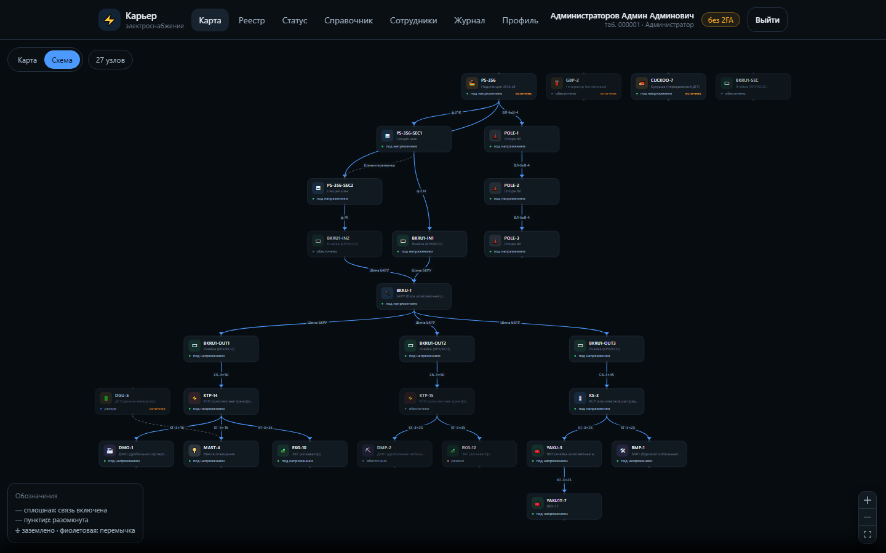
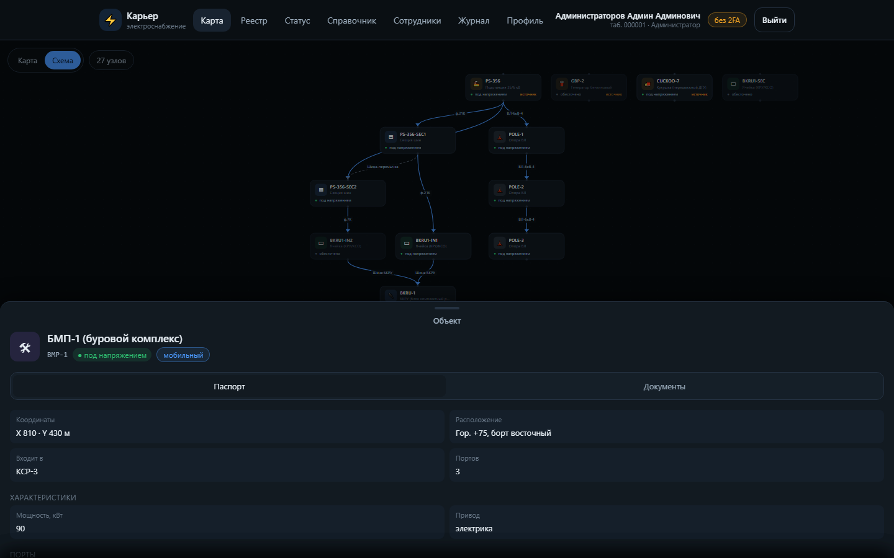
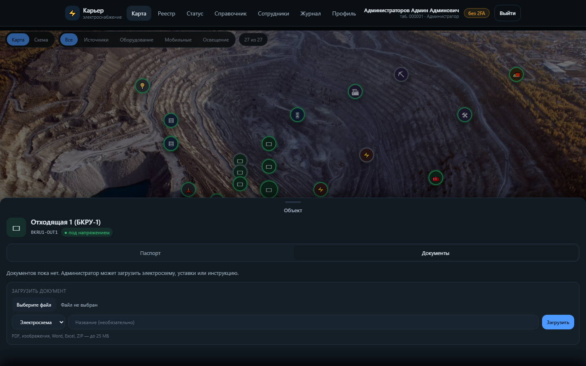
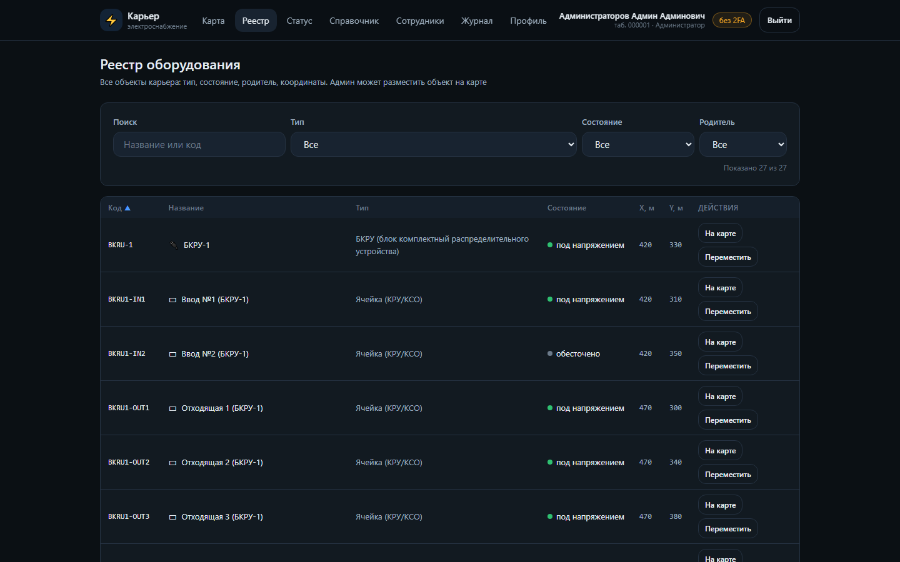
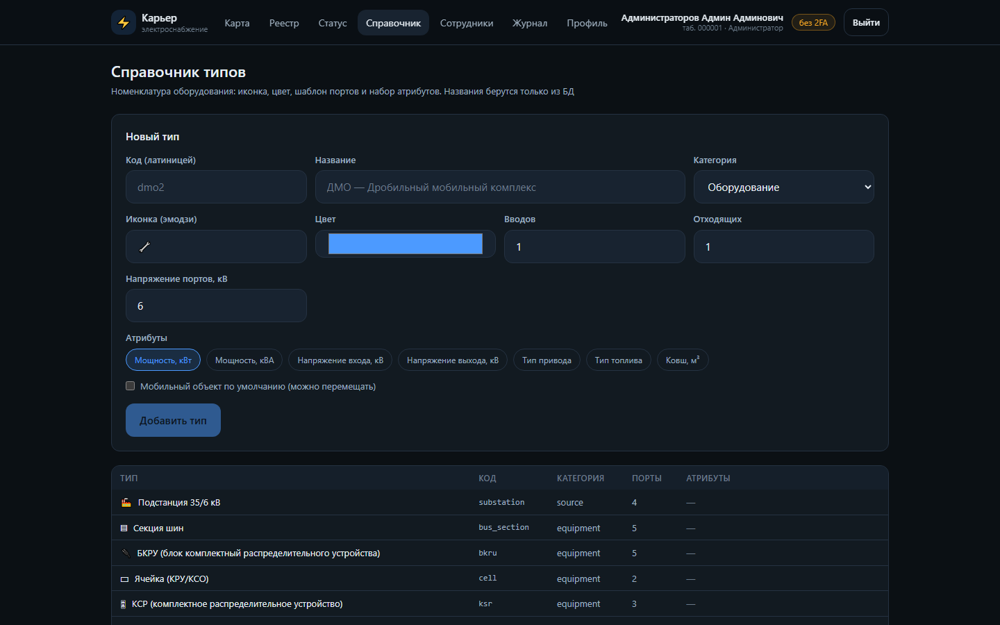

# Спринт 3 «Топология, однолинейная схема, документы» — отчёт

Ветка: `feature/sprint-3-topology` · Дата: 03.11.2026 · Спринты 1–2 не изменены



---

## 1. Что сделано

| Блок | Результат |
|---|---|
| Топология | `gis.lines` (фидеры), `gis.links` (участки порт→порт), `gis.switching_ops` (журнал переключений) |
| Расчёт питания | Обход графа от включённых источников по включённым связям и объектам — вместо заглушки по вложенности |
| Валидация связей | Направление портов (OUT→IN), совпадение напряжения, дубликаты, циклы в основной схеме |
| Проверки схемы | `GET /api/topology/issues`: объекты без ввода, без портов, кольца, несовпадение напряжения |
| Внутренняя структура | Секции шин и ячейки как дочерние объекты ПС и БКРУ, переключение из карточки |
| Переключения | Вкл/откл и заземление (с обязательной причиной), запись в журнал и аудит |
| Перемычки | Тип связи `jumper` между секциями учитывается в обходе (нормально разомкнута — на схеме пунктир) |
| Схема | React Flow + dagre: автоматическая раскладка сверху вниз, подписи связей, пунктир для разомкнутых |
| Реестр | Таблица объектов: сортировка, поиск, фильтры, «На карте» и «Разместить/Переместить» |
| Справочник | Админ создаёт типы: название, иконка, цвет, порты (вводы/отводы, напряжение), атрибуты |
| Документы | `ops.documents`: загрузка PDF/Word/Excel/изображений, типы (схема/уставки/инструкция), просмотр |
| Офлайн | Сохранение файла в IndexedDB, открытие без сети с пометкой «Офлайн-версия» |
| Соединение | Инструмент «Соединить» на карте: порт OUT → порт IN → марка и длина → связь создана |

## 2. Модель данных (добавлено в Спринт 3)

| Таблица | Назначение |
|---|---|
| `gis.lines` | логическая линия: код (`ф.21К`), вид (кабель/ВЛ/шина), напряжение, марка, длина, состояние |
| `gis.links` | участок между портами: тип (кабель/ВЛ/шина/перемычка), роль (основная/резерв/аварийная), состояние, марка, сечение, длина, версия, soft delete |
| `gis.switching_ops` | журнал: действие, было/стало, причина, кто, когда |
| `ops.documents` | файл объекта: тип, название, MIME, размер, sha256, путь, автор |

Ключевые ограничения в БД: уникальность пары активных портов (`uq_links_pair_active`), проверки `link_type`, `feed_role`, `state`, `doc_type`.

## 3. Как считается питание

```
узел графа  = порт объекта
ребро       = link со state = 'connected'
внутри узла = порты объекта связаны, если объект «проводит» (status = on и не заземлён)
старт       = источники (категория source ИЛИ объект только с OUT-портами: «кукушка»)
```

Особенности, которые пришлось учесть:

* **Мобильные генераторы.** «Кукушка» лежит в категории `mobile`, но физически выдаёт питание. Источник определяется не только категорией, но и набором портов (есть только OUT).
* **Остановка на отключённом объекте.** Обход заходит на ввод отключённого объекта (чтобы показать «докуда дошло»), но дальше не идёт — внутренние порты не активируются.
* **Цепочка для карточки.** Возвращается не только «есть/нет питания», но и путь с подписями связей: `ПС-35/6 → ф.21К → Секция 1 → Ввод №1 → БКРУ-1 → Отходящая 1 → КТП-14`.
* **Причина отсутствия питания** формулируется человеческим языком (заземлён, отключён, нет пути).

## 4. API (новое)

| Метод | Путь | Право |
|---|---|---|
| GET/POST | `/api/links`, `/api/links/{id}` (PATCH, DELETE) | чтение — все, изменение — `topology.edit` |
| POST | `/api/links/{id}/state` | `asset.status.edit` |
| GET/POST | `/api/lines` | `topology.edit` на создание |
| GET | `/api/topology/graph` | любой вход |
| GET | `/api/topology/issues` | любой вход |
| GET | `/api/topology/switching` | `asset.status.edit` |
| POST | `/api/assets/{id}/state` | `asset.status.edit` |
| GET | `/api/assets/{id}/children` | любой вход |
| GET/POST | `/api/assets/{id}/documents` | загрузка — `document.manage` |
| GET | `/api/documents/{id}/file?token=` | короткоживущая ссылка (30 мин) |
| DELETE/PATCH | `/api/documents/{id}` | `document.manage` |

## 5. Интерфейс

**Переключатель «Карта / Схема»** — в верхней панели. Схема строится dagre сверху вниз: источники → секции → ячейки → БКРУ → КТП → потребители. Клик по узлу открывает ту же карточку, что и на карте.



**Карточка объекта** получила вкладку «Документы» и кнопку «Внутренняя схема» для ПС/БКРУ.



**Внутренняя схема** — список ячеек с состоянием, переключателями и заземлением (требует причину, попадает в журнал). Заземлённая ячейка выделяется фиолетовой рамкой.

**Реестр оборудования** — таблица с сортировкой по коду/названию/типу/состоянию/координатам, поиском и фильтрами; кнопки «На карте» и «Разместить/Переместить» (клик по карте задаёт координаты).



**Справочник типов** — админ создаёт тип без релиза: код, название, категория, иконка, цвет, количество вводов/отводов, напряжение, набор атрибутов.



**Соединение на карте**: «🔗 Соединить» → клик по объекту-источнику и выбор порта OUT → клик по приёмнику и выбор IN → марка/длина → «Создать связь».

## 6. Проверки

| Проверка | Итог |
|---|---|
| `pytest -q` | **29 passed** (9 auth + 11 реестр + 9 топология/документы) |
| `scripts/smoke.ps1` | **26 проверок, 0 провалов** — Спринт 1 не сломан |
| `tsc --noEmit` | без ошибок |
| `vite build` | 406 КБ (125 КБ gzip) + ленивый чанк схемы 268 КБ |
| Headless Chrome | карта 27 маркеров, схема 27 узлов, реестр 27 строк, справочник 18 типов, 0 ошибок в консоли |

Новые тесты: полная цепочка питания, обрыв цепи при отключении ячейки, обязательная причина заземления и запись в журнал, граф и разомкнутые связи, обнаружение кольца, валидация связей, права оператора (переключения можно, топологию нельзя), загрузка/скачивание/удаление документа, запрет загрузки оператору.

## 7. Найденные и исправленные дефекты

1. **StrictMode убивал сессию.** Двойной запуск эффекта давал два параллельных `refresh`; второй шёл со старым токеном, срабатывала защита от повторного использования — семейство отзывалось, пользователь вылетал. Исправлено: дедупликация запроса на клиенте + окно 60 с на сервере, в котором повтор считается гонкой вкладок, а не кражей.
2. **Загрузка зависала на «Проверяем сессию…».** Гвард `bootstrapped` в StrictMode отменял установку `initializing`, и приложение оставалось на сплэше. Убран `cancelled`-флаг.
3. **Все связи на схеме выглядели пунктиром.** React Flow рисует `animated` связи анимированным пунктиром, а у нас пунктир = разомкнуто. Анимация отключена.
4. **Контролы схемы были белыми.** React Flow 12 красит их через CSS-переменные — перекрашены под тёмную тему.
5. **Напряжения в демо-данных не сходились** (0,4 кВ на 6 кВ). Сценарий выправлен: ЭКГ — 0,4 кВ от КТП, транзит 6 кВ у КСР, резерв ДГУ — на мачту.
6. **Сборка падала на удалении временных файлов esbuild** в системном temp. Сборка идёт с `TMP` внутри проекта.

## 8. Ограничения и что осознанно упрощено

* **Документы** лежат на локальном диске (`backend-v2/var/documents`), выдача — по короткоживущей ссылке. Для продакшена интерфейс `storage_path` готов к Vercel Blob, менять придётся только слой хранения.
* **Range-запросы** для PDF не поддержаны: файл отдаётся целиком. Для схем в 1–5 МБ это нормально; для больших альбомов стоит включить `FileResponse` с range или отдавать через Blob.
* **Ручная компоновка схемы** не сделана — раскладка автоматическая (dagre). Пользователь просил «вручную или автоматически»; автоматика покрывает сценарий, ручная компоновка — кандидат в Спринт 6.
* **Размещение объекта** — клик по карте, без drag-and-drop из таблицы.
* **Порты выбираются в шторке**, а не прямой клик по порту на карте: маркеры показывают объект, не порт. Сценарий «OUT → IN» сохранён, но через два шага в шторке.
* **Кластеризация** маркеров не включена; при 27 объектах не нужна, при 500+ понадобится.

## 9. Следующий шаг

Спринт 4 по плану ТЗ: фотофиксация с метаданными (Vercel Blob, водяной знак, EXIF), обходы и дефекты, QR-метки. Документы и офлайн-кэш из этого спринта станут основой для офлайн-фото.
