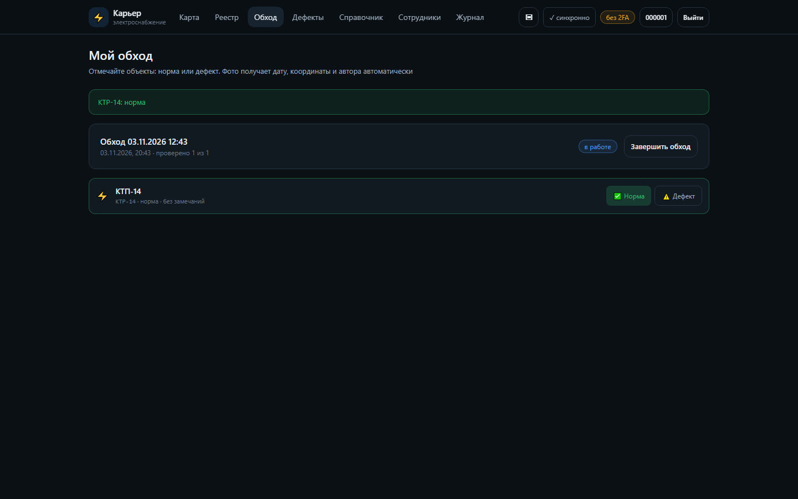
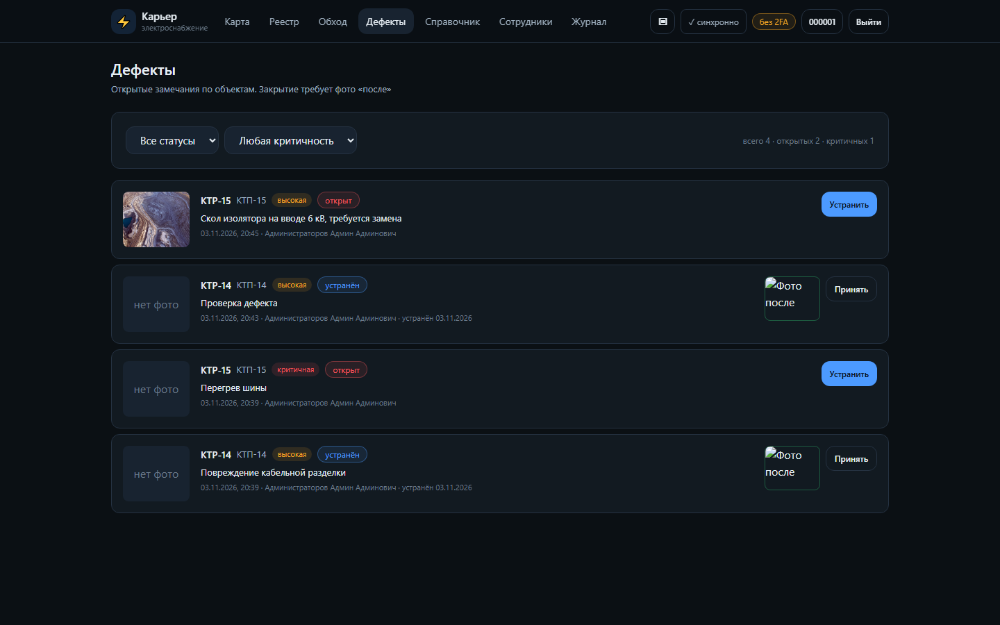
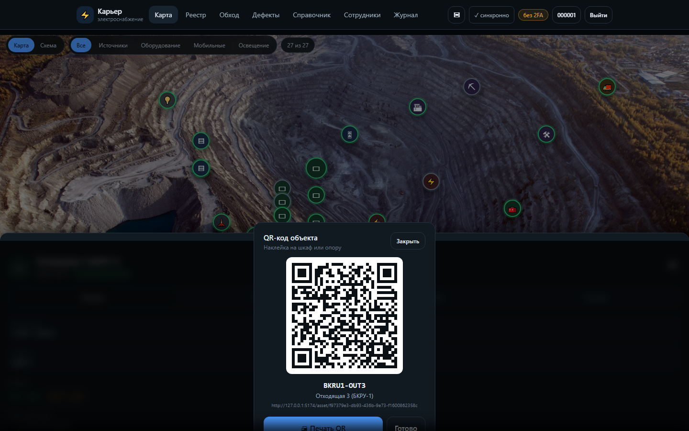

# Спринт 4 «Фотофиксация, обходы, дефекты, QR» — отчёт

Ветка: `feature/sprint-4-field` · Дата: 03.11.2026 · Спринты 1–3 не изменены



---

## 1. Что сделано

| Блок | Результат |
|---|---|
| БД | `ops.inspections`, `ops.inspection_items`, `ops.defects`, `ops.media` (миграция `0004_sprint4_ops`) |
| Хранилище | Абстракция `storage.py`: локальный диск по умолчанию, `BLOB_READ_WRITE_TOKEN` → Vercel Blob |
| Фото | Съёмка через `capture="environment"`, EXIF, гео, водяной знак на canvas, sha256 |
| Метаданные | Дата съёмки, координаты и источник (EXIF/устройство/объект/нет), автор и табельный — снимком |
| Обходы | Создание, объекты, отметки «норма/дефект/нет доступа», завершение, «Мой обход» |
| Дефекты | Создание с критичностью и фото, список, устранение с обязательным фото «после» |
| История | Вкладка в карточке: обходы, дефекты, фото, переключения в одной ленте |
| QR | Генерация QR на `/asset/{id}`, печать наклейки, сканирование камерой |
| Офлайн | Очередь в IndexedDB: обход, отметки, дефекты и фото уходят при появлении сети |

## 2. Модель данных

| Таблица | Ключевое |
|---|---|
| `ops.inspections` | вид обхода, статус, сотрудник, начало/завершение |
| `ops.inspection_items` | объект, результат (nullable = ещё не проверен), комментарий, время |
| `ops.defects` | объект, критичность, статус, описание, фото до/после, кто обнаружил/устранил |
| `ops.media` | объект, обход, дефект, путь в хранилище, MIME, размер, **sha256**, `captured_at`, lat/lon, `geo_source`, автор (ФИО + табельный снимком), `watermark_applied`, EXIF, `sync_state` |

## 3. Водяной знак и метаданные

Пайплайн полностью на устройстве:

1. `exifr` читает `DateTimeOriginal`, GPS, модель камеры.
2. Если EXIF без GPS — `navigator.geolocation`; если и он недоступен — координаты помечаются `none`, и в кадре честно пишется «координаты недоступны».
3. Canvas: изображение ужимается до 1600 px, снизу рисуется полупрозрачная плашка и три строки:
   ```
   03.11.2026 20:45
   56.234567, 101.876543 ±6 м · KTP-15
   Администраторов Админ Админович · таб. 000001
   ```
4. JPEG (качество 0.86) уходит на сервер; сервер **пересчитывает sha256** и сохраняет исходный EXIF, координаты и текст водяного знака.

Строки водяного знака вынесены в чистую функцию `buildWatermarkLines` — на неё есть юнит-тесты (дата, координаты, автор, отсутствие координат).

## 4. Офлайн-очередь

* Все действия (создание обхода, отметка, дефект, фото) кладутся в IndexedDB и **сразу** показываются в интерфейсе.
* Синхронизация: последовательная, по порядку появления; сетевые ошибки останавливают очередь и повторяются позже, логические (409 «обход уже отправлен») считаются выполненными.
* Временные идентификаторы: локальный обход получает `local-…`, после создания на сервере связка сохраняется в `idmap`, и все последующие отметки уходят уже с реальным id.
* Индикатор в шапке: `✓ синхронно` / `↑ N` / `офлайн · N`; при возврате сети очередь отправляется автоматически, есть и ручная кнопка.
* Фото в очереди хранятся как Blob, а не base64 — память не раздувается.

## 5. Интерфейс

**Мой обход** — старт по всем объектам (кроме ячеек РУ), список с кнопками «✅ Норма» / «⚠️ Дефект», прогресс, завершение. Дефект открывается формой: критичность, описание, фото с водяным знаком.

**Дефекты** — фильтры по статусу и критичности, превью «до/после», кнопка «Устранить» (только с фото «после») и «Принять».



**Карточка объекта** — вкладки «Паспорт / Фото / Документы / История», кнопка QR, съёмка фото прямо из карточки.

**QR** — генерация ссылки `/asset/{id}`, печать наклейки в отдельном окне, сканирование камерой из шапки; после скана открывается карточка объекта на карте.



## 6. Проверки

| Проверка | Итог |
|---|---|
| `pytest -q` | **35 passed** (+6 новых: метаданные/sha256, не-картинка, обход, дефект с фото «после», история, список фото) |
| `vitest run` | **3 passed** — строки водяного знака и честность координат |
| `smoke.ps1` | **26/26** — Спринт 1 цел |
| `tsc --noEmit` | без ошибок |
| `vite build` | основной бандл 533 КБ (169 КБ gzip), сканер и схема — лениво |
| Headless Chrome | обход, отметка «норма», дефекты, QR — 0 ошибок в консоли |

## 7. Найденные и исправленные дефекты

1. **`package.json` с BOM** — после правки через PowerShell Vite перестал читать конфиг; файл перезаписан без BOM.
2. **`Content-Type: application/json` на FormData** — загрузка фото ломалась бы; клиент теперь не подставляет заголовок для `FormData`.
3. **`user.permissions` в роутере обходов** — у модели нет такого поля, проверка переведена на `permissions_of()`.
4. **Битые миниатюры на скриншотах** — тестовые «фото» были 8-байтовой заглушкой, а не JPEG; для демонстрации загружено настоящее изображение.

## 8. Ограничения

* **Хранилище** — локальный диск; включение Vercel Blob сводится к переменным окружения (`STORAGE_BACKEND`, `BLOB_READ_WRITE_TOKEN`), код не меняется.
* **Сканер QR** требует HTTPS или localhost — в проде это выполняется автоматически.
* **Водяной знак** наносится до загрузки; если клиент скомпрометирован, подпись можно подделать — защита строится на sha256 + журнале и на том, что приложение работает в закрытом контуре.
* **Офлайн-очередь** не разрешает конфликты между устройствами (например, один объект отметили двое) — это Спринт 5 по плану ТЗ.
* **Видео и HEIC** принимаются по MIME, но превью не генерируются.

## 9. Следующий шаг

Спринт 5 по ТЗ: полноценная офлайн-синхронизация с разрешением конфликтов (`change_log`, `conflicts`), перемещение «кукушек» с историей, фоновая синхронизация. Основа уже есть — очередь и id-маппинг из этого спринта.
