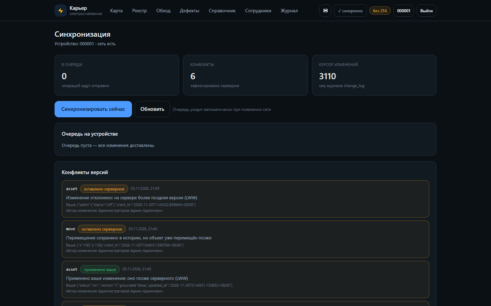
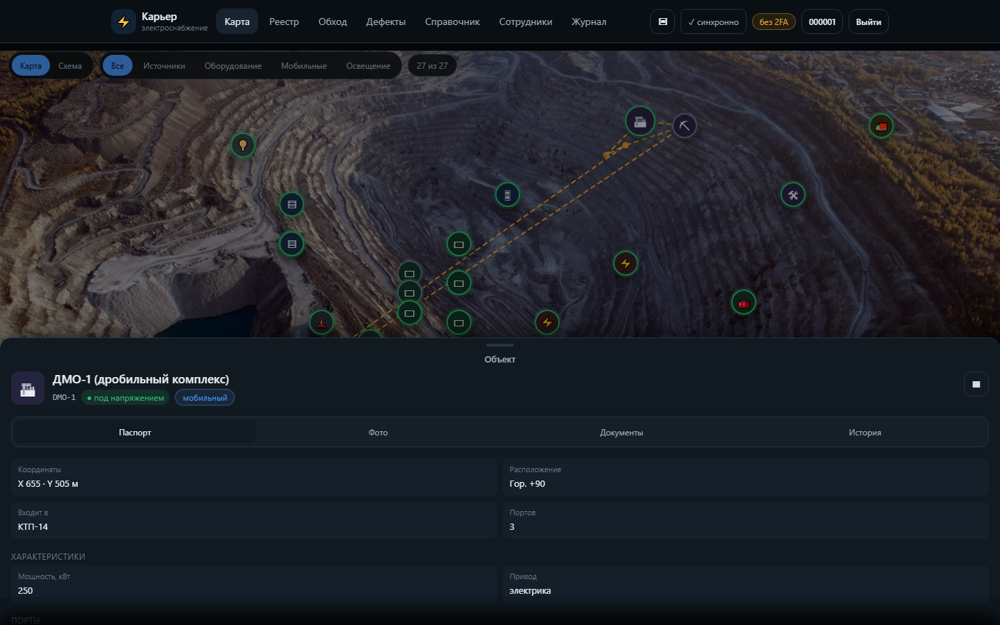

# Спринт 5 «Офлайн-синхронизация, конфликты, перемещения» — отчёт

Ветка: `feature/sprint-5-sync` · Дата: 03.11.2026 · Спринты 1–4 не изменены

---

## 1. Что сделано

| Блок | Результат |
|---|---|
| Журнал изменений | `ops.change_log` + триггеры на `gis.assets`, `gis.links`, `ops.defects` |
| Идемпотентность | `ops.sync_ops` с `op_id` — повторная отправка пачки не создаёт дублей |
| Push | `POST /api/sync/push` — пачка операций, результат по каждой |
| Pull | `GET /api/sync/pull?since=` — дельта изменений с курсором `seq` |
| Конфликты | `ops.conflicts`: победитель, проигравшее изменение, время клиента и сервера |
| LWW | Для статусов и заземления: побеждает более позднее изменение, проигравшее — в журнал |
| Перемещения | `gis.asset_moves` + `POST /api/assets/{id}/move` + история и линия на карте |
| Клиент | Экран «Синхронизация»: очередь, конфликты, курсор, ошибки |
| Service Worker | Кэш оболочки и GET-API (`assets`, `topology/graph` и др.), fallback при офлайне |
| Background Sync | Регистрация тега `karier-outbox`; SW будит вкладку, если браузер поддерживает |

## 2. Модель данных

| Таблица | Назначение |
|---|---|
| `ops.change_log` | `seq` (bigserial), `entity`, `entity_id`, `op`, `payload` (jsonb), `actor_id`, `client_ts`, `server_ts`, `pit_id` |
| `ops.sync_ops` | ключи идемпотентности принятых операций |
| `ops.conflicts` | `winner` (`client`/`server`), `winner_payload`, `loser_payload`, `client_ts`, `server_ts`, автор |
| `gis.asset_moves` | `from_x/y` → `to_x/y`, `moved_at`, `moved_by`, `note`, `source`, `conflict` |

Триггер `ops.log_change()` пишет строку на `INSERT/UPDATE/DELETE`. Автор берётся из `current_setting('karier.actor_id')`, который выставляет сервис перед мутациями — поэтому в журнале видно, кто менял.

## 3. Как разрешаются конфликты

1. Клиент присылает `base_version` — версию, которую видел при работе офлайн.
2. Если на сервере версия другая — считается конфликт.
3. Сравниваются `client_ts` и `updated_at` сервера:
   * **клиент позже** → изменение применяется, конфликт фиксируется с `winner=client` (статус `conflict_won`);
   * **сервер позже** → изменение отклоняется, но полностью сохраняется в `ops.conflicts` и аудите (статус `conflict_lost`).
4. Перемещения «кукушек»: **оба** попадают в `asset_moves`; текущее положение — по более позднему `client_ts`, проигравшее помечается `conflict=true` и остаётся в истории.

Проверено тестами: идемпотентность, оба исхода LWW, сохранение проигравшего перемещения, неизменность графа питания после офлайн-перемещения.

## 4. Перемещение «кукушек»

* В карточке мобильного объекта — кнопка 🚚 (и дубль в блоке действий).
* Режим выбора точки: клик по карте задаёт новые координаты.
* Форма: куда переставили/причина → операция уходит в офлайн-очередь, синхронизация выполняется сразу, если есть сеть.
* История: точки и пунктирная линия перемещений поверх карты (видно на скриншоте ниже).

## 5. Офлайн и Service Worker

* `public/sw.js`: precache оболочки (`/`, `index.html`, подложка), network-first для GET-API с fallback в кэш, кэш статики, обход dev-путей Vite.
* Приватные эндпоинты (`/api/auth`, `/api/sync`, `/api/media`, `/api/documents`) не кэшируются.
* При отсутствии сети `GET /api/assets` и `/api/topology/graph` отдаются из кэша — схема остаётся доступной.
* Background Sync: после постановки в очередь регистрируется тег `karier-outbox`; SW шлёт вкладке сообщение `karier-sync-request`, приложение отправляет очередь. Если браузер не поддерживает — работает обычный `online`-обработчик.

Проверка в headless Chrome: `service workers: 1`, кэши `karier-v1-shell`, `karier-v1-api`.

## 6. Проверки

| Проверка | Итог |
|---|---|
| `pytest -q` | **44 passed** (+9: триггер журнала, идемпотентность, LWW в обе стороны, перемещение и граф, гонка перемещений, запрет перемещать стационарный объект, pull, персистентность конфликтов) |
| `vitest run` | 3 passed (водяной знак) |
| `smoke.ps1` | **26/26** — Спринты 1–4 целы |
| `tsc --noEmit` | без ошибок |
| `vite build` | 545 КБ (173 КБ gzip), схема и сканер — лениво |
| Headless Chrome | экран синхронизации, карточка мобильного объекта, SW и кэши — 0 ошибок |

Сквозная проверка через API: `push` → `applied`, повтор → `duplicate`, координаты изменились, `power-path` остался `energized` с той же цепочкой, устаревшее изменение статуса → `conflict_lost`, конфликт появился в журнале, `pull` вернул дельту.

## 7. Найденные и исправленные дефекты

1. **`AssetMove` создавался в схеме `ops`** вместо `gis` — вставка падала с `UndefinedTable`; исправлена схема в модели (миграция была верной).
2. **`set_config(..., true)` сбрасывался на каждом commit** — триггеры теряли автора; переключено на сессионный режим с явным сбросом после пачки.
3. **Оператор мог через push менять `name`/`attrs`** — теперь набор полей зависит от прав: без `asset.create` разрешены только статус, заземление и координаты.
4. **Лимит полей `op_id`** — повторная отправка пачки от одного устройства теперь дедуплицируется по БД, а не по памяти.

## 8. Ограничения

* **Background Sync** поддерживается не всеми браузерами (Chrome/Edge — да, Safari — нет); в этом случае очередь уходит при возврате сети и по таймеру.
* **Pull-курсор** хранится на клиенте (в будущем — в `localStorage`/IndexedDB); полноценное применение дельт к локальному кэшу — следующий шаг, сейчас экран показывает состояние и конфликты.
* **Конфликты только по версии и времени**: если два устройства переместили объект с одинаковым временем, побеждает серверное (детерминированно).
* **Перемещение** меняет только координаты; связи и питание не трогаются — это проверено тестом.

## 9. Итог пяти спринтов

Система закрывает полный цикл: доступ по табельным с 2FA → реестр и карта → топология и расчёт питания → фото с водяным знаком и обходы → офлайн-синхронизация с конфликтами. Дальше по ТЗ идут отчёты (Спринт 6) и «твёрдость» (Спринт 7), но база для них готова.
