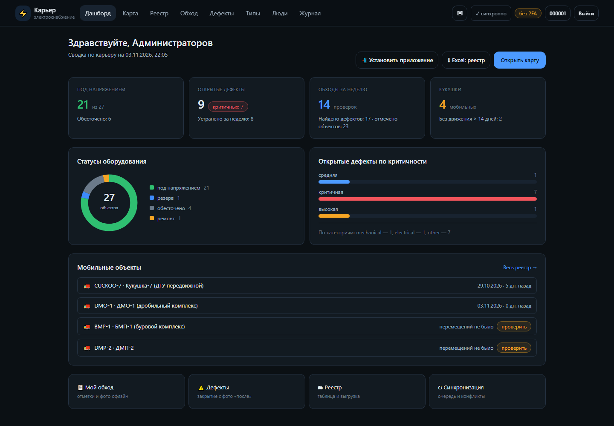

# Спринты 6–7 «Отчёты, дашборд, PWA и деплой» — финальный отчёт

Ветка: `feature/sprint-6-7-release` · Дата: 03.11.2026 · Спринты 1–5 не изменены

---

## 1. Дашборд

Новая стартовая страница (после входа открывается она, карта переехала на `/map`).

| Блок | Что показывает |
|---|---|
| Карточки | под напряжением / обесточено, открытые дефекты (с критичными), обходы за неделю, «кукушки» без движения |
| Круговая диаграмма | распределение объектов по статусам (SVG, без внешних библиотек) |
| Столбцы | открытые дефекты по критичности + разбивка по категориям |
| Мобильные объекты | когда последний раз перемещались, «проверить» для тех, что стоят > 14 дней |
| Быстрые ссылки | обход, дефекты, реестр, синхронизация |

Данные обновляются каждую минуту; метрика «под напряжением» считается тем же обходом графа, что и карточка объекта, — расхождений нет.

## 2. Отчёты

### Excel (openpyxl)

| Отчёт | Содержимое |
|---|---|
| Реестр оборудования | код, название, тип, статус, мобильность, заземление, родитель, координаты, атрибуты, дата |
| Дефекты | объект, критичность, статус, категория, описание, кто/когда обнаружил, кто/когда устранил, id фото |
| Переключения | время, объект, действие, было/стало, причина, сотрудник |
| Обходы | лист «Обходы» + лист «Строки обходов» |

Все листы с шапкой, автофильтром и закреплённой строкой.

### PDF-паспорт объекта (reportlab)

Карточка объекта, путь питания, QR-код на `/asset/{id}`, до трёх последних фото с подписями, дата формирования и автор.
Шрифт с кириллицей ищется автоматически (Segoe UI → DejaVu → Liberation), путь можно задать через `PDF_FONT_PATH`.
Битые фото не ломают документ — пропускаются.

### Ссылки на скачивание

Кнопка → `POST /api/reports/token` → короткоживущий токен (30 минут) → `GET /api/reports/export?token=…`.
Токен привязан к сотруднику и проверяет право `report.export`; просроченный или чужой — 401.

Кнопки: «⬇ Excel» в реестре и дефектах, «⬇ Паспорт (PDF)» в карточке объекта, «Excel: реестр» на дашборде.

## 3. PWA

* `manifest.webmanifest`: название, тёмные цвета (`#0B1014`), `display: standalone`, иконки 192/512 + maskable, ярлыки «Обход», «Карта», «Дефекты».
* Иконки сгенерированы (тёмный квадрат, синий круг, молния).
* Кнопка «📲 Установить приложение» появляется, когда браузер готов к установке (`beforeinstallprompt`).
* Service Worker из Спринта 5 кэширует оболочку, подложку и GET-API; `start_url` и `scope` — корень.
* Проверка в headless Chrome: `manifest: 200`, `service workers: 1`, кнопка установки показана.

## 4. Мобильная вёрстка

* Дашборд: карточки в одну колонку до 640 px, диаграммы друг под другом, кнопки переносятся.
* Таблицы реестра и дефектов — горизонтальный скролл с минимальной шириной, шапка навигации прокручивается.
* Шторка объекта, обход и дефекты проверены на 390×844.
* Нижние отступы учитывают `100dvh` (мобильные браузеры с адресной строкой).

## 5. Безопасность и деплой

* Бэкенд отдаёт `X-Content-Type-Options`, `Referrer-Policy`, `X-Frame-Options: SAMEORIGIN`, `Permissions-Policy`; HSTS — только вне dev.
* При старте в prod-режиме проверяются `COOKIE_SECURE` и «дев-секрет» — предупреждения в лог.
* `src-v2/vercel.json`: CSP, HSTS, кэширование ассетов, `Service-Worker-Allowed`, SPA-rewrites, исключение `/api`.
* `.env.example` содержит все ключи, включая `BLOB_READ_WRITE_TOKEN`, `STORAGE_BACKEND`, `PUBLIC_BASE_URL`, `PDF_FONT_PATH`.
* Корневой `README.md` — инструкция с нуля: БД, миграции, сиды, запуск, деплой на Render/Railway + Vercel, чек-лист перед продом.

## 6. Демо-данные

`seed_demo.py` создаёт «живую» картину для защиты:

* 5 фото с водяным знаком (КТП-14, БКРУ-1, ЭКГ-10, ДМО-1) — сгенерированы с той же плашкой, что и в приложении;
* 3 дефекта: критичный открытый (перегрев на ЭКГ-10), высокий устранённый с фото «после» (кабельная разделка КТП-14), средний открытый (дверца ячейки БКРУ-1);
* обход «Плановый обход: северный борт» с 4 объектами и результатами;
* перемещения ДМО-1 и «Кукушки-7» с историей.

Повторный запуск безопасен: если демо-дефекты уже есть, скрипт выходит.

## 7. Проверки

| Проверка | Итог |
|---|---|
| `pytest -q` | **50 passed** (44 + 6 новых: дашборд, 4 Excel-выгрузки, паспорт PDF, проверка токенов) |
| `smoke.ps1` | **26/26** |
| `vitest` | 3 passed |
| `tsc --noEmit` | без ошибок |
| `vite build` | 554 КБ (175 КБ gzip) + ленивые чанки схемы и сканера |
| Headless Chrome | дашборд 1440 и 390 px, реестр, манифест, SW — 0 ошибок в консоли |
| PDF | 1 страница, кириллица, QR и таблица читаются (проверено рендером в PNG) |

## 8. Найденные и исправленные дефекты

1. **PDF падал на битом JPEG** из тестовых данных — фото теперь валидируются через PIL и пропускаются при ошибке.
2. **Длинная строка «Питание» вылезала за таблицу** — заменена на абзац с переносом.
3. **PowerShell перекодировал `RegistryPage.tsx`** при массовой замене (UTF-8 → cp1251) — файл восстановлен из git, правки внесены через редактор; на будущее все правки кириллицы — только инструментом редактирования.
4. **Шапка не вмещала 8 пунктов** — контейнер расширен, «Справочник/Сотрудники» сокращены до «Типы/Люди».
5. **Заголовок «Последние фото» без фото** — теперь выводится только при наличии валидных изображений.

## 9. Готовность к защите и проду

* Демо-сценарий: вход `000001/admin` → дашборд → карта → карточка КТП-14 (паспорт PDF) → дефекты → обход → синхронизация.
* Все пять спринтов покрыты тестами (50 pytest + 3 vitest) и сквозным smoke-сценарием.
* Инструкция развёртывания и чек-лист безопасности — в корневом `README.md`.
