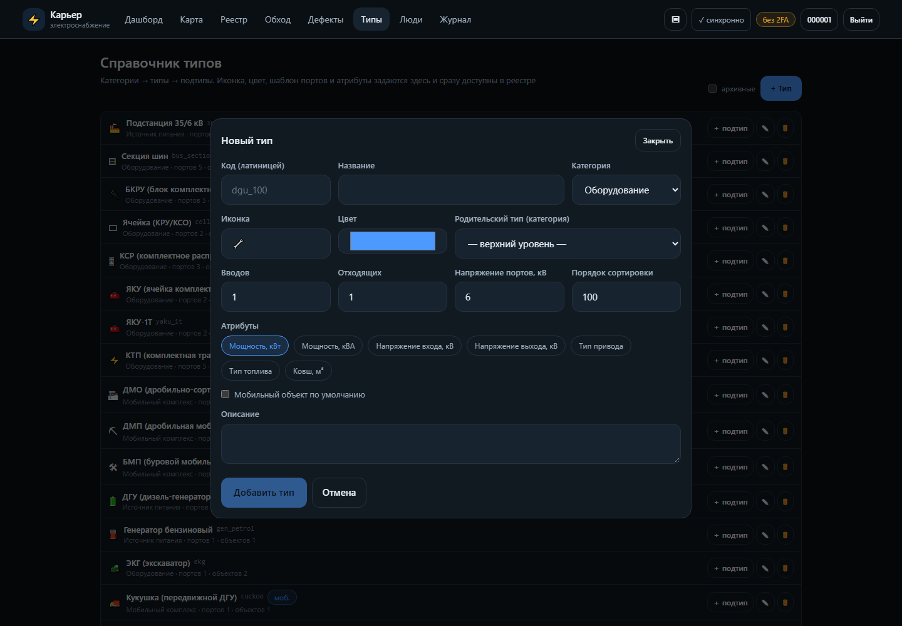
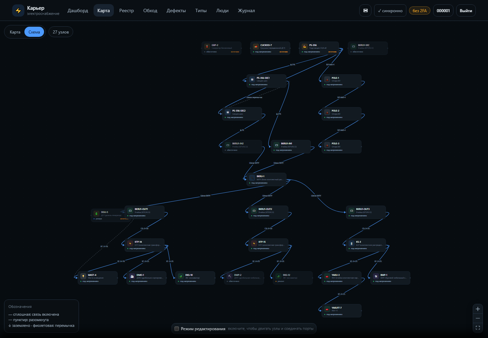

# Спринт 8 «Полный CRUD и ручной редактор схемы» — отчёт

Ветка: `feature/sprint-8-admin` · Дата: 05.11.2026 · Спринты 1–7 не изменены

---

## 1. Иерархия справочника

В `gis.asset_types` добавлено `parent_id` (self-FK, `ON DELETE SET NULL`), миграция `0006_sprint8_admin`.
Теперь справочник — дерево: категория → тип → подтип (например, «Генераторы» → «Дизельные» → «ДГУ-100»).

API:

| Метод | Что делает |
|---|---|
| `GET /api/asset-types?include_inactive=true` | всё дерево, с `parent_id`, `parent_name`, `assets_count` |
| `POST /api/asset-types` | создать тип/подтип (`parent_id`) |
| `PATCH /api/asset-types/{id}` | изменить название, иконку, цвет, порты, атрибуты, родителя, сортировку |
| `DELETE /api/asset-types/{id}` | **мягкое** удаление (`is_active=false`) |

Защита от ошибок:

* цикл в дереве запрещён — нельзя вложить тип в собственный подтип (`asset_type.parent_cycle`);
* удаление типа, у которого есть объекты, отклоняется с 409 `asset_type.in_use` и числом объектов;
* удаление типа с активными подтипами — 409 `asset_type.has_children`;
* коды уникальны.

## 2. Админка справочника

`/types` переписана: дерево с отступами, счётчики портов и объектов, архивные типы (переключатель), кнопки «＋ подтип», «✎», «🗑».
Редактор — модальное окно: код, название, категория, иконка, цвет, родитель, количество вводов/отходящих, напряжение портов, атрибуты, мобильность, описание, сортировка.

## 3. Реестр оборудования

* Кнопка **«Удалить»** в каждой строке — soft-delete через `DELETE /api/assets/{id}`, объект исчезает из реестра, история остаётся в БД.
* Кнопка **«+ Объект»** открывает форму без карты: название, тип, код (необязательно), состояние, текстовое расположение и **необязательные** координаты X/Y.
* Если координаты пустые — объект создаётся сразу и попадает в блок **«Не размещённые»** с подсказкой; позже его ставит на карту кнопка «Разместить».

## 4. Сотрудники

* **«✎»** — редактирование ФИО, должности, роли и телефона существующего сотрудника.
* **«Уволить»** — `DELETE /api/employees/{id}`: статус `dismissed`, все сессии отзываются, вход блокируется.
* Защита: нельзя уволить самого себя (`employee.self_action`) и последнего администратора (`employee.last_admin`).

## 5. Ручной редактор схемы

В `gis.assets` добавлены `schema_x`, `schema_y` (миграция `0006`). Раскладка общая для всех пользователей: если координаты сохранены, схема открывается по ним, иначе — dagre.

В режиме «Схема» у администратора появляется панель:

| Кнопка | Действие |
|---|---|
| ☑ «Режим редактирования» | узлы можно двигать мышью или пальцем, появляются порты |
| «Сохранить раскладку» | `PUT /api/topology/layout` — координаты всех узлов пишутся в БД |
| «Авто-раскладка» | возвращает dagre-раскладку (сбрасывает ручные правки) |

**Соединение на холсте.** В режиме редактирования каждый порт узла — отдельный кружок (вводы слева, отходящие справа). Тянуть от кружка к кружку: открывается мини-форма с маркой кабеля и типом связи (кабель / ВЛ / перемычка), после подтверждения создаётся `POST /api/links` с `from_port_id` и `to_port_id`.

**Разомкнутые связи** (`state != connected`) рисуются пунктиром — это было и раньше, сохранено.

Проверено в headless Chrome: узел перетащен мышью, кнопка «Сохранить раскладку» стала активной, после нажатия в БД записались координаты всех 27 узлов.

## 6. Права

| Действие | Право |
|---|---|
| Справочник (создание/правка/удаление) | `settings.edit` (только админ) |
| Ручная раскладка схемы | **только роль `admin`** (новый `require_admin`) |
| Создание/удаление объектов | `asset.create` |
| Сотрудники | `employee.manage` |
| Соединение портов | `topology.edit` |

Проверка прав — на сервере; клиент лишь скрывает кнопки. Тест `test_non_admin_cannot_manage_types_or_layout` подтверждает 403 для наблюдателя.

## 7. Проверки

| Проверка | Итог |
|---|---|
| `pytest -q` | **61 passed** (+11 новых: дерево, цикл, архив типа, занятый тип, права, объект без координат, сохранение и выдача раскладки, soft-delete, правка/увольнение сотрудника) |
| `smoke.ps1` | **26/26** |
| `vitest` | 3 passed |
| `tsc --noEmit` | без ошибок |
| `vite build` | 566 КБ (178 КБ gzip) + ленивый чанк схемы |
| Headless Chrome | дерево типов, форма объекта, перетаскивание и сохранение схемы — 0 ошибок |

## 8. Найденные и исправленные дефекты

1. **`conflict()` не принимает `fields`** — падало 500 при попытке удалить используемый тип; убрал лишний аргумент.
2. **Тесты накапливали типы** — повторный прогон падал на дубликате кода; тесты теперь используют уникальные коды и чистят за собой.
3. **Панель редактора перекрывала узлы** — перенесена вниз по центру, между легендой и контролами.
4. **После сохранения раскладки выключался режим редактирования** — теперь режим сохраняется, сбрасываются только локальные сдвиги.
5. **`gisApi.create` требовал координаты** — тип расширен на `x?/y?`, иначе форма без карты не компилировалась.

## 9. Ограничения

* Соединение портов проверяется той же валидацией, что и раньше: OUT→IN, совпадение напряжения, запрет дубликата пары и цикла — ошибка показывается в панели схемы.
* Мультивыделение и групповое перетаскивание не поддерживаются (по одному узлу).
* На телефоне редактор работает (перетаскивание пальцем), но мелкие порты удобнее на планшете — мобильная версия приложения не менялась и продолжает работать.
* «Авто-раскладка» требует нажать «Сохранить раскладку», чтобы сброс сохранился в БД — сделано намеренно, чтобы не потерять ручную работу случайно.
