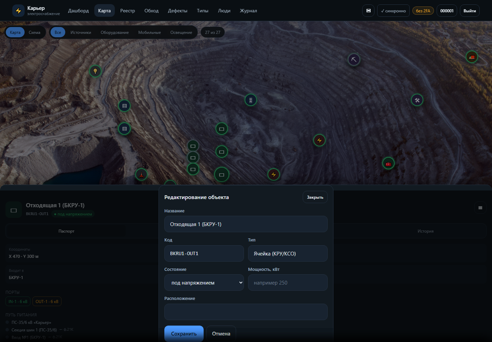

# Спринт 9 «UX-полировка» — отчёт

Ветка: `feature/sprint-9-ux` · Дата: 05.11.2026 · Спринты 1–8 не изменены

---

## 1. Перетаскивание объектов на карте

Маркеры Leaflet стали перетаскиваемыми для администратора (`draggable` включается только при `asset.create` и когда не активны режимы размещения/перемещения).

При отпускании маркера:

* **мобильный объект** → `POST /api/assets/{id}/move` — пишется история перемещений и обновляется положение;
* **стационарный** → `PATCH /api/assets/{id}` с новыми `x`, `y` — объект остаётся на новом месте после перезагрузки;
* **без сети** → операция уходит в офлайн-очередь: `asset_move` для «кукушек» и `asset_update` (patch `x/y`) для стационарных; очередь отправляется при появлении сети и через `sync/push` с `base_version`, поэтому конфликты разрешаются по LWW;
* маркер сразу переезжает (оптимистично), а после ответа сервера карта и список обновляются.

## 2. Редактирование карточки оборудования

В шторке объекта у администратора появилась кнопка **«✎ Редактировать»**. Открывается модальное окно, заполненное текущими значениями: название, код, тип (только чтение), состояние, мощность (атрибут `power_kw`), текстовое расположение.

Сохранение — `PATCH /api/assets/{id}`; карточка перезагружается сразу (`load()`), изменения видны в паспорте без перезагрузки страницы. Ошибки сервера (например, занятый код) показываются в модальном окне.

## 3. Порты по периметру в ручном редакторе схемы

БД: `gis.asset_ports.schema_x`, `schema_y` (миграция `0007_sprint9_ports`) — относительное положение кружка в долях ширины/высоты узла (0…1).

Frontend:

* в режиме редактирования появился переключатель **«Двигать порты»**; при включении кружки становятся оранжевыми, соединение узлов мышью временно отключается (`nodesConnectable=false`), а перетаскивание двигает порт;
* точка привязки проецируется на периметр узла (функция `clampToPerimeter`), поэтому кружок всегда на краю карточки;
* координаты хранятся в состоянии и уходят на сервер вместе с раскладкой: `PUT /api/topology/layout` с `items` и `ports`;
* при отрисовке связи цепляются за сохранённые позиции (`Handle` со `style.left/top`), поэтому после перезагрузки линии идут к новым точкам.

Проверено в headless Chrome: перетаскивание конкретного порта изменило его положение с `38.7%` на `30.3%`, после «Сохранить раскладку» и перезагрузки графа позиция осталась новой.

## 4. Удаление сотрудников навсегда

`DELETE /api/employees/{id}/permanent`:

* нельзя удалить себя (`employee.self_action`);
* нельзя удалить последнего администратора (`employee.last_admin`);
* если у сотрудника есть записи в `audit.audit_log` (`actor_id`), удаление отклоняется с 409 `employee.has_history` — интерфейс предлагает «Уволить» (архивировать), чтобы не терять авторство действий;
* сессии отзываются, запись удаляется физически, событие `employee.deleted` пишется в аудит.

В списке сотрудников появилась кнопка **«🗑»** с подтверждением; при 409 показывается подсказка про «Уволить».

## 5. Проверки

| Проверка | Итог |
|---|---|
| `pytest -q` | **68 passed** (+7: перемещение через PATCH и его влияние на питание, офлайн-push координат, сохранение и чтение позиций портов, валидация 0…1, сохранение после «перезагрузки», безвозвратное удаление и защита истории) |
| `smoke.ps1` | **26/26** |
| `vitest` | 3 passed |
| `tsc --noEmit` | без ошибок |
| `vite build` | 570 КБ (179 КБ gzip) |
| Headless Chrome | карточка с предзаполнением, режим портов, перетаскивание порта и сохранение — 0 ошибок |

## 6. Найденные и исправленные дефекты

1. **Порты рисовались на боковых гранях** — теперь позиция берётся из `schema_x/y`, а сторона узла выбирается по ближайшей грани (`sideOf`), поэтому стрелка смотрит в правильную сторону.
2. **Конфликт «соединить» и «двигать порт»** — решён отдельным режимом: при включённом «Двигать порты» соединение мышью отключается.
3. **После сохранения раскладки порты сбрасывались** — вместе с узлами сохраняются позиции всех портов, а после ответа граф перезагружается с новыми координатами.
4. **Демо-данные были частично скрыты** (часть объектов и типов оказалась в архиве от предыдущих прогонов) — восстановил 17 объектов и 4 типа, реестр снова 27 объектов, связи (25) целы.

## 7. Ограничения

* Перетаскивание маркера меняет только координаты; связи и питание не пересчитываются — это проверено тестом (`power-path` не меняется).
* Порт двигается по периметру своего узла; «вынести» его за пределы карточки нельзя — так сохраняется читаемость схемы.
* На телефоне перетаскивание работает, но мелкие порты удобнее на планшете/десктопе; мобильная вёрстка не менялась.
