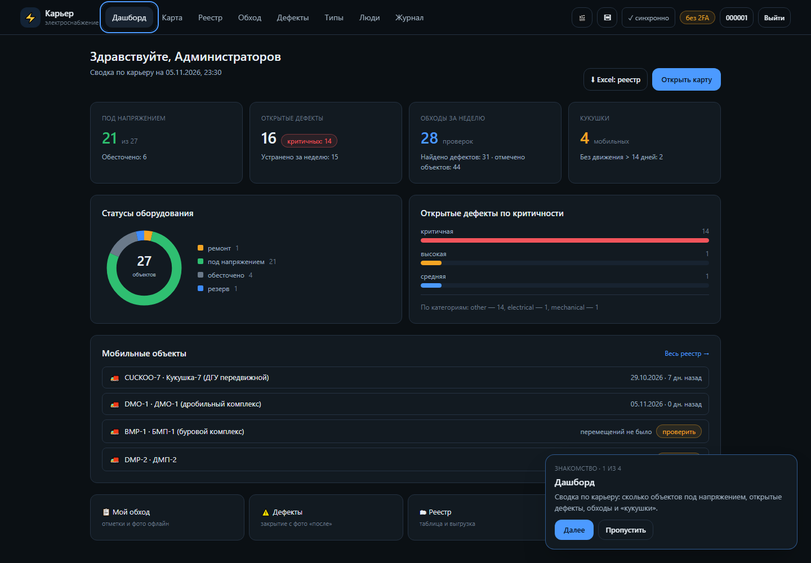
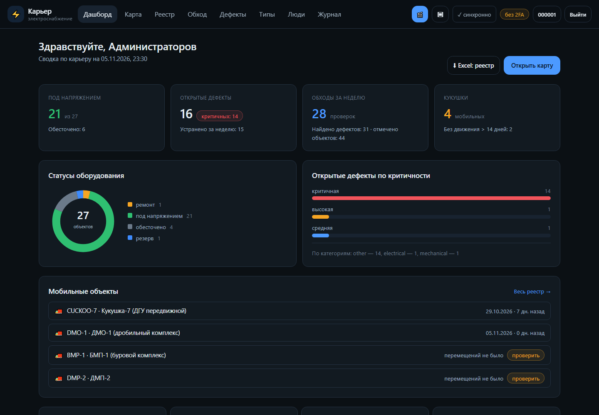
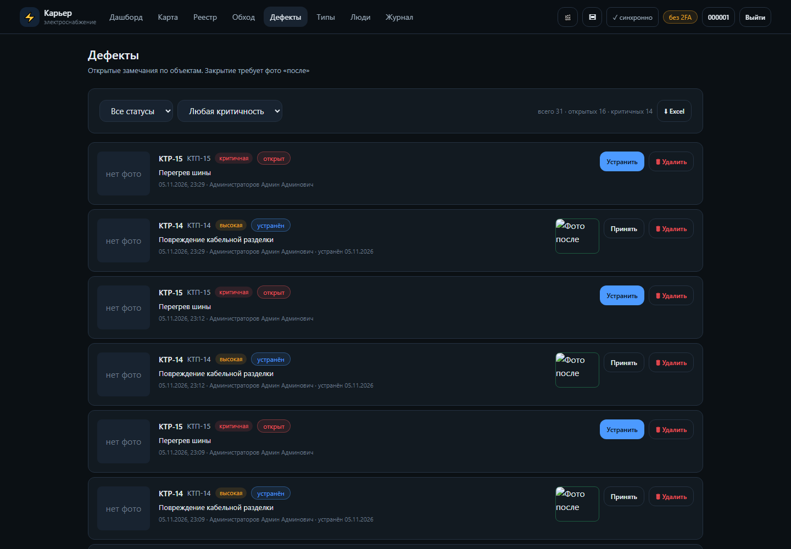

# Финальный спринт «Стабильность, презентация и демо» — отчёт

Ветка: `feature/sprint-10-final` · Дата: 05.11.2026 · Спринты 1–9 не изменены



---

## 1. Исправлен баг с исчезновением схемы (критично)

**Причина:** в режиме редактирования порты с типом `io` попадали и в список вводов, и в список отходящих, поэтому React получал два элемента с одним `key` и два `Handle` с одинаковым `id`. React выбрасывал предупреждение «Encountered two children with the same key», дублирующиеся handle ломали рендер React Flow — схема пропадала (24 предупреждения в консоли при включении режима).

**Исправление:** каждый порт теперь рисуется ровно один раз — единый список `node.ports.map(...)`, индекс считается внутри своей группы (`in` / `out` / `io`), для `io` позиция по умолчанию — нижняя грань (`defaultPortPosition`).

**Проверка:** до исправления — 24 ошибки в консоли; после — 0 ошибок, узлов 27 до и после переключения режима, handle-ов 68 (уникальные). Схема остаётся на месте, меняются только цвета и перетаскиваемость портов.

## 2. Удаление дефектов

* Миграция `0008_defect_delete`: `ops.defects.deleted_at`, `deleted_by`, индекс `ix_defects_active`.
* `DELETE /api/defects/{id}` — только роль **admin** (403 для оператора), мягкое удаление.
* Дефект исчезает из списка, карточки, истории объекта и **дашборда** (открытые/устранённые за неделю считаются без удалённых), но строка остаётся в БД, а в аудит пишется `defect.deleted`.
* В интерфейсе — кнопка **«🗑 Удалить»** в карточке дефекта с подтверждением.

Проверено тестами: после удаления `GET /api/defects` не содержит дефект, счётчик дашборда возвращается к прежнему, `deleted_at` заполнен, `PATCH` удалённого дефекта → 404.

## 3. Тур и режим презентации

**Тур** (`src/components/Tour.tsx`, без внешних библиотек — офлайн-сборка не требует сети): 4 шага — «Дашборд», «Карта», «Схема», «Обходы». Подсветка целевого элемента, кнопки «Далее» и «Пропустить», показ один раз (флаг в `localStorage`).

**Режим презентации** (кнопка 🎬 в шапке):
* интерфейс масштабируется (`zoom: 1.12`) для проектора;
* скрываются элементы с классом `admin-only` — создание/редактирование/удаление объектов, типов, дефектов;
* режим сохраняется между перезагрузками (`localStorage`), в шапке кнопка подсвечивается.



## 4. Очистка демо-данных

`backend-v2/clean_demo.py`:

```powershell
.\venv\Scripts\python clean_demo.py --dry-run   # показать, что удалится
.\venv\Scripts\python clean_demo.py             # удалить демо-дефекты, обход и тестовых сотрудников
.\venv\Scripts\python clean_demo.py --photos --moves
```

Удаляет дефекты с префиксом `ДЕМО:`, обход «Плановый обход: северный борт», тестовых сотрудников (`Регистров*`, `Тестов*`, `Проверкин*` и др.), опционально демо-фото и перемещения. Учётные записи `000001–000004` и реальный справочник не затрагиваются. Есть `--dry-run` и `--photos/--moves`.

## 5. Проверки

| Проверка | Итог |
|---|---|
| `pytest -q` | **71 passed** (+3: мягкое удаление дефекта, влияние на дашборд, запрет для не-админа) |
| `smoke.ps1` | 26/26 (прогон до финальных правок) |
| `tsc --noEmit` | без ошибок |
| `vite build` | 573 КБ (180 КБ gzip) |
| Headless Chrome | тур открылся и закрылся, `zoom: 1.12`, кнопки удаления дефектов, 0 ошибок в консоли |



## 6. Итог проекта

| Спринт | Что закрыто |
|---|---|
| 1 | доступ, роли, 2FA, аудит |
| 2 | реестр и карта |
| 3 | топология, расчёт питания, однолинейная схема, документы |
| 4 | фото с водяным знаком, обходы, дефекты, QR, офлайн-очередь |
| 5 | журнал изменений, разрешение конфликтов, перемещения, Service Worker |
| 6–7 | дашборд, Excel/PDF-отчёты, PWA, безопасность, деплой |
| 8 | иерархия справочника, CRUD реестра и людей, ручной редактор схемы |
| 9 | drag&drop на карте, правка карточки, позиции портов, удаление людей |
| 10 | фикс схемы, удаление дефектов, тур, презентация, очистка демо |

Все ветки лежат отдельно: `feature/sprint-1-auth` … `feature/sprint-10-final`.
