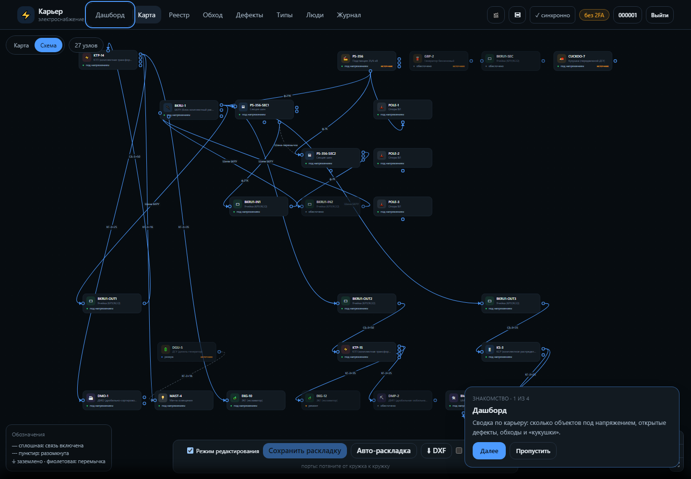

# Спринт 11 «MCP-сервер для ИИ и сетка/экспорт схемы» — отчёт

Ветка: `feature/sprint-11-mcp` · Дата: 07.11.2026 · Спринты 1–10 не изменены



---

## 1. MCP-сервер топологии

`backend-v2/mcp_server.py` — сервер на официальной библиотеке `mcp` (FastMCP), транспорт **stdio** (по умолчанию) или **SSE** (`--http --port 8020`).

Инструменты:

| Инструмент | Что делает |
|---|---|
| `list_assets()` | объекты с портами, координатами карты и схемы |
| `list_links()` | все связи: объекты, порты, тип, состояние, марка кабеля |
| `create_link(from_port_id, to_port_id, cable_mark, link_type)` | создание связи с валидацией OUT→IN, напряжения и дубликатов |
| `move_asset(asset_id, x, y)` | перенос: мобильные — с историей, стационарные — сменой координат |
| `check_topology()` | проблемы схемы (нет ввода, кольца, несовпадение напряжения) |

Логика вынесена в `app/services/ai_tools.py`, MCP-сервер — тонкая обёртка. Поэтому проверки те же, что в REST API: `links_service.create_link` валидирует направление, напряжение, дубликаты и циклы, `gis.check_bounds` не даёт вынести объект за карту.

**Права:** каждый инструмент начинается с `ensure_agent_role` — разрешены только `admin` и `operator`; `viewer`/`contractor` получают `mcp.forbidden`. Исполнитель — служебная учётная запись из `KARIER_MCP_TAB_NO` (по умолчанию `000001`).

**Подключение в Claude Desktop / Cursor:**

```json
{
  "mcpServers": {
    "karier-topology": {
      "command": "C:\\karier\\backend-v2\\venv\\Scripts\\python.exe",
      "args": ["-m", "mcp_server"],
      "cwd": "C:\\karier\\backend-v2",
      "env": { "KARIER_MCP_TAB_NO": "000001" }
    }
  }
}
```

Проверка по протоколу (stdio, JSON-RPC):

```
initialize → protocolVersion 2024-11-05
tools/list → ['list_assets', 'list_links', 'create_link', 'move_asset', 'check_topology']
tools/call check_topology → isError: false, вернулись проблемы схемы
```

Зависимости: `mcp>=1.2,<2` (ветка 2.x требует starlette ≥ 0.48, что конфликтует с FastAPI 0.115). В `requirements.txt` закреплён `starlette==0.38.6` — API продолжает работать, проверено входами и тестами.

**REST API не менялся:** MCP-сервер использует те же сервисы и отдельный процесс, порт 8001 не занят.

## 2. Сетка и экспорт DXF

* React Flow: `snapToGrid` + `snapGrid={[20, 20]}` — узлы прилипают к сетке 20 px.
* Порты: при перетаскивании координаты округляются до шага 1/20 узла, то есть тоже по сетке.
* Кнопка **«⬇ DXF»** в панели редактора выгружает текущую раскладку в DXF R12 (AC1009): узлы — прямоугольники с подписями, порты — окружности, связи — линии с маркой кабеля. Ось Y инвертируется, чтобы файл открывался в нормальной ориентации.

Экспорт реализован своим генератором (`src/lib/dxf.ts`) — библиотека `dxf-writer` требует сети для установки, а формат R12 достаточно прост. Файл открывается в nanoCAD/AutoCAD.

Проверка: unit-тесты DXF (структура файла, количество линий/окружностей, инверсия Y, пустая схема) — 3 теста.

## 3. draw.io (опционально) — решение

Встроенный draw.io (`@drawio/react`) не добавлен: для установки нужен доступ к npm, которого в контуре нет. Вместо этого закрыт практический сценарий «отдать схему в CAD» через DXF. При появлении сети интеграция сводится к отдельной странице с iframe и парсером XML → `links/assets`, точка расширения — `PUT /api/topology/layout` и `POST /api/links`.

## 4. Проверки

| Проверка | Итог |
|---|---|
| `pytest -q` | **80 passed** (+9: инструменты MCP — права, список, создание связи с валидацией, дубликат, IN→IN, топология, перемещение стационарного и мобильного, неизвестный служебный сотрудник) |
| `vitest` | **6 passed** (+3 DXF) |
| `tsc --noEmit` / `vite build` | чисто; 573 КБ (180 КБ gzip) |
| MCP stdio | initialize, tools/list (5), tools/call `check_topology` — без ошибок |
| Headless Chrome | панель редактора с «⬇ DXF», сетка, тур — 0 ошибок |

## 5. Найденные и исправленные дефекты

1. **`mcp` 2.x ломал FastAPI** (требует starlette ≥ 0.48 против < 0.39) — установлена ветка 1.x и закреплён `starlette==0.38.6`; проверено, что API и тесты работают.
2. **`create_link` возвращал объект Pydantic** — сериализатор падал на `PortRefOut.asset`; теперь ответ собирается по полям `LinkOut`.
3. **Тест связей оставлял «хвост»** при падении — выбор пары вынесен в поиск свободной пары портов, удаление в `finally`.

## 6. Ограничения

* MCP работает от одной служебной учётной записи; разделения по пользователям пока нет.
* `create_link` создаёт связь, но не рисует её на карте — координаты портов задаются в редакторе схемы.
* DXF — R12 без слоёв-стилей и блоков (узлы как прямоугольники, а не INSERT), этого достаточно для просмотра и печати; для полноценных блоков нужен `ezdxf` на сервере.
