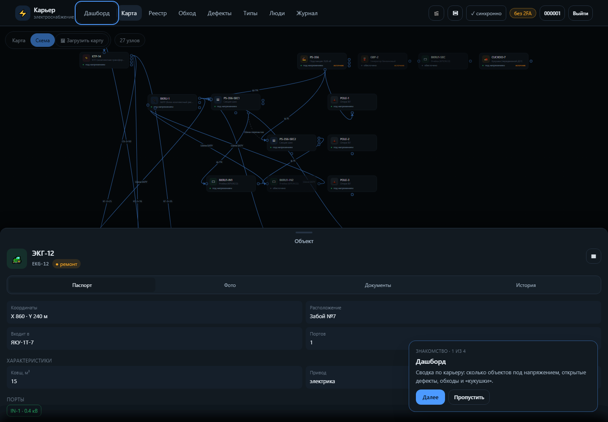

# Спринт 12 «Фикс схемы, подложки карты, полный CRUD» — отчёт

Ветка: `feature/sprint-12-fix` · Дата: 07.11.2026 · Спринты 1–11 не изменены

---

## 1. Фикс React Flow (критично)

### Причина 1 — пропадание и мигание при зуме

Режим «Двигать порты» отключал соединение (`nodesConnectable={false}`), а вместе с ним React Flow выставлял портам `pointer-events: none`. Наши обработчики перетаскивания при этом оставались на узле, а состояние `nodes` пересобиралось на каждое движение указателя: при зуме/панораме React Flow получал новый массив узлов и терял внутренние измерения — схема мигала и исчезала.

**Что сделано:**

* схема переведена на `useNodesState` / `useEdgesState` — узлы и связи живут в состоянии React Flow, а не пересобираются на каждый рендер;
* узлы пересобираются **только при смене графа** (эффект на `[graph]`); переключение режимов меняет лишь флаги `editable/portDrag/draggable`, не трогая позиции;
* перетаскивание порта обновляет **только свой узел** (`setNodes` с точечным изменением `data.portPositions`), без глобальной пересборки;
* в режиме портов handle остаётся неинтерактивным для соединения, но получает `pointer-events: auto`, поэтому перетаскивание ловится.

**Проверка в headless Chrome:** 6 циклов зума + панорамирование в режиме портов — узлов было 27, осталось 27, ошибок в консоли 0.

### Причина 2 — позиции портов не применялись в read-only

В режиме просмотра узел рисовал два «служебных» handle по краям, игнорируя `schema_x/schema_y`. Поэтому после переключения «Карта → Схема» порт выглядел на старом месте.

**Что сделано:** узел всегда рисует по handle на каждый порт с координатами из БД (`portsForNode`); в просмотре они меньше и `isConnectable={false}` — только как точки привязки связей.

**Проверка:** порт перетащен с `0% / 50%` на `2.5% / 100%`, сохранён, затем «Карта → Схема» — в read-only порт отрисован на `2.5% / 100%`, то есть координаты берутся из БД.

## 2. Загрузка подложек карты

* `POST /api/map/layers` (multipart: `file`, `name`, `meters_per_pixel`, `origin_x`, `origin_y`) — только право `settings.edit`. Файл проверяется PIL, пересохраняется в PNG, кладётся в хранилище (`maps/<id>.png`), прежние слои деактивируются, версия увеличивается.
* `GET /api/map/layers` — история подложек, `GET /api/map/layers/{id}/image` — отдача картинки.
* `bounds` теперь учитывают `origin_x/origin_y`: `[[oy, ox], [oy + h, ox + w]]`. Координаты объектов остаются в метрах карьера и не пересчитываются — новая карта накладывается на ту же систему координат.
* В интерфейсе карты у админа — кнопка **«🖼 Загрузить карту»**: выбор файла, название, масштаб (м/px), начало координат.

## 3. Полный CRUD

| Сущность | Что добавлено/проверено |
|---|---|
| Связи | клик по связи в схеме открывает панель: марка кабеля, длина, состояние (включена/разомкнута/заземлена), «Сохранить» и «Удалить» (soft-delete). Граф отдаёт эти поля (`cable_mark`, `length_m`, `cross_section_mm2`, `cores`) |
| Документы | загрузка и удаление работали; замены файла нет — сценарий «заменить» выполняется удалением и загрузкой новой версии |
| Дефекты | soft-delete и кнопка «🗑 Удалить» (Спринт 10), проверено тестами и в UI |
| Типы | дерево с созданием, правкой и архивированием; занятый тип возвращает 409 с подсказкой «сначала переназначьте объекты» |
| Сотрудники | правка ФИО/должности/роли/телефона, «Уволить» и «Удалить навсегда» с защитой истории |

Все операции проверяются на сервере: загрузка карты и безвозвратное удаление — только admin, связи — `topology.edit`, типы — `settings.edit`.

## 4. Тесты

| Проверка | Итог |
|---|---|
| `pytest -q` | **84 passed** (+4: загрузка подложки и её активация, 403 для оператора, координаты портов в read-only графе (дважды подряд), правка связи и её отражение в графе) |
| `vitest` | 6 passed |
| `tsc --noEmit` / `vite build` | чисто; 577 КБ (181 КБ gzip) |
| Headless Chrome | зум/панорама в режиме портов — 27 узлов, 0 ошибок; сохранение порта и read-only — координаты совпадают |

## 5. Найденные дефекты

1. **`pointer-events: none` на портах** в режиме перетаскивания — из-за этого drag не срабатывал вовсе; добавлен явный `pointerEvents: 'auto'`.
2. **`useNodesState` не был подключён** — состояние пересобиралось на каждый рендер, отсюда мигание; переведено на хуки React Flow.
3. **PowerShell-замена сломалa `routers/__init__.py`** (литерал `` `n `` внутри строки) — переписал файл целиком.
4. **`GraphEdge` не содержал полей связи** — добавлены `cable_mark/length_m/cross_section_mm2/cores/version`, иначе панель редактирования не компилировалась.

## 6. Ограничения

* Замена существующей подложки — это загрузка новой версии (старая остаётся в истории и деактивируется).
* Для карты с другим масштабом объекты не пересчитываются: они живут в метрах, поэтому при несовпадении масштаба требуется `origin_x/origin_y`.
* draw.io-интеграция по-прежнему не подключена (нет сети для npm), DXF-экспорт закрывает сценарий CAD.
