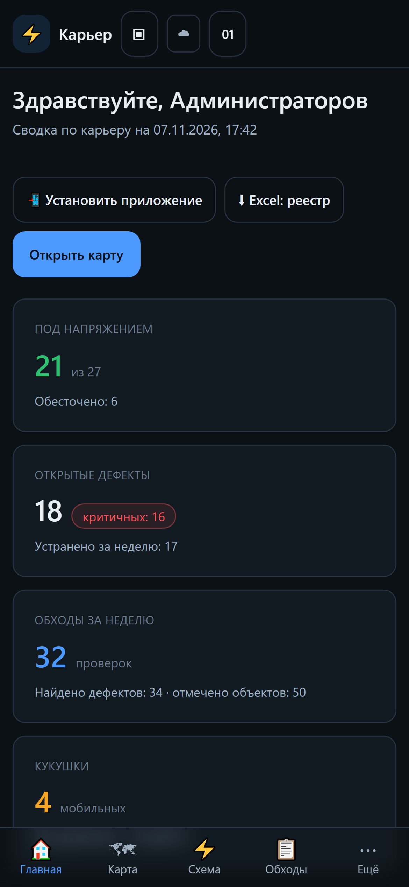
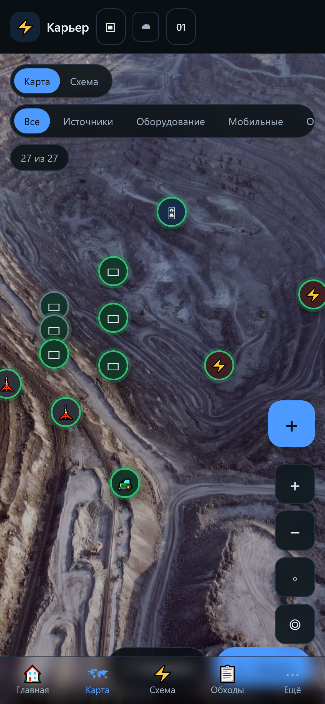
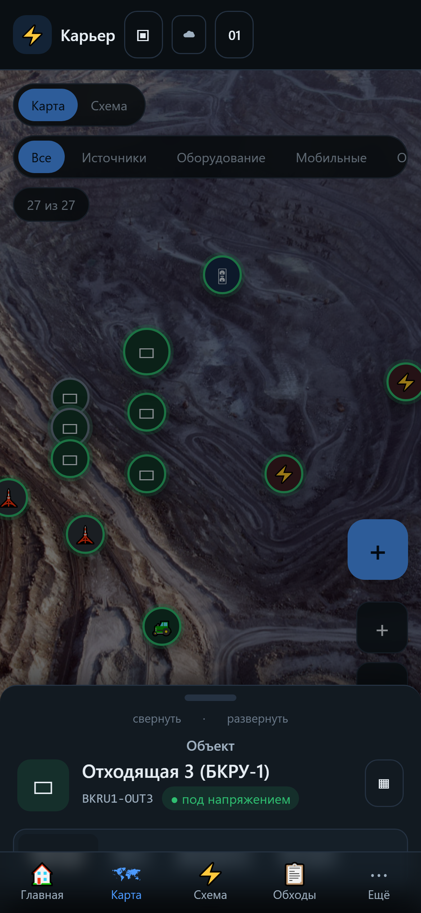
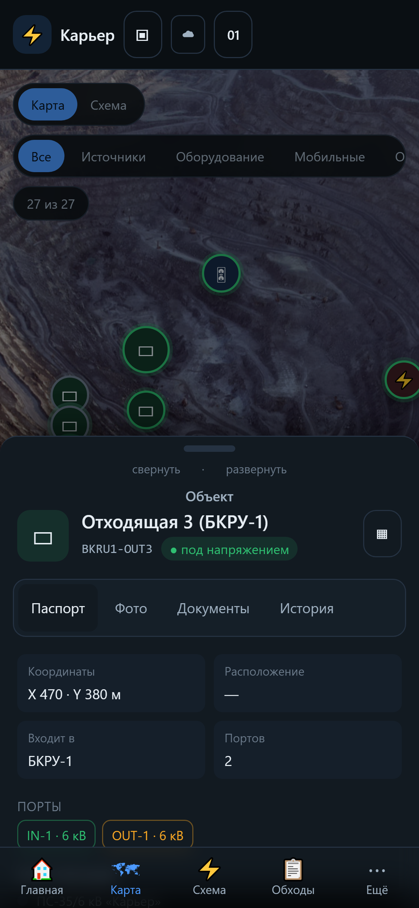
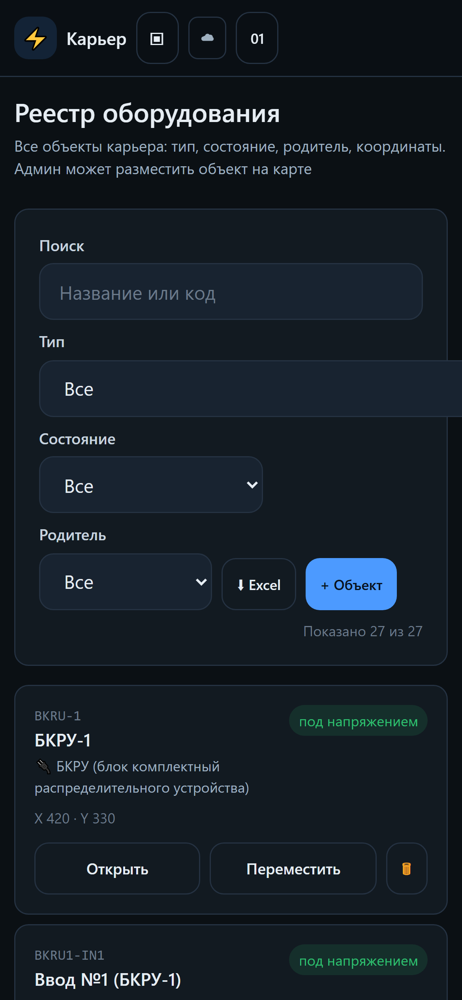
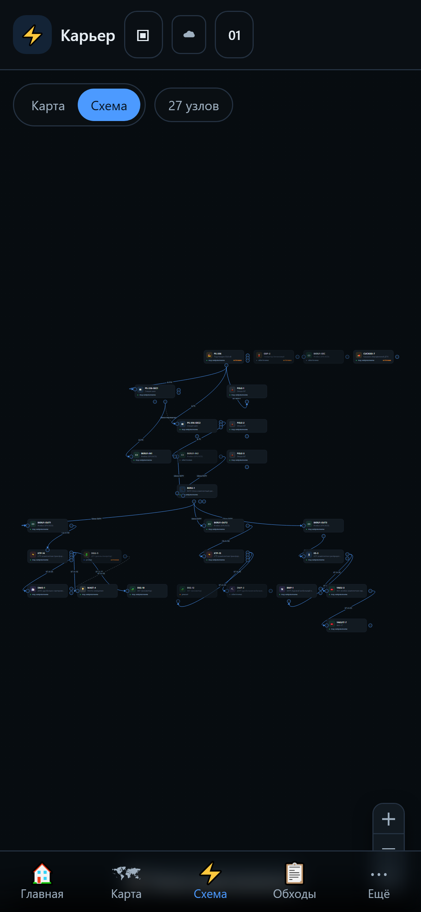

# Спринт 13 «Mobile-First UI/UX» — отчёт

Ветка: `feature/sprint-13-mobile` · Дата: 07.11.2026 · Спринты 1–12 не изменены

---

## 1. Мобильная навигация

* Верхнее горизонтальное меню скрыто на экранах < 768 px (`hidden md:flex`), вместо него — **нижняя панель** `BottomNav` (`md:hidden`): Главная, Карта, Схема, Обходы, Ещё.
* «Ещё» открывает шторку со ссылками: Реестр, Дефекты, Типы, Сотрудники, Журнал, Синхронизация, Профиль (с учётом прав).
* «Схема» ведёт на `/map?view=schema` — MapPage читает query-параметр и сразу открывает схему, а переключатель вида обновляет URL.
* Шапка компактная: логотип и название, справа — QR-сканер, индикатор синхронизации (облачко/офлайн, с числом очереди), аватар (последние две цифры табельного). Кнопки «2FA» и «Выйти» остались только на десктопе, выход доступен через «Ещё → Профиль».

## 2. Карта и схема на телефоне

* Кнопки **+**, **−**, «центр» и «моё положение» — 48×48 px, правый нижний угол, с учётом safe-area.
* **FAB «+»** (56×56) — плавающая кнопка добавления объекта над зумом; повторное нажатие отменяет режим.
* Маркеры Leaflet перетаскиваются пальцем (жест уже поддерживался, draggable включён для админа).
* В редакторе схемы порты на мобильных увеличены до **20 px** (`!h-5 !w-5 md:!h-3 md:!w-3`), проверено через `getComputedStyle`.

## 3. Карточка объекта — Bottom Sheet с тремя точками

`BottomSheet` переписан: **peek 25dvh**, **half 52dvh**, **full 90dvh**.

* свайп вниз из peek закрывает карточку, из half/full опускает на шаг; свайп вверх — поднимает;
* под ручкой — кнопки «свернуть» и «развернуть» (крупные, доступны пальцем);
* вкладки «Паспорт / Фото / Документы / История» — горизонтально прокручиваемое меню (`overflow-x-auto`, кнопки ≥ 44 px);
* высоты измерены в браузере: **211 / 439 / 760 px** при экране 844 px — ровно 25 / 52 / 90 %.

## 4. Формы и таблицы

* Для экранов < 768 px: `input/select/textarea` — минимум **48 px** и `font-size: 16px` (iOS Safari не зумит при фокусе), кнопки — минимум 44 px.
* Реестр: на мобильном — **карточки** (код, название, тип, статус, координаты, кнопки «Открыть / Разместить / 🗑»), таблица показывается с `md`. Дефекты и раньше были карточками — добавлен `flex-col` до 640 px, чтобы фото и действия не сжимались.
* Тёмная тема: добавлены усиленные цвета статусов (`--ok-strong`, `--bad-strong`, `--warm-strong`), подписи полей светлее (`#c7d3df`) — читаемо на солнце.

## 5. PWA и safe-area

* `html, body, #root { min-height: 100dvh }` — нет белых полос сверху/снизу в standalone.
* Нижняя навигация и шторка используют `padding-bottom: env(safe-area-inset-bottom)` — кнопки не перекрываются индикатором iPhone.
* Контент страниц получает отступ снизу под панель навигации (`pb-[calc(72px+env(safe-area-inset-bottom))]`), карта — `pb-[calc(56px+…)]`.

## 6. Проверки

| Проверка | Итог |
|---|---|
| Эмуляция iPhone 13 / Pixel 5 (390×844, DPR 3, touch) | 0 ошибок в консоли |
| Нижняя навигация | присутствует; верхнее меню `display: none` |
| Кнопки зума | ровно **48×48** |
| FAB «Добавить объект» | присутствует |
| Шторка | 211 / 439 / 760 px (25 / 52 / 90 %) |
| Реестр | таблица скрыта, карточки отрисованы |
| Порт схемы | **20 px** на мобильном |
| Горизонтальный скролл | `scrollWidth - clientWidth = 0` |
| `tsc --noEmit` / `vite build` | чисто; 584 КБ (183 КБ gzip) |

## 7. Найденные дефекты

1. **Тур перекрывал нижнюю навигацию** — карточка поднята на `calc(84px + safe-area)` и ограничена `60dvh` со скроллом.
2. **Кнопка «Загрузить карту» занимала место в мобильной панели** — скрыта до `md`, загрузка карт остаётся на десктопе.
3. **Шторка была двухпозиционной** — добавлены три точки фиксации и кнопки-подсказки под ручкой.

## 8. Ограничения

* Нижняя навигация фиксированная: на очень низких экранах (< 600 px) карта получает меньше места — компенсируется FAB и зумом.
* Перетаскивание маркера пальцем работает, но на плотной застройке удобнее режим «Переместить» из карточки.
* Вкладка «Схема» на телефоне полноценно редактируется, однако мелкие подписи связей читаются только при увеличении.
