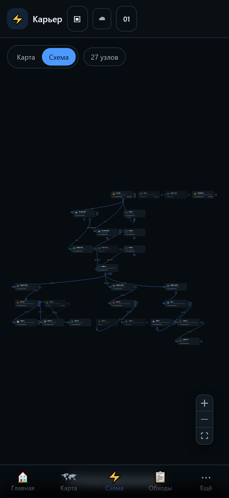
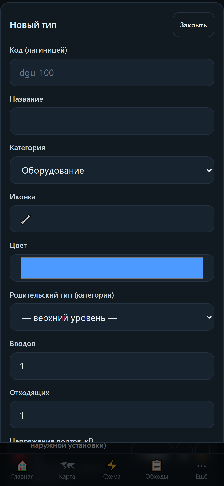
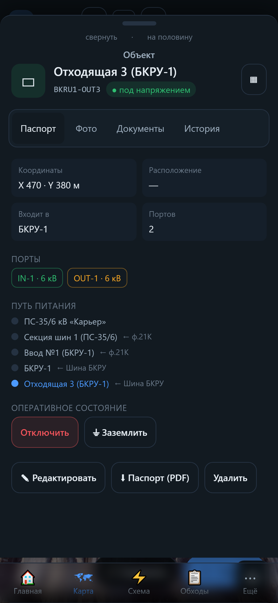
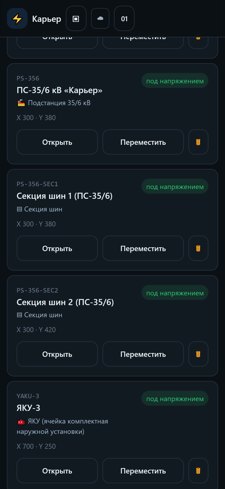

# Спринт 14 «Аудит мобильной вёрстки» — отчёт

Ветка: `feature/sprint-14-audit` · Дата: 07.11.2026 · Спринты 1–13 не изменены



---

## 1. Единый токен отступа

Вместо повторяющихся `calc(...)` введены CSS-переменные и утилиты:

```css
:root { --bottom-nav: 0px; }
@media (max-width: 767px) { :root { --bottom-nav: calc(64px + env(safe-area-inset-bottom)); } }

.pb-nav        { padding-bottom: calc(var(--bottom-nav) + 16px); }
.nav-safe-above{ bottom: calc(var(--bottom-nav) + 12px); }
.modal-safe    { padding-bottom: calc(var(--bottom-nav) + 12px); }
```

На десктопе `--bottom-nav: 0` — все отступы обнуляются, вид не меняется.

## 2. Автоматический аудит

Написан скрипт `scripts/dev-audit-mobile.mjs`: обходит **11 маршрутов**, прокручивает каждый до низа и проверяет, пересекается ли прямоугольник любого видимого интерактивного элемента (button/a/input/select/textarea) с прямоугольником нижней панели. Дополнительно проверяются шторка (half/full) и три модальных окна; элемент считается видимым, только если `elementFromPoint` действительно попадает в него.

## 3. Что исправлено

| Экран / элемент | Было | Стало |
|---|---|---|
| Карта: зум +/−, центр, «моё положение» | кнопки на `bottom: 72px` внутри canvas, который заходил под панель | canvas заканчивается над панелью (`padding-bottom: var(--bottom-nav)` у `main`), кнопки — `bottom-3` |
| Карта: FAB «+» | `bottom: calc(72px + 236px + safe)` | `bottom: 236px` от низа canvas, выше зума |
| Карта: шторка объекта | закрытая шторка «выглядывала» на 64 px, её ручка попадала в панель | `translate-y-[calc(100%+var(--bottom-nav))]`, панель не перекрывается |
| Схема: React Flow Controls | системный `bottom: 10px` — под панелью | `style={{ bottom: 'calc(var(--bottom-nav) + 12px)' }}` |
| Схема: панель редактора | `bottom-3` внутри canvas | canvas над панелью, панель не пересекается |
| Шторка: вкладки и кнопки | высота 90dvh от низа экрана — низ под панелью | `bottom: var(--bottom-nav)`, `z-[1350]` |
| Модалки: «Сохранить/Отмена» | `z-50` (ниже панели), высота 92vh | `z-[1400]`, `modal-safe`, `max-h-[calc(100dvh-var(--bottom-nav)-16px)]` |
| Длинные списки (реестр, дефекты, типы, люди, журнал) | отступ 72 px | `pb-nav` = `64px + safe-area + 16px` |
| Дашборд, обходы, профиль, синхронизация | — | проверены: прокрутка до низа без пересечений |

## 4. Результат аудита

| Проверка | Пересечений |
|---|---|
| `/` (верх и низ) | 0 |
| `/map` (верх и низ) | 0 |
| `/map?view=schema` (верх и низ) | 0 |
| `/registry` (верх и низ) | 0 |
| `/defects` (верх и низ) | 0 |
| `/inspections` (верх и низ) | 0 |
| `/types`, `/employees`, `/audit`, `/sync`, `/profile` (верх и низ) | 0 |
| Шторка объекта: half и full | 0 |
| Модалки: тип, объект, сотрудник | 0 |
| **Итого** | **0** (до исправлений: 9 пересечений в 4 местах) |

Ошибок в консоли — 0. Эмуляция: 390×844 (iPhone 13) и 393×851 (Pixel 5), touch, DPR 3.

## 5. Скриншоты

| Экран | До | После |
|---|---|---|
| Карта | `s13-map.png` (FAB и зум под панелью) | `s14-map.png` |
| Схема | `s13-schema.png` (контролы внизу) | `s14-schema.png` |
| Шторка | `s13-sheet-half.png` | `s14-sheet-full.png` |
| Модалка типа | — | `s14-modal.png` |
| Реестр (низ) | — | `s14-registry-bottom.png` |
| Обходы (низ) | — | `s14-inspections-bottom.png` |







## 6. Проверки

| Проверка | Итог |
|---|---|
| Аудит 11 экранов + шторка + 3 модалки | **0 пересечений**, 0 ошибок |
| `tsc --noEmit` | без ошибок |
| `vite build` | 584 КБ (183 КБ gzip) |
| Десктоп (≥768 px) | не менялся: `--bottom-nav: 0`, панель скрыта, отступы обнулены |

## 7. Найденные дефекты

1. **Закрытая шторка выглядывала из-под панели** — `translate-y-full` не учитывал `bottom: var(--bottom-nav)`; исправлено на `calc(100% + var(--bottom-nav))`.
2. **Модалки были ниже панели по z-index** — `z-50` против `z-1300`; подняты до `z-[1400]`.
3. **Canvas карты/схемы заходил под панель** — `main` для карты не имел отступа; заменено на `padding-bottom: var(--bottom-nav)`.
4. **Аудит давал ложные срабатывания** — считал элементы внутри самой панели и перекрытые модалкой; добавлены проверки `nav.contains` и `elementFromPoint`.

## 8. Ограничения

* Реальная высота панели 57 px (без safe-area), а токен заложен на 64 px — отступ получается на 7 px больше, это безопасный запас.
* Аудит проверяет геометрию и видимость, но не контраст; контраст усилен в Спринте 13.
* На экранах с очень малым viewport (< 600 px) карта остаётся читаемой за счёт зума, но панель занимает заметную долю высоты — это осознанный компромисс ради крупных кнопок.
