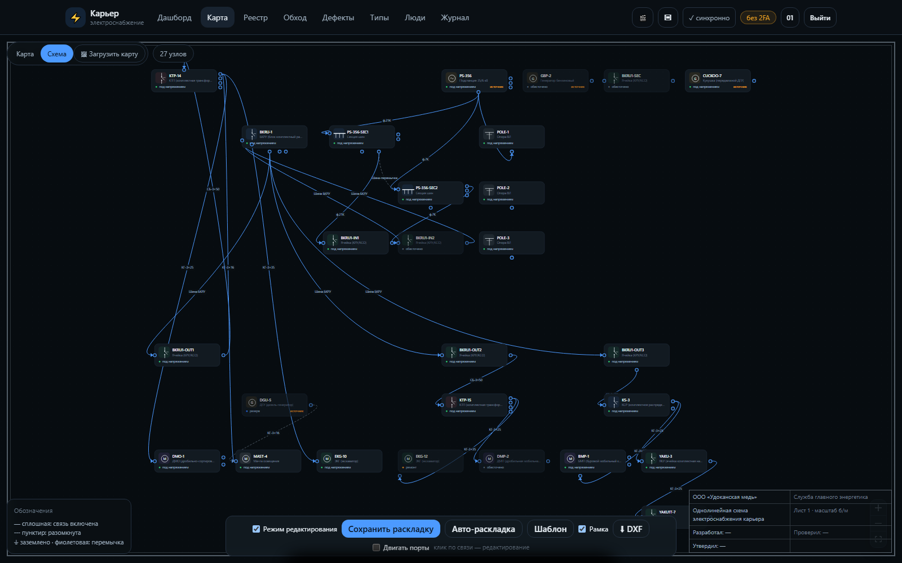
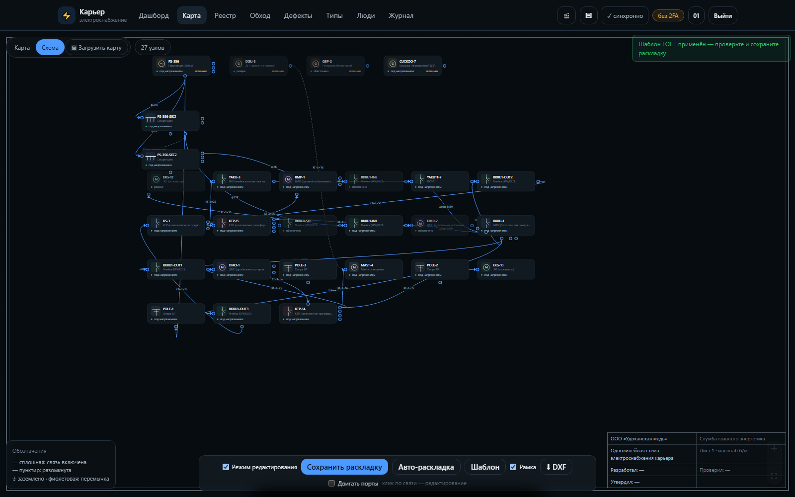

# Однолинейная схема в стиле ГОСТ — реализация (этапы 1–4)

Ветка: `feature/sprint-16-gost` · Дата: 08.11.2026

## Этап 1. Символы

* `gis.asset_types.schema_symbol` (миграция `0010_schema_gost`) — символ задаётся в справочнике типов.
* Набор: `breaker` (QF), `disconnector` (QS), `busbar` (шины), `load` (M), `generator` (G),
  `source` (ПС), `line` (опора), `ct` (TA), `arrester` (ОПН).
* Для существующих 18 типов символы проставлены миграцией: ячейки/КТП/БКРУ — выключатель,
  секции — шины, генераторы — G, опоры — ВЛ, остальное — нагрузка.
* В редакторе типов появилось поле «Символ на схеме».
* React-компонент `GostSymbol` рисует SVG-обозначения без внешних библиотек.

## Этап 2. Шины и шаблон

* Секции (`busbar`) рисуются горизонтальной линией, а не прямоугольником.
* Кнопка **«Шаблон»** в редакторе раскладывает схему по логике чертежа:
  источники/генераторы — верхний ряд, шины — горизонтально в середине,
  ячейки и потребители — сеткой ниже.

## Этап 3. Рамка и штамп

* `gis.pits.schema_frame` (JSONB) — настройки штампа: организация, подразделение,
  название объекта, лист, масштаб, «Разработал / Проверил / Утвердил», дата, формат (A4/A3/A1).
* API: `GET /api/topology/frame` (все), `PUT /api/topology/frame` (только admin, пишется в аудит).
* На экране — SVG-рамка с полями штампа, переключатель **«Рамка»** (состояние запоминается).
* По умолчанию — A3, что соответствует референсу.

## Этап 4. Экспорт

* `GET /api/topology/schema.pdf` — печать A3: рамка, штамп с подписантами, узлы с
  обозначениями, связи, дата формирования. Проверено: 200, `application/pdf`, ~28 КБ.
* DXF-экспорт (Спринт 11) сохранён; рамка и штамп пока только в PDF.

## Проверки

| Проверка | Итог |
|---|---|
| `pytest -q` | **96 passed** (+7: символы в графе, правка символа типа, штамп по умолчанию и обновление, 403 для оператора, PDF, полнота символов) |
| `tsc --noEmit` / `vite build` | без ошибок; 585 КБ (184 КБ gzip) |
| Скриншоты | схема с символами и рамкой, шаблон — 0 ошибок в консоли |
| PDF | открывается, рамка и штамп на месте |

## Что осталось за рамками этой итерации

1. **Точная геометрия DWG** — файл `Однолинейная УЭЭК.dwg` (AC1032, nanoCAD) без конвертера
   (ODA File Converter / LibreDWG) не читается; нужен экспорт в DXF.
2. **Штамп в DXF** — сейчас рамка/штамп только в PDF; добавим слои `FRAME` в DXF,
   когда согласуем окончательный вид штампа.
3. **Редактор штампа в UI** — сейчас поля меняются через API; форма в админке — следующий шаг.
4. **Привязка ячеек к шинам** — шаблон расставляет по порядку; точная привязка
   «ячейка → секция шин» с авто-выравниванием — по итогам сравнения с референсом.

## Как посмотреть

1. `/map?view=schema` → включить «Режим редактирования» → «Рамка» (появится лист со штампом).
2. «Шаблон» — разложить по ГОСТ-логике, затем «Сохранить раскладку».
3. Скачать PDF: `GET /api/topology/schema.pdf` (или кнопка будет добавлена в следующей итерации).
