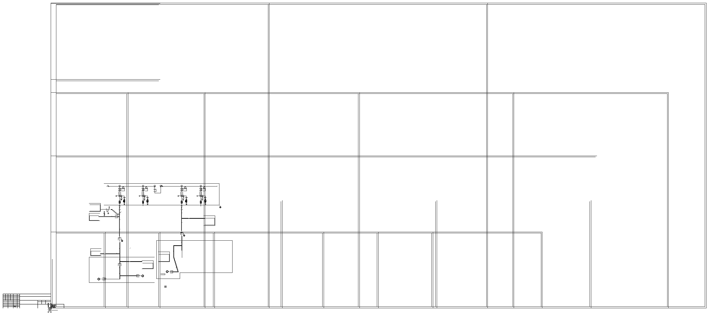

# Анализ DXF «Однолинейная УЭЭК.dxf»

Дата: 08.11.2026 · Файл: 1.5 МБ, AC1027 (AutoCAD 2013), UTF-8, сохранён nanoCAD.
Разобрано полностью: 61 406 пар DXF, 5 секций (HEADER, TABLES, BLOCKS, ENTITIES, OBJECTS).

---

## 1. Что внутри

| Параметр | Значение |
|---|---|
| Формат | AC1027, единицы — миллиметры, лист A1 (841×594) |
| Сущности | LWPOLYLINE 1435, HATCH 219, MTEXT 109, LINE 101, TEXT 87, CIRCLE 64, INSERT 63 |
| Слои | `0` (1397), `линии` (504), `Текст` (223), `Непечатать` (70), `Основные линии` (18), `Размеры` (6), `подписи`, `рамки` |
| Вставки | 28× `A$C731F4000`, 27× `A$C469878D5` (вероятно, символы ячеек), `РЛНД`, `кушнапрев`, `Шифр` |
| Подписи | 130 уникальных TEXT/MTEXT |

**Важно:** основная часть графики — «взорванные» полилинии (1435), поэтому текст
частично потерян как текст и существует только в виде геометрии. Подписи, которые
удалось прочитать, перечислены ниже.

## 2. Содержание схемы

**Шины:** `I с.ш. 6.3 кВ` и `II с.ш. 6.3 кВ` (а не «1С/2С»), от `ПС 35/6 кВ`.

**Фидеры:** `ф.5-6`, `ф.7-6`, `ф.7.1-6`, `ф.16-6`, `ф.21-6` (формат «ф.N-6»).

**Оборудование и подписи:**

* ячейки `ЯКНО-6 №1…№4`, `Реклоузер`, `РЛНД`, `РТП/52`, `ИРС`;
* подстанции `ПКТП-3/6/0.4 кВ Pу=320 кВт ΔU=4,21%`, `ПКТП-1/6/0.4 кВ Pу=46.37 кВт ΔU=1,21%`,
  `ПКТП-2/6/0.4 кВ 630 кВа ΔU=6,66%`, `КТПН-44МК ΔU=6,66%`, `ТП-52 ΔU=6,66%`;
* нагрузки `ЭКГ-15М Pу=1500 кВт Iр=112,1 А ΔU=8,1%`, `ЭКГ-12К/1 и /2 Iр=71.7 А ΔU=7,16%`;
* опоры ВЛ с номерами: `Оп.№1`, `Оп.№1.1`, `Оп.№8.1`, `Оп.№14.1`, `Оп.№44`, `Оп.№44/1`,
  `Оп.№44/8`, `Оп.№47`, `Оп.№50`, `Оп.№62`, `Оп.№62/1`, `Оп.№68`, `Оп.№80`, `Оп.№80/8`, `Оп.№88`, `Оп.№91`, `Оп.№98`;
* площадки: `Площадка раскомандировки №1`, `Площадка Стоянки белазов`, `Площадка сбора ЭКГ, площадка №1/№2`.

**Примечания и легенда:**
`Условные обозначения`, `— проектируемое оборудование; — существующее оборудование`,
`установлено напряжение 6.3 кВ при максимальном расчётном падении напряжения 8,1% на самом удалённом участке`,
`Карьер "Западный", участок №1/№2 см. УМ-22-780-1.x-2023-ЭС`.

**Штамп (ГОСТ 2.104, форма 1):** `ООО "Проектный Центр Сибири"`, `Шифр 0153-ВЭ`,
стадия `Р`, `Разраб.` Кушнарёв, `Проверил` Маскевич, `Н. контр.` Семененко, `ГИП` Гончаров,
`Согласовано`, `Взам. инв. №`, `Инв. № подл.`, `Подп. и дата`, `Лист`, `Листов`, `Дата 02.23`,
таблица форматов `А4…А0, А4х3…А0х3`.

## 3. Чем это отличается от того, что мы уже сделали

| Наша схема (Спринт 16) | В DXF |
|---|---|
| Секции «шины» без названия | `I с.ш. 6.3 кВ` / `II с.ш. 6.3 кВ` |
| Подпись связи — марка кабеля | Плюс номер фидера `ф.7-6`, `ф.21-6` |
| Символы QF/QS/TA/ОПН | Плюс специфические: реклоузер, ЯКНО, РЛНД, ПКТП/КТПН |
| Нет параметров на схеме | `Pу`, `Iр`, `ΔU` прямо у оборудования |
| Нет нумерации опор | `Оп.№47`, `Оп.№44/8` и т.д. |
| Рамка A3, простой штамп | A1, штамп формы 1 с шифром, стадией, листами, подписями |
| Нет легенды на листе | `Условные обозначения` + пометка проектируемое/существующее |
| Линии одного веса | Слои `Основные линии` / `линии` / `Текст` / `Непечатать` |

## 4. Предлагаемые изменения (следующая итерация)

1. **Названия секций** — добавить в модель шины поле `label` и выводить
   «I с.ш. 6.3 кВ», «II с.ш. 6.3 кВ» вместо безликих линий.
2. **Номера фидеров** — у линии (фидера) поле `feeder_no` («ф.7-6»), вывод рядом с маркой кабеля.
3. **Параметры на схеме** — подпись узла из `attrs`: `Pу`, `Iр`, `ΔU` (уже хранятся в атрибутах,
   нужно вывести в узле при включённом режиме «Параметры»).
4. **Спецсимволы** — добавить `recloser`, `yakno`, `rlnd`, `ktp` (ПКТП/КТПН) в набор символов.
5. **Нумерация опор** — поле `pole_no` у объекта-опоры, вывод «Оп.№47».
6. **Штамп формы 1** — расширить `schema_frame`: шифр, стадия, лист/листов, Н. контр., ГИП,
   «Взам. инв. №», «Инв. № подл.», таблица форматов; формат A1 по умолчанию для таких листов.
7. **Легенда** — блок «Условные обозначения» на листе (проектируемое/существующее, типы линий).
8. **Слои и веса линий** — в PDF/DXF: `BUSBARS` (толстая), `LINES` (тонкая), `LABELS`,
   `FRAME`, `LEGEND`; вес основной линии 0.6–0.8 мм, тонкой 0.2–0.3 мм.

**Оценка:** 2–3 дня. Схема данных расширяется незначительно (поля подписи), логика
питания и MCP не затрагиваются.

## 5. Ограничения анализа

* Текст в DXF частично «взорван» в полилинии — прочитаны только 130 подписей из TEXT/MTEXT;
  полный список оборудования придётся собрать по этим подписям и вашим уточнениям.
* Координаты в мм, лист A1; диаграмма занимает левую нижнюю часть листа, остальное — рамка,
  штамп и свободное поле под примечания.
* Блоки `A$C…` — это, скорее всего, символы ячеек, но их имена неинформативны;
  геометрию символов можно восстановить из BLOCKS при необходимости.
