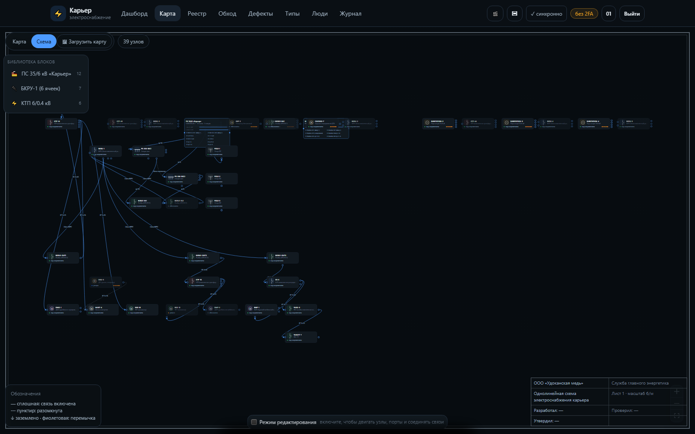

# Спринт 17. Библиотека блоков схемы — отчёт

Ветка: `feature/sprint-17-blocks` · Дата: 08.11.2026

## 1. Модель данных (миграция 0011)

| Объект | Что добавлено |
|---|---|
| `gis.schema_blocks` | `code`, `name`, `block_type` (composite/simple), `asset_type_id`, `template_json` (JSONB: nodes + links + external_ports), `icon`, `sort_order`, `is_active` |
| `gis.assets` | `schema_block_id` (принадлежность блоку), `schema_local_x/y` (координаты внутри блока), `schema_role` (busbar, incoming, outgoing, section, tt, opn, znv, transformer, block) |
| Связь с объектом | вложенные элементы создаются как обычные `gis.assets` с `parent_asset_id` = родительский блок |

Внешние порты блока — обычные `gis.asset_ports` родителя (IN-1/IN-2/OUT-1…), поэтому
соединение блоков кабелем работает через существующий API связей.

## 2. Шаблоны (сиды `seed_schema_blocks.py`)

| Код | Состав |
|---|---|
| `substation_35_6` | ПС 35/6 «Карьер»: 2 секции шин (I/II с.ш. 6.3 кВ), 2 ввода ЯКНО, ШР СВ, ТТ, ОПН, ЗНВ, 4 фидера (ф.7-6, ф.16-6, ф.21-6, ф.5-6) — 12 элементов, 6 внешних портов |
| `bkru_standard` | БКРУ-1: 6 ячеек (2 ввода, секционная, 3 отходящих), шина — 7 элементов, 5 портов |
| `ktp_standard` | КТП 6/0.4: ввод, трансформатор, 4 отходящие линии — 6 элементов, 5 портов |

## 3. API

| Метод | Назначение |
|---|---|
| `GET /api/schema/blocks` | библиотека шаблонов (код, состав, число портов) |
| `POST /api/schema/blocks/{code}/instantiate` | поставить блок: создаёт родителя, вложенные объекты, порты и внутренние связи |
| `POST /api/schema/assets/{id}/cells` | добавить ячейку в блок (только роли cell/incoming/outgoing) |
| `DELETE /api/schema/assets/{id}/cells/{cell_id}` | удалить ячейку; структурные элементы защищены |
| `GET /api/topology/graph` | теперь отдаёт `blocks[]` с составом, а вложенные элементы исключены из `nodes` |

Защита структуры: удаление шины, ввода, ТТ, ОПН, ЗНВ, трансформатора или секционного
выключателя возвращает `409 block.structural_protected`; удаление последней ячейки —
`409 block.last_cell`.

## 4. UI

* Панель «Библиотека блоков» на схеме: ПС 35/6, БКРУ, КТП с числом элементов.
* Клик по блоку ставит его на холст (создаются реальные объекты).
* Блок рисуется карточкой: заголовок (название, код, число ячеек и секций),
  горизонтальные шины, список ячеек; клик по ячейке открывает её карточку.
* Кнопка «＋ ячейка» внутри блока (admin) добавляет отходящую ячейку.

## 5. Проверки

| Проверка | Итог |
|---|---|
| `pytest -q` | **103 passed** (+7: библиотека, создание ПС, правка ячейки, защита структурного элемента, добавление/удаление, последняя ячейка, 403 для оператора) |
| `tsc --noEmit` / `vite build` | без ошибок; 587 КБ (184 КБ gzip) |
| API вручную | ПС создаёт 12 элементов, БКРУ — 7; граф отдаёт 2 блока, 39 узлов |
| Скриншот | панель библиотеки + два блока на схеме, 0 ошибок в консоли |

## 6. Что не доделано (следующая итерация)

1. **Визуал блока** — карточка получилась широкой, подписи ячеек тесно; нужен
   компактный режим и аккуратная сетка (в духе листа A3).
2. **Свернуть/развернуть** — пока блок всегда развёрнут; кнопка сворачивания до иконки не сделана.
3. **Удаление ячейки из UI** — API готово, кнопка в карточке блока ещё нет.
4. **Экспорт PDF/DXF** — блоки выгружаются как отдельные объекты; рамка блока и внутренние
   связи в PDF/DXF ещё не рисуются как единая конструкция.
5. **Легенда** — автоматический сбор символов из блоков не реализован.
6. **Перемычки между блоками** — соединение идёт через внешние порты, отдельных
   «перемычек» внутри блока (сверх шаблона) пока нет.

## 7. Как проверить

1. `/map?view=schema` → панель «Библиотека блоков» слева.
2. Нажать «ПС 35/6» — блок появится на схеме (12 элементов).
3. Клик по ячейке в блоке — откроется карточка объекта, там меняются название и параметры.
4. «＋ ячейка» — добавляет отходящую; удаление структурной ячейки через API вернёт 409.
