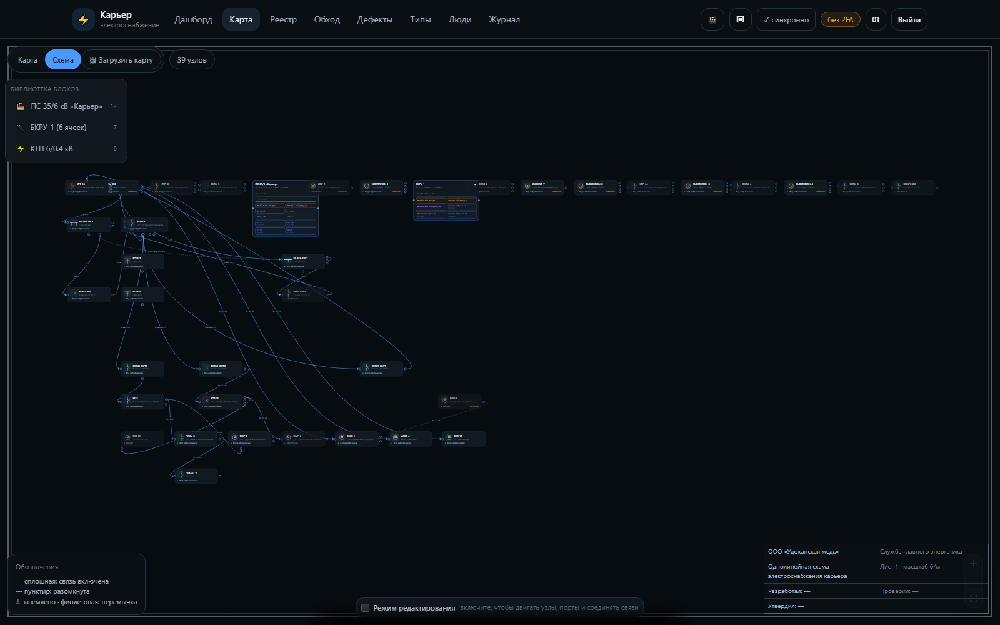

# Спринт 18. Доработка библиотеки блоков — отчёт

Ветка: `feature/sprint-18-blocks-ux` · Дата: 08.11.2026

## 1. Компактный визуал блока

* Ширина карточки — **320 px** на десктопе, `max-w-[calc(100vw-28px)]` на телефоне.
* Ячейки — **сетка 2 колонки**, подписи не обрезаются (truncate только у длинных марок).
* Шины — горизонтальная линия с подписью над ней (`I с.ш. 6.3 кВ`).
* Заголовок в одну строку: название (13 px, semibold), под ним код · число ячеек · число секций.
* Цвета по ролям: вводы — тёплый (`warm`), отходящие — акцентный (`accent`), секционные — фиолетовый, остальные — нейтральные.
* Под названием ячейки выводится марка кабеля из `params.cable`.

## 2. Сворачивание/разворачивание

* Кнопка `▾` в заголовке сворачивает блок до компактной карточки `▣ Название · N эл.`, кнопка `▸` разворачивает.
* Состояние хранится в `assets.attrs.collapsed` родительского объекта блока — переживает перезагрузку.
* API: `POST /api/schema/assets/{id}/collapse` (только admin), пишется в аудит (`schema.block_collapsed` / `expanded`).
* Граф отдаёт `blocks[].collapsed`.

## 3. Удаление ячейки из UI

* В карточке ячейки при наведении появляется `🗑` (только admin), с подтверждением.
* Вызов `DELETE /api/schema/assets/{id}/cells/{cell_id}`.
* Ошибки приходят с сервера и показываются пользователю: «Нельзя удалить структурный элемент» (`block.structural_protected`), «Нельзя удалить последнюю ячейку» (`block.last_cell`).

## 4. Экспорт с блоками

**PDF** (`GET /api/topology/schema.pdf`, A3):
* каждый блок рисуется рамкой с заголовком, кодом и числом элементов;
* внутри — шины толстыми линиями и ячейки сеткой 3 колонки с подписями;
* свёрнутые блоки — компактным прямоугольником с названием и «N эл.»;
* связи между блоками — линиями, одиночные объекты — рамками с символом.

**DXF** — пока без нативного INSERT-блока: выгружаются отдельные объекты. Рамка и подписи
блока добавлены в PDF; полноценный `INSERT` с именем блока — следующий шаг (nanoCAD
требует BLOCKS-секцию, её нужно генерировать целиком).

## 5. Легенда

* `GET /api/schema/legend` — собирает использованные `schema_symbol` из типов объектов
  и считает количество: `[{symbol, title, count}]`.
* Названия: QF — Выключатель / ячейка, QS — Разъединитель, ТТ — Трансформатор тока, ОПН, шины, M, G, ПС, опора.
* В PDF — блок «Условные обозначения» над штампом (справа).
* На экране — панель в правом нижнем углу листа.

## 6. Перемычки внутри блока

* `POST /api/schema/assets/{id}/jumpers` `{from_cell_id, to_cell_id, label}`.
* Валидация: обе ячейки должны принадлежать одному блоку (`409 block.jumper_foreign`),
  нельзя соединить ячейку саму с собой (`block.jumper_self`).
* Создаётся link с типом `jumper`; действие пишется в аудит `schema.jumper_created`.

## 7. Проверки

| Проверка | Итог |
|---|---|
| `pytest -q` | **109 passed** (+6: сохранение свёрнутого состояния, перемычка внутри блока, отказ между блоками, легенда, PDF с рамкой блока, 403 для оператора) |
| `tsc --noEmit` / `vite build` | без ошибок; 588 КБ (184 КБ gzip) |
| Скриншот | карточки ПС и БКРУ в новом виде, 2 блока, 0 ошибок в консоли |

## 8. Ограничения

1. **DXF** — без INSERT-блока; рамка и подписи пока только в PDF.
2. **Легенда на экране** — панель добавлена, но в кадре скриншота не видна (нужно проверить позиционирование относительно рамки и панели редактирования).
3. **Перемычки в UI** — API и валидация готовы, кнопки рисования перемычки на холсте нет.
4. **Мобильный вид** — карточка ограничена шириной экрана, но сетка из двух колонок на 360 px тесновата.
