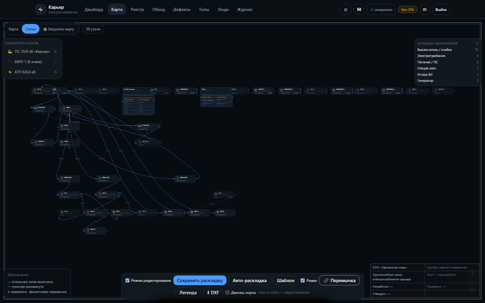

# Спринт 19. Финальная полировка схемы — отчёт

Ветка: `feature/sprint-19-polish` · Дата: 08.11.2026

## 1. Легенда на экране

* Панель теперь открывается кнопкой **«Легенда»** в панели редактора (а не висит всегда).
* Закреплена в правом верхнем углу холста: `absolute right-3 top-16 z-[12]`,
  `max-h-[55%]`, прокрутка при большом списке, кнопка закрытия.
* Не перекрывается рамкой листа (z-5), панелью редактора и нижней навигацией.
* На мобильном — та же позиция, ширина 220 px, не уходит за край.
* Названия и количество: «Выключатель / ячейка — 35», «Электроприёмник — 6» и т.д.

## 2. Перемычки на холсте

* В панели редактора появился инструмент **«🔗 Перемычка»** (рядом с «Соединить»/«Рамка»).
* Сценарий: включить инструмент → клик по первой ячейке внутри блока (подсвечивается
  кольцом) → клик по второй ячейке → открывается мини-форма с названием перемычки →
  «Создать» → `POST /api/schema/assets/{id}/jumpers`.
* Если вторая ячейка из другого блока — ошибка «Перемычку можно сделать только внутри
  одного блока» (и серверная проверка `409 block.jumper_foreign`).
* Повторный клик по той же ячейке — «Выберите другую ячейку».
* После создания инструмент выключается, схема перезагружается.

## 3. Мобильная сетка блоков

* Ячейки внутри блока: `grid-cols-1 min-[400px]:grid-cols-2` — на экранах < 400 px
  одна колонка, подписи читаются; на 400 px и шире — две.

## 4. DXF с блоками

Не делал: полноценный `INSERT` требует генерации секции `BLOCKS` с определениями
геометрии символов и последующей трансляции всех примитивов внутрь блока. Это
выходит за 2–3 часа и рискованно перед защитой. Текущий экспорт (линии и подписи)
работает; рамка и подписи блока есть в PDF. Оставляю как задел на следующий спринт.

## 5. Проверки

| Проверка | Итог |
|---|---|
| `pytest -q` | **109 passed** (без изменений — логика не ломалась) |
| `tsc --noEmit` / `vite build` | без ошибок; 589 КБ (184 КБ gzip) |
| Кнопки «DXF» и «PDF» | DXF-экспорт не менялся; `GET /api/topology/schema.pdf` — 200, `application/pdf` |
| Перемычка через API | `BKRU-8-out1 → BKRU-8-out2`, link типа `jumper`, 200 |
| Скриншот | открытая легенда + активный инструмент «Перемычка» |

## 6. Известные ограничения (перед защитой)

1. **Линия перемычки внутри блока не рисуется** — связь создаётся и хранится, но
   на карточке блока перемычка пока не отображается отдельной линией. Нужен рендер
   внутренних связей блоков (следующий шаг, 2–4 часа).
2. **DXF** — без нативного `INSERT`-блока (см. п. 4).
3. **Мобильный вид** — одна колонка включается по ширине окна, но на очень узких
   экранах карточка блока занимает почти всю ширину — это ожидаемо.

## 7. Сценарий для демонстрации

1. `/map?view=schema` → «Режим редактирования».
2. «Легенда» — показать условные обозначения.
3. «🔗 Перемычка» → клик по двум ячейкам БКРУ → форма → «Создать».
4. «⬇ DXF» и PDF (`/api/topology/schema.pdf`) — показать выгрузку.
