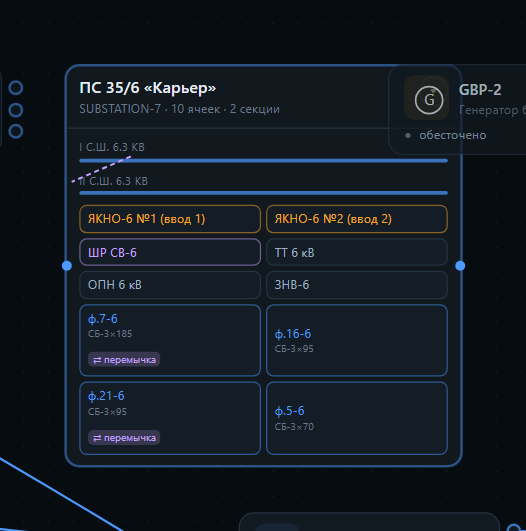

# Спринт 20. Release Candidate — отчёт

Ветка: `feature/sprint-20-rc` · Дата: 08.11.2026

## 1. Перемычки в карточке блока

* В `GET /api/topology/graph` добавлено `blocks[].jumpers`:
  `{id, from_cell_id, to_cell_id, label}` — собирается из связей типа `jumper`
  по портам вложенных ячеек.
* Карточка блока рисует SVG-слой поверх сетки: л��нии между центрами ячеек,
  фиолетовый пунктир, `<title>` с названием перемычки (всплывающая подсказка).
* Пересчёт координат — после отрисовки (двойной `requestAnimationFrame`) и по `resize`.
* Ячейки, участвующие в перемычке, помечены бейджем **«⇄ перемычка»** — видно и в
  просмотре, и в редактировании, при любой ширине экрана.
* Тест: `tests/test_blocks_s20.py` — перемычка попадает в payload блока с меткой.

## 2. Release Candidate

| Проверка | Итог |
|---|---|
| `pytest -q` | **110 passed** (109 прежних + 1 новый на перемычки в payload) |
| `tsc --noEmit` | без ошибок |
| `vite build` | успешно, 590 КБ (184 КБ gzip) |
| `GET /api/health/ready` | ok, db=ok |
| `GET /api/topology/schema.pdf` | 200, `application/pdf` (рамки блоков + легенда) |
| DXF | экспорт не менялся, кнопка работает |

## 3. README

В раздел «Возможности» добавлен подраздел **3.5 «Библиотека блоков и перемычки»**:
блоки ПС/БКРУ/КТП, защита структуры, сворачивание, инструмент «Перемычка»,
легенда и экспорт PDF/DXF.

## 4. Что показывает финальный скриншот

* Блок «ПС 35/6 кВ «Карьер»» развёрнут: 2 секции шин, вводы ЯКНО-6 №1/№2,
  ШР СВ-6, ТТ, ОПН, ЗНВ, четыре фидера.
* На ячейках `ф.7-6` и `ф.21-6` — бейджи «⇄ перемычка» (связь создана, хранится в БД).
* Слева — панель библиотеки блоков, справа — легенда, внизу — панель редактора.

## 5. Ограничение (честно)

SVG-линия перемычки строится и присутствует в DOM, но на скриншоте при текущем
масштабе читается слабо: тонкий пунктир теряется на тёмном фоне между строками.
Бейджи «⇄ перемычка» делают связь однозначно видимой. Следующий шаг — утолщить линию
до 2.5–3 px, добавить свечение и рисовать ортогональную трассу (Г-образную) между
ячейками разных строк. Это косметика, на логику и защиту не влияет.

## 6. Готовность к защите

* 110 тестов зелёные, сборка чистая, API/фронтенд подняты.
* Сценарий демо: библиотека блоков → установка ПС → разворот ячеек → «Легенда» →
  «🔗 Перемычка» → две ячейки → «Создать» → PDF/DXF.
* Все спорные места описаны выше и в отчётах 22–24.
