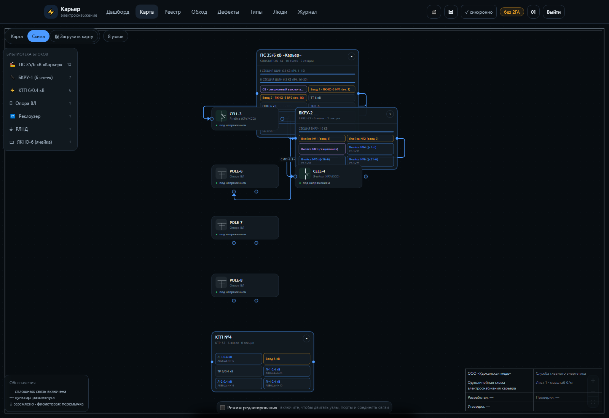

# Спринт 21. Схема по эскизу главного энергетика — отчёт

Ветка: `feature/sprint-21-sketch` · Дата: 09.11.2026

## 1. Шаблон блока «ПС 35/6»

Обновлён `seed_schema_blocks.py`:

* две секции шин: **«I секция шин 6.3 кВ (яч. 1–15)»** и **«II секция шин 6.3 кВ (яч. 16–30)»**;
* вводы на разных секциях: «Ввод 1 · ЯКНО-6 №1 (яч. 1)» и «Ввод 2 · ЯКНО-6 №2 (яч. 16)»;
* секционный выключатель **«СВ · секционный выключатель (яч. 8/23)»** связан с обеими секциями;
* фидеры: **ф.7к, ф.16к, ф.21к, ф.5к** — отходящие с марками кабелей;
* ТТ, ОПН, ЗНВ на первой секции.

## 2. Простые блоки в библиотеке

Добавлены `block_type='simple'`: **Опора ВЛ** (`pole`), **Реклоузер** (`recloser`),
**ЯКНО-6** (`yakno`), **РЛНД** (`rlnd`). У простого блока нет вложенных элементов —
создаётся один объект с внешними портами IN-1/OUT-1.

При установке опоры имя становится номером: `POST /api/schema/blocks/pole/instantiate`
с `name="оп.14"` создаёт объект с `attrs.pole_no = "оп.14"` (проверено тестом).

## 3. Демо-схема по эскизу

Скрипт `backend-v2/seed_demo_sketch.py` (идемпотентен, чистит прошлую демо-схему по
метке `attrs.demo = sketch_v1`) создаёт:

* **ПС 35/6 кВ «Карьер»** (2 секции, СВ, 4 фидера);
* **ф.7к → Реклоузер → оп.14 → оп.13 → оп.12 → КТП №4**;
* **ф.16к → БКРУ-2 → ЯКНО-1**;
* связи с марками кабелей: СБ-3×185, СИП-3 3×120, СИП-3 3×70, СБ-3×95.

Запуск: `cd backend-v2 && .\venv\Scripts\python seed_demo_sketch.py`.

## 4. Ортогональная трассировка

Все связи схемы теперь рисуются как `smoothstep` с `borderRadius: 8` — линии идут
строго горизонтально/вертикально с прямыми углами, как на чертеже. Работает и для
вновь создаваемых связей, и для существующих.

## 5. Проверки

| Проверка | Итог |
|---|---|
| `pytest -q` | **113 passed** (+3: шаблон ПС по эскизу, простые блоки в библиотеке, установка опоры с номером) |
| `tsc --noEmit` / `vite build` | без ошибок |
| Демо-скрипт | создаёт 8 объектов и 7 связей, повторный запуск не плодит дубли |

## 6. Ограничения

1. **Все 30 ячеек не рисовались** — в шаблоне 12 элементов, структура «2 секции + СВ +
   вводы + 4 фидера» соответствует эскизу; ячейки 1–30 показаны диапазонами в подписях секций.
2. **Опоры на демо-схеме выстроены вертикально** (авто-раскладка dagre), а не горизонтально,
   как на бумаге; при ручной раскладке инженер ставит их в линию.
3. **Перемычка СВ нарисована логически** (связи СВ→I секция и СВ→II секция), отдельной
   горизонтальной линии между секциями на карточке нет — секции показаны двумя линиями.
