# Этап 2 модели оборудования «Карьер»: фронтенд (ui_agent)

Дата: 26.11.2026 · статус: **готово к приёмке** · цепочка: db_agent → **ui_agent** → qa_agent
Область: `karier/src-v2/src` (frontend), отчёт и скриншоты — `karier/docs/team/33b-*`.
Backend не менялся. Рабочая `karier_db` не затрагивалась: живые проверки и скриншоты — на
`karier_test_db` (ревизия `0016_stage2_equipment`), созданные демо-объекты после съёмки удалены.

## 1. Итог

| Требование этапа 2 | Статус | Где смотреть |
|---|---|---|
| Создание по шаблону: БКРУ ровно 6 ячеек | ✅ | мастер «По шаблону», скриншоты 01/07/08; API-проверка §6.1 |
| ПС 35/6: `cells_per_section` по умолчанию 17, поле 1…50 | ✅ | скриншоты 02/03/04; API-проверка §6.2–6.3 |
| КТП: 0 ячеек + вводной разъединитель | ✅ | скриншоты 09/10/11; API-проверка §6.4 |
| Блок и ячейки появляются сразу с секциями и номерами | ✅ | 04/05/08/10/11 |
| Ячейки: тип (вводная/отходящая/секционная) + номер, секции подписаны | ✅ | 05/08/10/11; подписи с напряжением секции |
| «Включить/Отключить» у ячеек и разъединителя КТП: схема, карточка, списки | ✅ | 05/06/11/12/13 |
| Состояние через toggle-API, показывается напряжение/обесточено | ✅ | зелёная плашка «включено — под напряжением, 6 кВ» / «отключено — обесточено» |
| Красный `#F04438` = под напряжением, зелёный `#22C55E` = обесточено/заземлено везде | ✅ | схема 05/11, карточка 06, список 12/13, легенда 19, маркеры карты 18 (фон) |
| Цвет дублируется текстом/иконкой, доступно скринридеру | ✅ | бейджи/строки «⚡ под напряжением» / «○ обесточено», `role="status"`, `aria-label`, `title` |
| Кабели: вкладки installed/reserve/repair, установка/снятие через API | ✅ | 14/15/16/17/20/21; API-проверка §6.6 |
| Статус и привязка видны в таблице и карточке | ✅ | 14/15/17 (таблица), 18 (карточка) |
| `tsc`, `build`, `vitest` зелёные | ✅ | §7: exit 0, 78 тестов |
| Отчёт со скриншотами и хешами | ✅ | §8, §9 |

## 2. Мастер «По шаблону» (редактор схемы)

Новый компонент `src/components/map/CompositeTemplateDialog.tsx`, кнопка **«▤ По шаблону»** в
нижней панели редактора (рядом с «+ Добавить», видна с правом `settings.edit`).

* Список шаблонов строится из `GET /api/asset-types`: сначала БКРУ, затем ПС 35/6, затем КТП;
  для типов без размеченного `composite_template` берётся **встроенный профиль** по коду/названию
  (копия backend-правила `profile_for_type`) — мастер работает даже на непереразмеченном справочнике.
* Разбор `composite_template` v2 (массив: мета + секции) — `src/lib/equipmentTemplates.ts`,
  покрыт тестами: БКРУ = 6 (секция 1: вводная + 2 отходящие + секционная, секция 2: отходящая +
  вводная), ПС = 2 секции × 17 (`in + 15×out + sectional`), КТП = 0 ячеек + вводной разъединитель.
* **Поле «Ячеек на секцию» 1…50** появляется только для настраиваемого шаблона (ПС), по умолчанию
  17 из меты API. Клиентская проверка повторяет Pydantic `ge=1, le=50`; значение уходит в
  `POST /api/schema/composite {type_code, name, x, y, cells_per_section}`.
* Предпросмотр состава считается той же логикой, что backend `build_layout`: для ПС при n ≥ 2
  секция = 1 вводная + (n−2) отходящих + 1 секционная, при n = 1 — только вводная. На экране
  видно «N ячеек · секций M · всего элементов», состав каждой секции чипами и пометку КТП
  «0 ячеек · вводной разъединитель».
* После создания — тост «Создано по шаблону: «…» — 6 элементов, секций: 2», камера наводится на
  блок (`focusAsset`), граф перезагружается: блок появляется с секциями, номерами, видами ячеек.

Скриншоты: `01-templates-default.png` (три шаблона), `02-template-ps-default-17.png` (ПС, 17 → 34),
`03-template-ps-5-preview.png` (5 → 10), `07-template-bkru.png`, `09-template-ktp.png`.

## 3. Переключение ячеек и разъединителей

API: `POST /api/assets/{id}/toggle` (тело `{state: 'on'|'off', reason?}`), ответ содержит
`status, energized, voltage_kv, nominal_voltage_kv, grounded, topology_energized`.
В клиенте — `gisApi.toggleAsset` (`src/lib/gis.ts`), права `asset.status.edit`.

Кнопка «Включить/Отключить» есть в трёх местах:

1. **Узел схемы** — каждая ячейка внутри блока ПС/БКРУ и вводной разъединитель КТП
   (`SchemaView.tsx`, блок `cells`): маленькая кнопка «Вкл/Откл» с `data-testid="toggle-cell-<id>"`,
   цвет кнопки = цвет результата (включить → красный, отключить → зелёный), `aria-label` содержит
   текущее состояние. Одиночный разъединитель-узел на схеме (`schema_symbol=disconnector` или тип
   `razedinitel`) получает полноразмерную кнопку «Включить/Отключить» с текущим состоянием.
2. **Карточка объекта** (`AssetSheet` + `StateControls`): для объекта с `cell_kind` или класса
   `switching` (в т.ч. `razedinitel`) включение/отключение идёт через toggle-API; в карточке есть
   бейдж питания, номер ячейки/вид/секция и плашка «переключение через toggle-API · аудит».
   Заземление осталось прежним (`POST /state`) — оно не переключает питание.
3. **Списки/реестр** (`RegistryPage`, а также мобильные карточки списка): кнопка
   `PowerToggleButton` в колонке «Действия», состояние — бейдж питания. Ячейки и разъединители
   показываются в реестре и без галочки «вложенные», иначе кнопки были бы недоступны для
   единственного места, где они вложены (ПС/БКРУ/КТП).

После toggle показывается текстовый результат с напряжением: «Яч. №1 (Вводная): включено — под
напряжением, 6 кВ» / «отключено — обесточено»; в карточке — та же плашка. Аудит и журнал
`switching_ops` пишет backend.

Производительность: граф отдаёт состав блока без статуса, но вместо запроса `children` на каждый
из ~490 блоков статусы ячеек берутся из уже загруженного реестра (`GET /api/assets` в `MapPage`),
локальные переключения накладываются сверху (`mergedCellStates`). Это убрало шторм из сотен
запросов и «залипание» камеры: авто-`fitView` теперь выполняется один раз при открытии схемы,
а не после каждого переключения.

Скриншоты: `05-schema-cell-on-red.png` (ячейка включена — красная, остальные зелёные),
`11-schema-ktp-disconnector-on.png` (разъединитель КТП включён), `06-card-cell-power.png`,
`12-registry-cells-power.png`, `13-registry-toggle-result.png`.

## 4. Цвета по электробезопасности

Единый модуль `src/lib/power.ts`:

* `POWER_COLOR.on = #F04438` (под напряжением), `POWER_COLOR.off = #22C55E` (обесточено) — из
  `lib/gis.ts`; заземление (`grounded`) всегда зелёное и «заземлено».
* `powerStateOf(status, grounded)` → `{energized, color, label, title, icon, kind}`; тексты
  «под напряжением» / «обесточено» / «заземлено» + иконки ⚡ / ○ / ⏚.
* `PowerStateBadge` (`components/asset/PowerStateBadge.tsx`) — бейдж с `role="status"` и
  `aria-label="Электробезопасность: …"`, показывает и номинал («6 кВ») при включении.
  `PowerDot` — точка-дубль цвета для строк, текст рядом обязателен.

Применение: узлы и ячейки схемы, шапка блока (сводка «N под напряжением · M обесточено»),
карточка объекта, строки реестра/мобильные карточки, легенда редактора, а также кайма маркеров
карты и её легенда (раньше «под напряжением» на карте было зелёным — исправлено). В легенде
редактора появился раздел «Ячейки и разъединители» с расшифровкой цвета, номера/вида и кнопки
«Вкл/Откл».

Скриншоты: `05`, `06`, `11`, `12`, `13`, `19-schema-legend.png`.

## 5. Кабельный учёт

`src/pages/CablesPage.tsx` переписан на новый API этапа 2:

* Вкладки **«На оборудовании» (installed) / «В запасе» (reserve) / «В ремонте» (repair)** с
  счётчиками; данные — `GET /api/cables?lifecycle_status=…`, счётчики — из общего списка.
  Для каждой вкладки есть подсказка и поиск по коду/марке/объекту/участку.
* Таблица: код, кабель, марка · сечение, длина, статус, **привязка** (`link_label` +
  `from_asset → to_asset`, либо `installed_on`), действия. На мобильных — карточки.
* **«Установить»** (для reserve/repair) — диалог выбора **участка связи** (свободные кабельные/ВЛ
  связи, `link.cable_asset_id = null`) или **объекта** (поиск по реестру, первые 30 совпадений).
  Вызов `POST /api/cables/{id}/install {link_id | asset_id, reason}`; обрабатываются 409
  `cable.already_installed/link_occupied/link_ambiguous` и 422 `cable.not_cable` человеческими
  подсказками. Справочники для диалога грузятся **по требованию** (500 объектов и ~3800 связей
  не нужны на каждой вкладке).
* **«Снять»** (для installed) — диалог «в запас / в ремонт / оставить установленным» →
  `POST /api/cables/{id}/return {status, reason}`; показывается, сколько связей освобождено.
* Старая форма кабельных связей (`link.cable_*`) сохранена вкладкой **«Журнал связей»** —
  данные и редактирование не потеряны; в таблице видно и кабель-объект (`cable_asset`).
* В карточке кабеля (`AssetSheet`) появился блок **«Кабельный учёт»**: состояние
  (на оборудовании/в запасе/в ремонте), марка, сечение, длина и привязка (`link_label` или
  `installed_on`, `from → to`).

Скриншоты: `14-cables-installed.png`, `15-cables-reserve.png`, `16-cable-install-dialog.png`,
`17-cables-repair.png`, `18-cable-card.png`, `20-cable-install-result.png` (установка через UI:
зелёная плашка и счётчики), `21-cable-return-result.png` (снятие через UI: «в ремонте,
освобождено связей: 1»).

## 6. Живые проверки API на `karier_test_db` (backend 8002, TestClient-подобный сценарий)

Backend запускался отдельным процессом с `DATABASE_URL=…karier_test_db` (порт 8002), рабочая
`karier_db` не затрагивалась.

### 6.1 БКРУ

```
POST /api/schema/composite {type_code: bkru, name: "БКРУ-UI (тест)", x: 320, y: 180}
→ 201, children=6, sections=2, cell_kind = [in, out, out, sectional, out, in]
```

### 6.2 ПС 35/6 (по умолчанию)

```
POST … {type_code: substation, name: "ПС 35/6 UI (тест)"}
→ 201, children=34, sections=2, по 17 ячеек на секцию
```

### 6.3 `cells_per_section`

```
POST … {type_code: substation, cells_per_section: 5}
→ 201, children=10, 2 секции по 5
```

### 6.4 КТП

```
POST … {type_code: ktp} → 201, children=1, cells=0, sections=0,
disconnector = RAZEDINITEL-1 «Вводной разъединитель», cell_kind=in, status=off
```

### 6.5 Переключение

```
POST /api/assets/{cell}/toggle {state: on}  → 200 {status: on, energized: true, voltage_kv: 6.0}
POST /api/assets/{cell}/toggle {state: off} → 200 {status: off, energized: false, voltage_kv: 0.0}
POST /api/assets/{razedinitel}/toggle {state: on} → 200 {status: on, energized: true, nominal: 6.0}
```

В UI то же подтверждено скриншотами 05/11 (схема), 06 (карточка), 12→13 (список).

### 6.6 Кабели

```
POST /api/assets {type_code: cable, attrs:{cable_mark, length_m, section_mm2}} → 201
POST /api/cables/{id}/install {link_id} → 200, lifecycle_status=installed, link_label=…
POST /api/cables/{id}/return {status: reserve} → 200, detached_links=[…]
GET  /api/cables?lifecycle_status=installed|reserve|repair → 200, по 1 кабелю
POST /api/cables/{id}/install {asset_id} → 200, installed_on="CELL-80"
```

Через UI: 14→16→20 (установка), 20→21 (снятие), 17/18 (таблица/карточка).

## 7. Проверки

Контрактная команда (из `C:\karier\karier\src-v2`):

```
powershell -NoProfile -Command "cd C:\karier\karier\src-v2; npm.cmd run typecheck; npm.cmd run build; npx.cmd vitest run"
```

| Проверка | Результат |
|---|---|
| `npm run typecheck` (`tsc -b --noEmit`) | exit 0, ошибок нет |
| `npm run build` (`tsc -b && vite build`) | exit 0, `✓ built in 4.90s`, 516 модулей |
| `npx vitest run` | exit 0, **7 файлов / 78 тестов passed** |
| Новые тесты | `src/lib/power.test.ts` (11), `src/lib/equipmentTemplates.test.ts` (19) |
| Браузерный сценарий (Edge/CDP, production-сборка, без кеша и SW) | все шаги пройдены, **console errors: none**, 21 скриншот |
| Демо-объекты после съёмки | удалены из `karier_test_db` (блоки с детьми, 3 кабеля); `cables left: 0`, `UI assets left: 0` |

Сценарий скриншотов: вход `000001/admin` → схема → мастер: ПС 17 (предпросмотр 34) → ПС 5 →
создание (10 ячеек) → включение вводной на схеме → карточка ячейки → БКРУ 6 → КТП + включение
разъединителя → легенда → реестр (поиск «Яч. №», переключение) → кабели: installed → reserve →
установка → снятие в ремонт → карточка кабеля. В `karier_test_db` до съёмки не было кабелей —
3 демо-кабеля созданы через API и затем удалены.

## 8. Файлы и хеши (SHA-256, от `C:\karier\karier`)

| Файл | Размер | SHA-256 |
|---|---|---|
| `src-v2/src/lib/power.ts` (новый) | 5754 | `bfdb47d7c7e126ce17e3fb5e062be30eb39ee28d68610cbef8c70df5e6a3af45` |
| `src-v2/src/lib/power.test.ts` (новый) | 4911 | `f4c6870f8e0045b77966cafdad50e5457a9bb4fdce5a866a24cd10bc1d1875c6` |
| `src-v2/src/lib/equipmentTemplates.ts` (новый) | 19857 | `71eaa1a29311e40ec143c8da85c7597061976783142a9a68eb7ba5197ce0de76` |
| `src-v2/src/lib/equipmentTemplates.test.ts` (новый) | 12885 | `ca0db33e75b8a26cf8ed21a9038c8650fb9dafa577938a3b0ae03110810ccff0` |
| `src-v2/src/lib/gis.ts` | 32312 | `0dcc637b6b67dc7163dc6dc2cc9a4615cd2f739e34a403bf19274ab95ee35404` |
| `src-v2/src/components/map/SchemaView.tsx` | 137042 | `9dcfcf309b52ecee7169a31bd6bb6290db4d5b8e60ad890d7de00dd1fe9db492` |
| `src-v2/src/components/map/CompositeTemplateDialog.tsx` (новый) | 14504 | `07540b154e252195400a432aabaaf35154482043b8e2fcda25ef9c85b7448651` |
| `src-v2/src/components/map/MapView.tsx` | 10152 | `fbf10e5e456739c855c67e082c2f7fa37e709c04042edd4a598815da507d774d` |
| `src-v2/src/components/asset/PowerStateBadge.tsx` (новый) | 2362 | `9a3c5803d71fb201e81f7b7b2519dea06a7a34fe68a3eee9ad641c7a5ce93420` |
| `src-v2/src/components/asset/PowerToggleButton.tsx` (новый) | 3210 | `45f14ef6d994508cd8fbaaaa6886f12f8299384580e1b4b80b2def10b545b6c2` |
| `src-v2/src/components/asset/StateControls.tsx` | 7195 | `5b912e18b8cbeb0b29ae9f3038cc09b3cf8b424e9ff500c078c8aa1295ae5444` |
| `src-v2/src/components/asset/AssetSheet.tsx` | 22888 | `040c0bf2667119ac35910a9a3601b5b99e05d311163049c19040c12b3ae1f7e3` |
| `src-v2/src/pages/MapPage.tsx` | 66943 | `b506e77b352ac079a23e1882177994a6a339797b25efb8e0407f4597fe77fa9a` |
| `src-v2/src/pages/RegistryPage.tsx` | 40587 | `255dd5d2a5eea7c560930cf556f9b6c6e8bfd6c20998cc553a8ef00b6005f20e` |
| `src-v2/src/pages/CablesPage.tsx` | 34395 | `115566132117b483d66f2dab7d6a145b1cdf41b1d7b78c7c303b69548e6b2286` |
| `src-v2/src/pages/TypesPage.tsx` | 23613 | `9ca0df5145788422d0064e212375a930c948d7b565a97d2a1de1cdb6ef26c071` |

Не менялись: `backend-v2/**`, `src-v2/src/lib/api.ts`, `src-v2/src/lib/assetFields.ts`,
`src-v2/src/components/asset/ChildrenModal.tsx`, `docs/team/33a-db-stage2.md`.

Особенность по `TypesPage`: форма «Типы» раньше сохраняла `composite_template` плоским списком v1
и затёрла бы v2-шаблон БКРУ/ПС/КТП. Теперь тип с v2-шаблоном помечается `templateV2`, форма
показывает пояснение и **не отправляет** `composite_template` (backend сохраняет прежний состав);
legacy-типы сохраняются как раньше.

## 9. Скриншоты (`docs/team/33b-shots/`, 21 файл, 1440×940)

| Файл | Что показывает | SHA-256 |
|---|---|---|
| `01-templates-default.png` | мастер «По шаблону»: БКРУ 6, ПС 34, КТП 0+разъединитель; предпросмотр БКРУ | `2e53dfa674349cc3dca6e97e1a4d0c49b78f14f3385a422a356b41c828a93b29` |
| `02-template-ps-default-17.png` | выбран ПС, поле «Ячеек на секцию» = **17**, предпросмотр «34 ячеек» | `9017465ea1e5afab9f6eea70f254aab0d3244b062ccb804569b876c63b0e2019` |
| `03-template-ps-5-preview.png` | ПС, 5 на секцию → 10 ячеек, состав секции чипами | `ac0fb9b433435aa4feb6a9e4a570014aa50f399e4f11e4533d4afc182750d0b3` |
| `04-schema-ps-block.png` | создан блок ПС: 10 ячеек, секции, номера, кнопки «Вкл» | `b1c841d285a163799237b00b155108b0bbcb0dff4bf6296db00585f9bd226101` |
| `05-schema-cell-on-red.png` | вводная включена: **красная** «⚡ под напряжением», остальные **зелёные** «○ обесточено» | `3f39fddbf30f1d009b67faa4720b56fac11258a374bf638c65c1c1d1f796a4df` |
| `06-card-cell-power.png` | карточка ячейки: красный бейдж «под напряжением 35 кВ», «№1 · вводная · секция 1», кнопка «Отключить», плашка toggle-API | `3b790353e5054a0ccbe3bc343a35b8a38db5829497dea5f859fc3e5b976cf685` |
| `07-template-bkru.png` | мастер: выбран БКРУ (6 ячеек), состав 2 секций | `0768a5a8bcee5ac4e4fe41cd7476976e913d6b35ebe4521a8975fa23ac90748a` |
| `08-schema-bkru-6-cells.png` | блок БКРУ: «6 ячеек · 0 шин», секции 1–2, «0 под напряжением · 6 обесточено» | `31d105f51ef9bcc21a9779eb5a1739afb3cc225bbc3b85550fe5d47d3b2f3a56` |
| `09-template-ktp.png` | мастер: КТП «0 ячеек · вводной разъединитель» | `fccd515655fa5ce868cbca100f0ed0ceb791a76646d2b5eb94b00702accc091e` |
| `10-schema-ktp-disconnector.png` | блок КТП: «1 ячейка», разъединитель с «Вкл», обесточено | `0d08cede033e06a0a25c5107078fd87644e41c64c92e1de5cc40329143cab690` |
| `11-schema-ktp-disconnector-on.png` | разъединитель КТП включён: красный, «под напряжением» | `34e53c40b303688747c5946beae8a69e68abe09854021134828fa6d67ff556b8` |
| `12-registry-cells-power.png` | реестр: ячейки с номером/видом, красный/зелёный бейдж, кнопки «Включить/Отключить» | `e8a3f8945d7941708ee72ca0c185bd684b7c2eba7f29716497117e393f6b52e8` |
| `13-registry-toggle-result.png` | после «Отключить»: плашка «отключено — обесточено», строка стала зелёной | `5bda9673dce8d725e63312706a9b881f00d3448d02acc0726d75aa371721ecae` |
| `14-cables-installed.png` | вкладка «На оборудовании», привязка CELL-80, кнопка «Снять» | `50f540fe5e2da77931627a928c9f49b5ede68357542f3c99e636033ab3b34ce2` |
| `15-cables-reserve.png` | вкладка «В запасе», «не установлен», кнопка «Установить» | `d687df7c3ef1266578dfc4a98f262ef5e844b4abfc7373217a5989dddcda12e8` |
| `16-cable-install-dialog.png` | диалог установки: 260 свободных связей, выбор «участок связи / объект» | `5e63bbcb211797d0ad19210b2956b1cd79c9bf951ddb7d4fc021ad1694063287` |
| `17-cables-repair.png` | вкладка «В ремонте»: 2 кабеля | `30bb4fc9a4962277c1baf4f773d0f6507aac8eddf73af5e2b2836b17fe533a82` |
| `18-cable-card.png` | карточка кабеля: «Кабельный учёт», состояние, марка/сечение/длина, привязка; фон — маркеры карты с красной/зелёной каймой | `41b2cc18b6c4fc63a72ce53b19cd8bcd1291baa8af95d075621231ecfa67b7d6` |
| `19-schema-legend.png` | легенда: красный = под напряжением, зелёный = обесточено; раздел «Ячейки и разъединители» | `ced496c865a9e6e78c11888bba7f17433bc7052e47ff9bbf4af7b8bc755770e3` |
| `20-cable-install-result.png` | установка через UI: плашка «установлен: Ф-7К», счётчики изменились | `5feeb4dde73a84e436c8eaaa15f4894473ce9f6c4df42604159e3f6c2afb5dda` |
| `21-cable-return-result.png` | снятие через UI: «снят — в ремонте; освобождено связей: 1» | `7b9427dd476efc1c0f5ea097ec7c5da44c3a6baf14c3c7d1dde870fcbbb44c5e` |

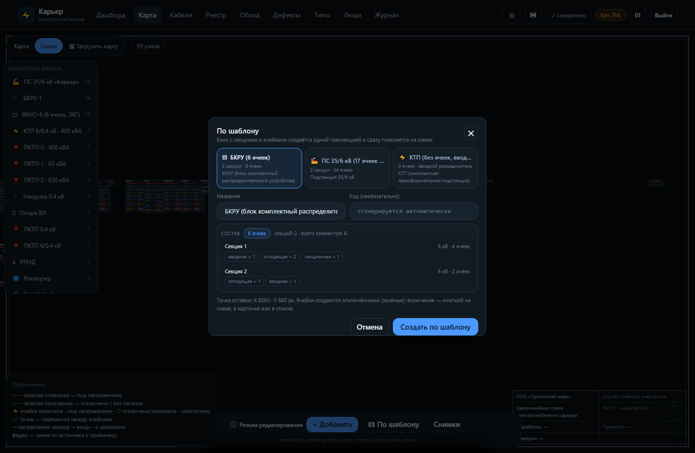
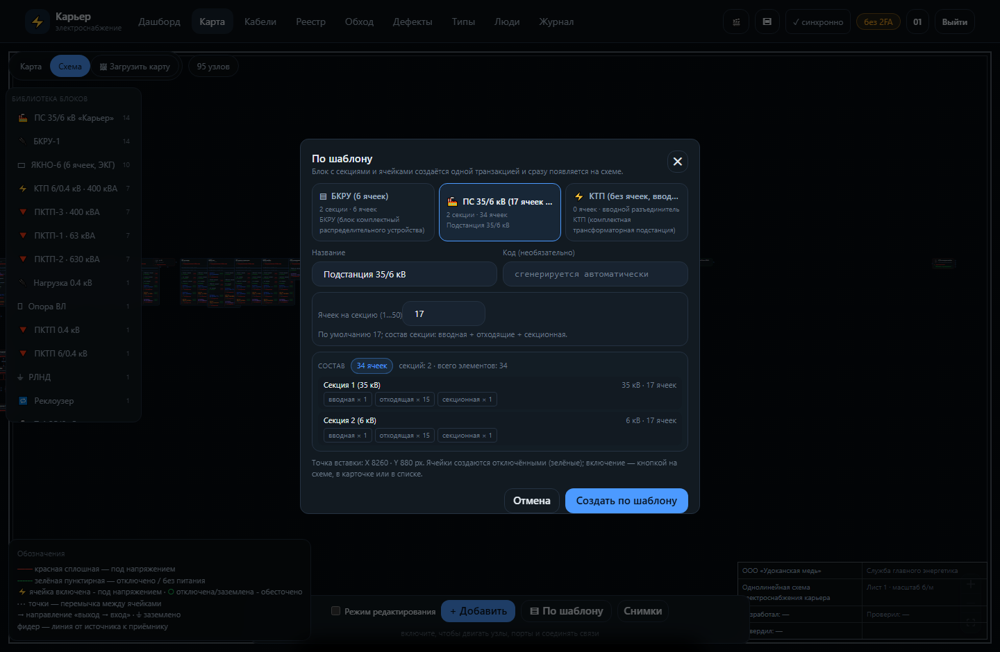
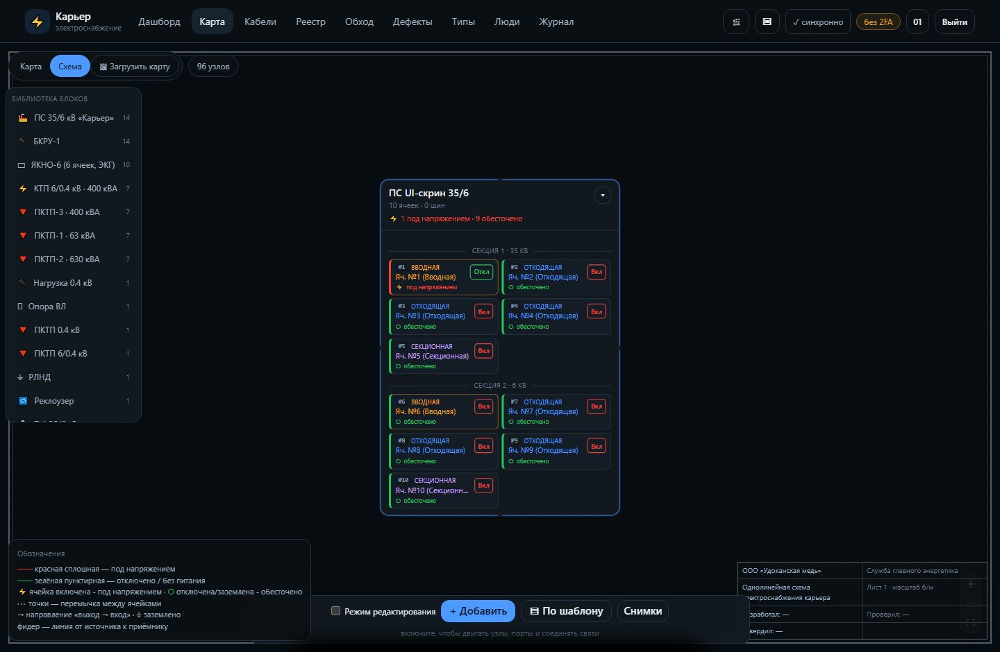
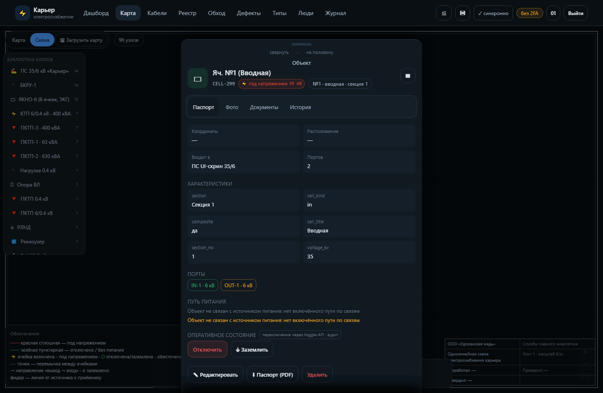
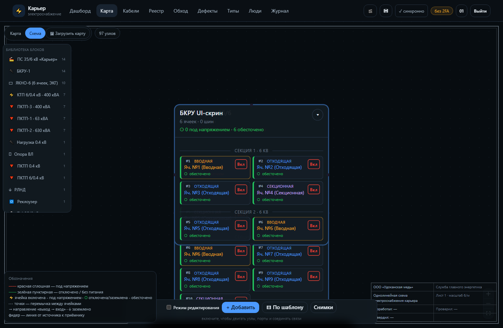
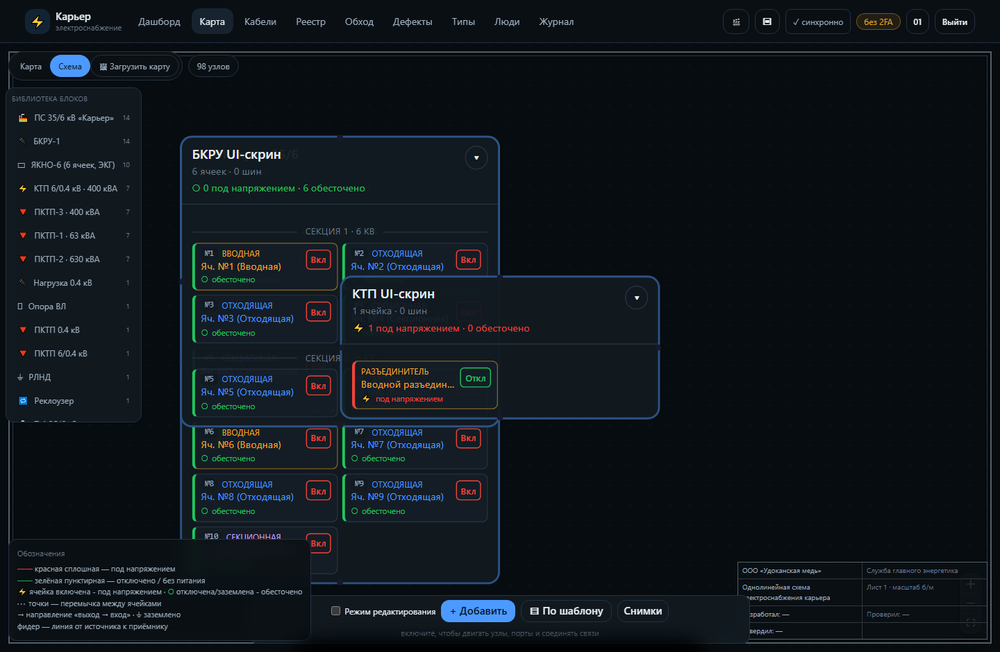
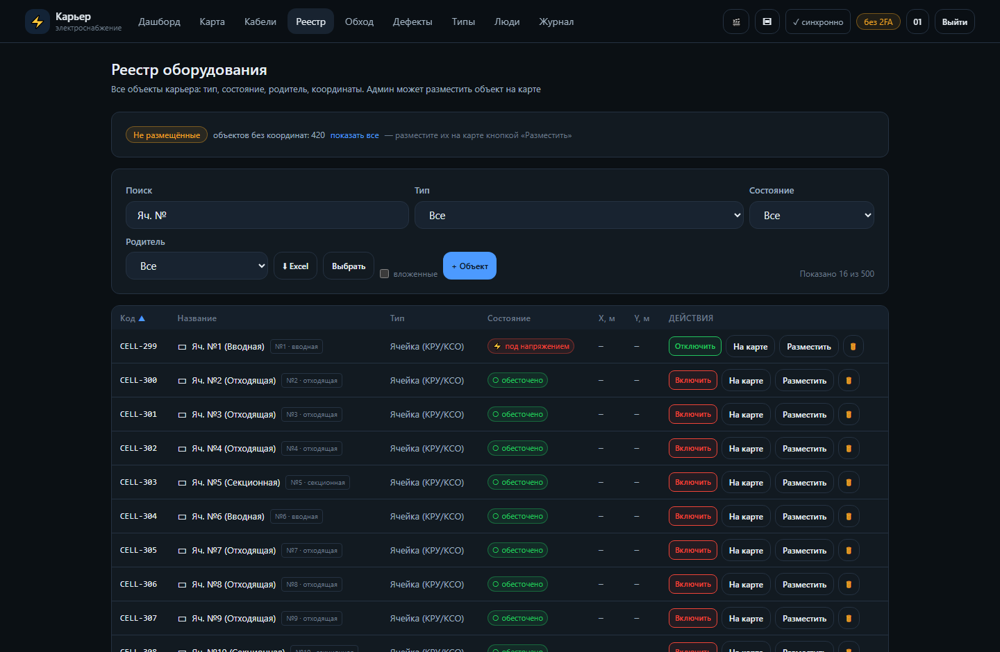
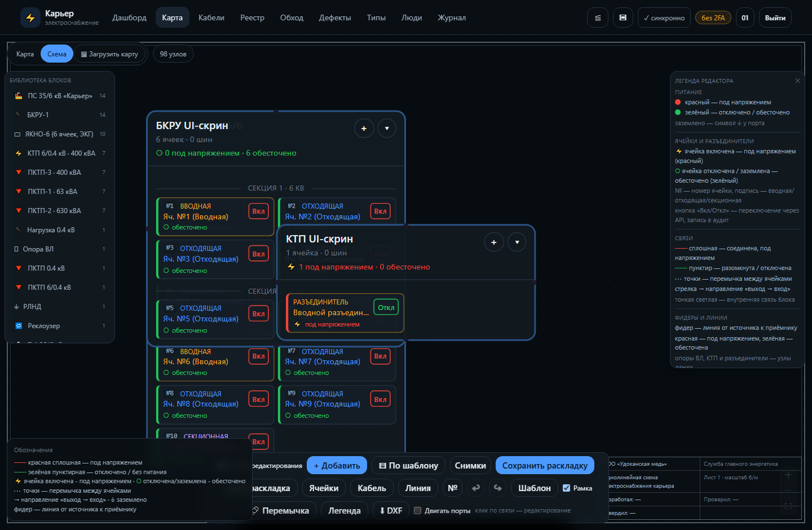
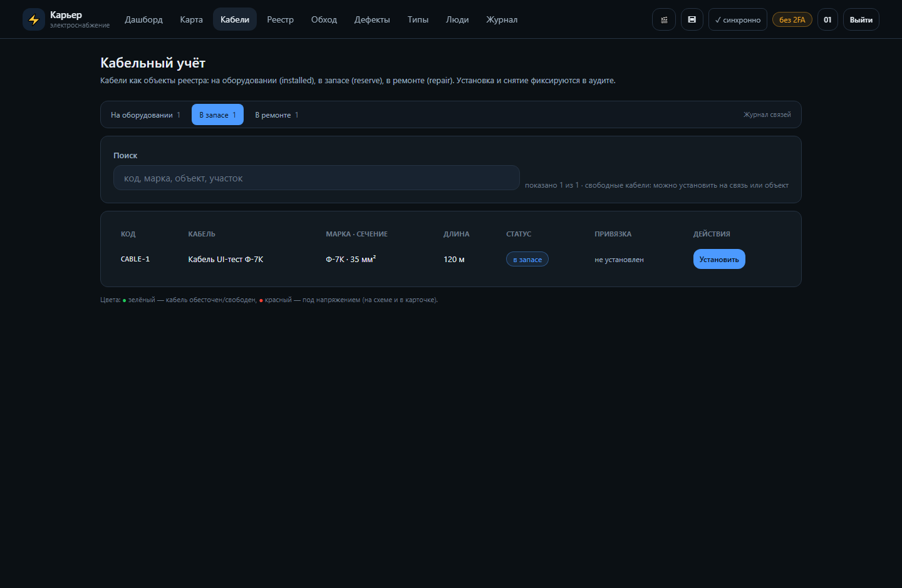
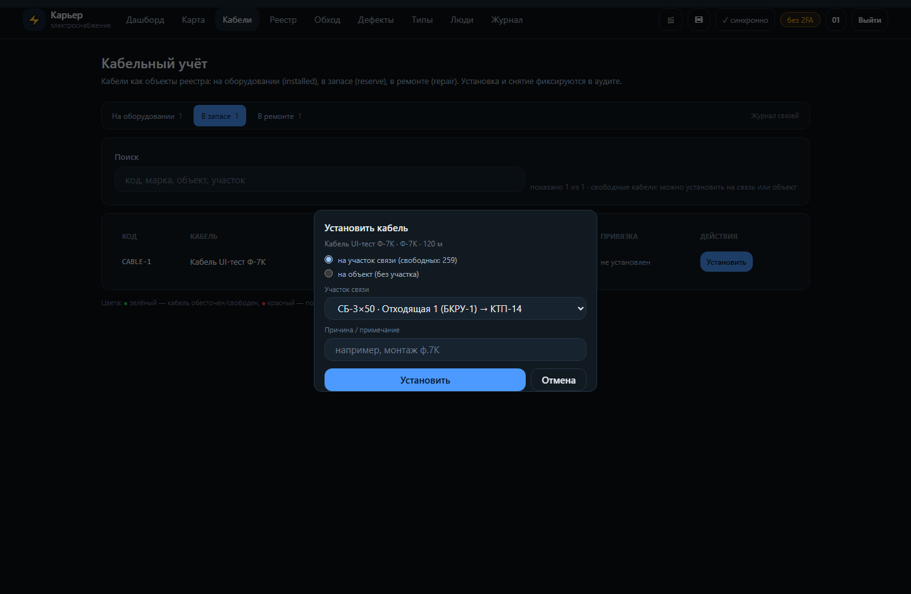
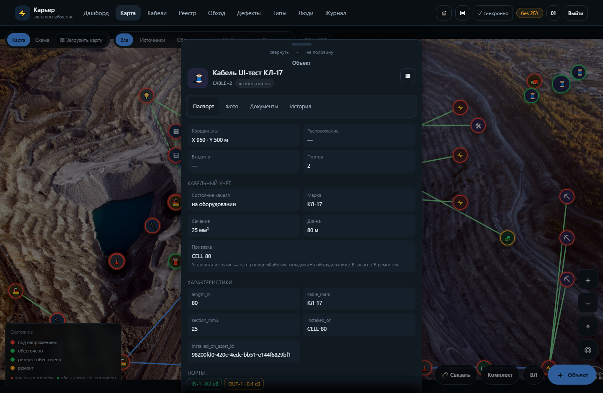

## 10. Как воспроизвести

```powershell
# 1) backend с новым кодом и ТЕСТОВОЙ базой (рабочую karier_db не трогаем)
cd C:\karier\karier\backend-v2
$env:DATABASE_URL = "postgresql+psycopg://karier_user:<пароль>@127.0.0.1:5432/karier_test_db"
.\venv\Scripts\python.exe -m uvicorn app.main:app --host 127.0.0.1 --port 8002

# 2) фронтенд: сборка + статический сервер с прокси /api → 8002 (Vite dev падает на watch
#    временных файлов редактора; для скриншотов использован статический сервер)
cd C:\karier\karier\src-v2
npm.cmd run build
node C:\karier\.tmp\serve-dist.mjs           # http://127.0.0.1:5180

# 3) браузерный сценарий (Edge через CDP): логин, мастер, переключения, кабели
node C:\karier\.tmp\stage2-shots.mjs         # скриншоты в docs/team/33b-shots/
```

Для ручной проверки в dev-режиме: `npx vite --config vite.test.config.mjs` (порт 5175, прокси на
8002) — тот же сценарий проходится руками.

## 11. Замечания и границы

* В `GraphBlockChildOut` графа нет статуса ячейки — фронтенд берёт статусы из реестра
  (`GET /api/assets`, уже загружен `MapPage`) и накладывает локальные результаты toggle. Это не
  меняет API; если backend позже добавит `status/grounded` в children, приоритет можно отдать им.
* «Секция» подписана из `attrs.section` («Секция 1», «Секция 2») + напряжение секции из
  `attrs.voltage_kv` (35 кВ / 6 кВ). Отдельного поля `label` секции в графе нет.
* Кабели на объект без свободной связи ставятся как «на объекте» (`attrs.installed_on_asset_id`) —
  так и отображается в карточке (`installed_on = CELL-…`).
* Вне этапа (по плану 31 и отчёту db_agent): `GET /api/equipment/classes` (счётчики вкладок),
  паспортные поля `serial_no/manufacturer/...`, `POST /api/cables` (создание кабеля сразу в запас).
* Тесты этапа 2 на backend и полная приёмка — за qa_agent (`tests/test_equipment_stage2.py`).
