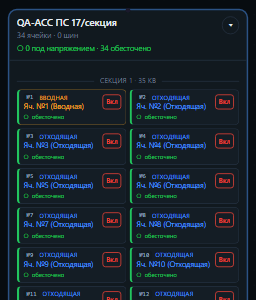
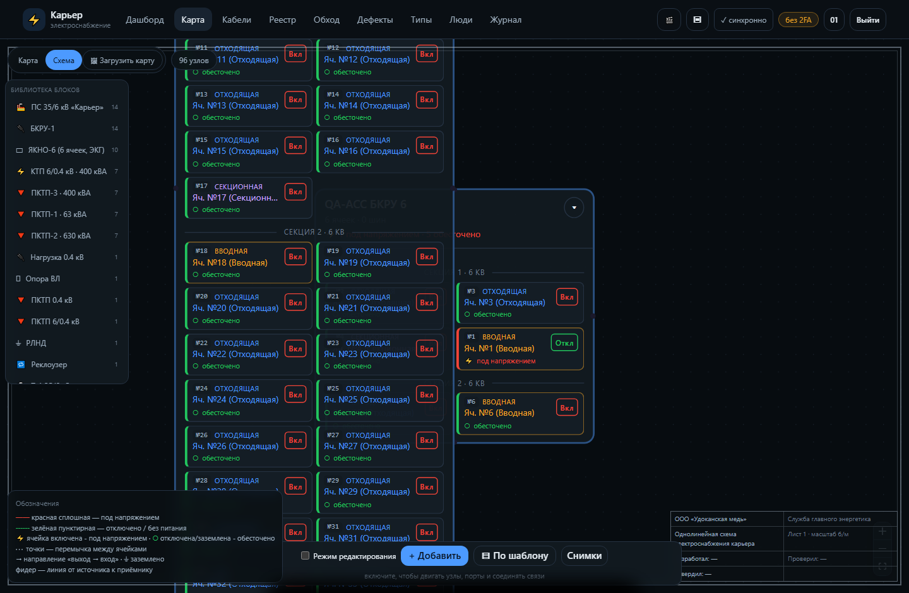
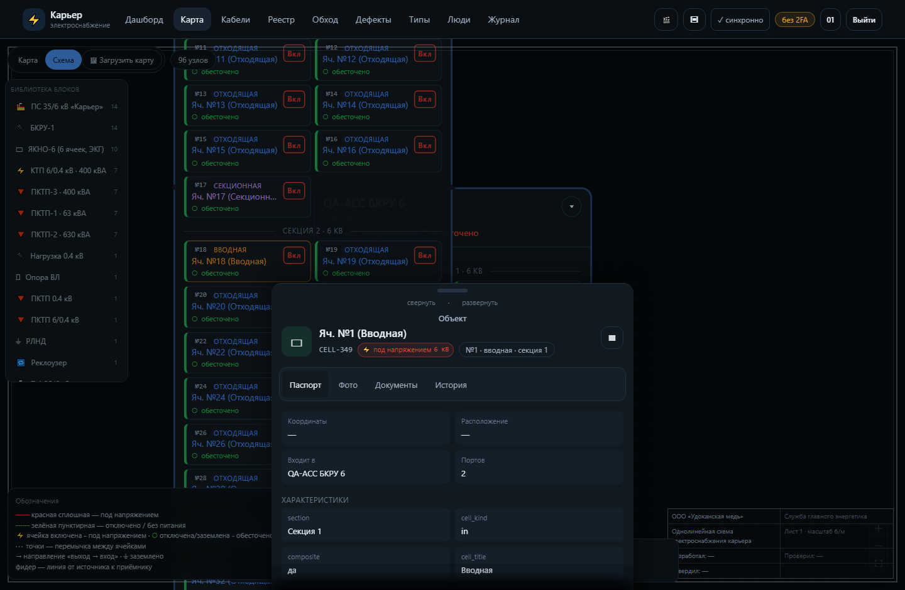
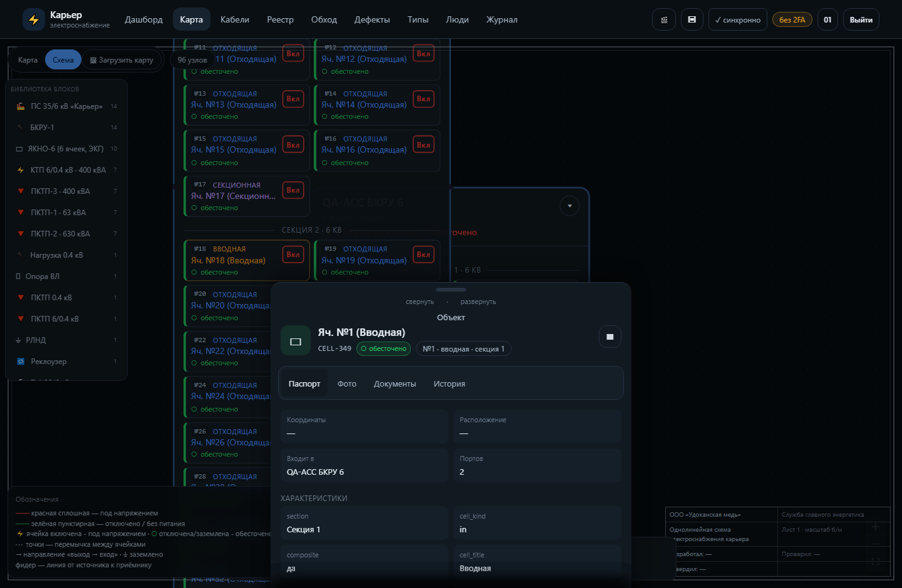
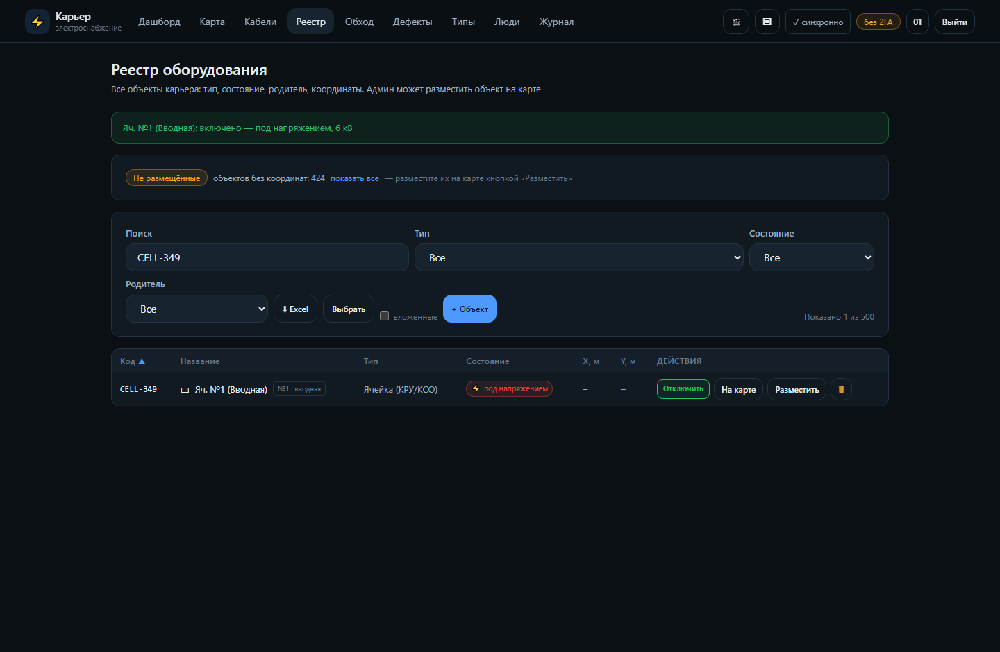
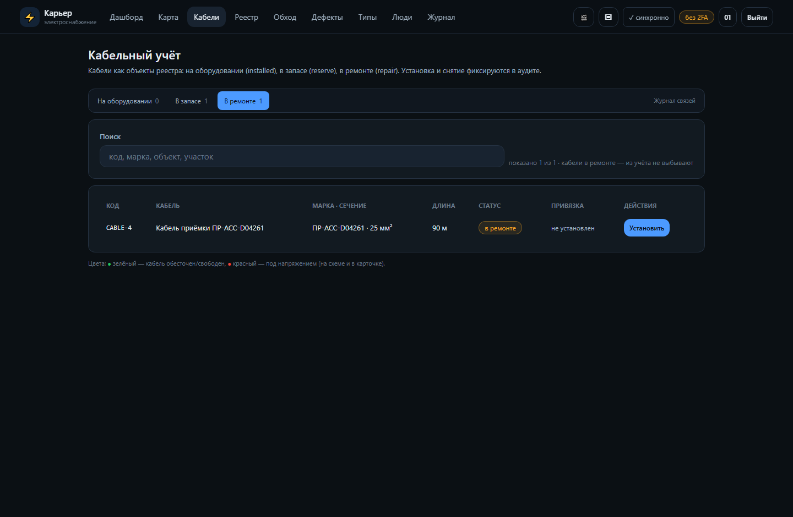

# Приёмка этапа 2 «Оборудование Карьера»: шаблоны, цвета, toggle, кабели

Дата: 26.11.2026 · исполнитель: qa_agent (независимая приёмка t4)
Стенд: `karier_test_db` (ревизия `0016_stage2_equipment`) + изолированные сервисы на 127.0.0.1:8003/5181
Рабочая `karier_db` **не менялась** (read-only: head `0015_asset_type_fields`, колонки
`gis.links.cable_asset_id` нет, типа `razedinitel` нет, 12 объектов).
`backend-v2/app`, `backend-v2/tests`, `src-v2` **не менялись** — хеши до/после совпали (§3).

## 1. Вердикт

**PASS с оговорками.** Все критерии приёмки t4 выполнены: миграция 0016 откатывается и
накатывается, полный pytest зелёный, фронтенд-проверки зелёные, API-контракты этапа 2
подтверждены живыми вызовами, браузерный смоук на изолированном стенде пройден
(21/21 обязательная проверка, 0 ошибок консоли и API), скриншоты сняты с хешами.
Оговорки — в §9: одно UI-замечание (схема не перекрашивается сразу после toggle **из
карточки**, нужна перезагрузка), известные расхождения формулировок t3 с фактическим API
(422 вместо 400 и семантика `cells_per_section`), пропуск 3 тестов миграций без выделенной БД.
Блокирующих дефектов нет; всё перечисленное не мешает эксплуатации и покрыто документацией.

| # | Критерий приёмки (t4) | Вердикт | Подтверждение |
|---|---|---|---|
| 1 | Хеши `app/`, `tests/`, `src-v2` до и после совпали; миграция 0016 up→down→up на `karier_test_db` | ✅ | §3 (4 области, 0 изменённых файлов), §4 (0016→0015→0016, данные по md5 идентичны) |
| 2 | Полный pytest 0 failed (число зафиксировано); tsc, build, vitest зелёные | ✅ | §5 (**226 passed, 3 skipped, 0 failed**, exit 0, 336.22 с), §6 (typecheck/build/vitest — exit 0, 78 тестов) |
| 3 | API: composite БКРУ=6 с правильными `cell_kind`/`section_no`; ПС 17/секция (+параметр); КТП 0+разъединитель; toggle → voltage/energized + `audit.audit_log`; кабель install→installed+`cable_asset_id`, return→reserve | ✅ | §7: 20/20 живых проверок PASS |
| 4 | Браузерный смоук: БКРУ (6) и ПС (17) из UI, toggle — красный↔зелёный на схеме, в карточке и списке; установка/снятие кабеля; ошибок консоли/API нет; скриншоты с хешами | ✅ (см. §9 F1) | §8: 21/21 проверок PASS, console errors none, API >=400 none, 19 скриншотов с SHA-256 |
| 5 | Отчёт `docs/team/33d-stage2-acceptance.md` с вердиктом и оговорками | ✅ | этот документ |

## 2. Метод (независимо от тестов t3)

* хеши сняты **до** любых действий и повторно — после всех прогонов;
* миграция и pytest — на `karier_test_db` c явной подстановкой `DATABASE_URL`
  (без подстановки `alembic` взял бы рабочую БД из `backend-v2/.env` — предупреждение в §10);
* API проверялся отдельным скриптом (TestClient, живые вызовы, созданные объекты удалены);
* браузер — production-сборка `src-v2/dist` (без dev-сервера, кеш и SW отключены),
  backend-процесс на `karier_test_db`, Edge через CDP; демо-объекты удалены после смоука;
* ничего в коде не исправлялось: `backend-v2/app`, `backend-v2/tests`, `src-v2/src` не менялись.

## 3. Хеши до/после (SHA-256, от `C:\karier\karier`)

Определение: SHA-256 от строк `"<sha256>  <путь>"` (два пробела, POSIX-путь, сортировка по
пути, `\n` после каждой строки). Области: `backend-v2/app/**/*.py` (80), `backend-v2/tests/**/*.py`
(34), `src-v2/src/**` (71), конфиги `src-v2` (8: package.json, package-lock.json, tsconfig.json,
vite.config.ts, vite.test.config.mjs, index.html, postcss.config.js, tailwind.config.js).
`node_modules/`, `dist/`, `__pycache__` исключены.

| Область | Файлов | Агрегат ДО | Агрегат ПОСЛЕ | Совпал |
|---|---:|---|---|---|
| `backend-v2/app` | 80 | `db5ce3e4f8b3bb6b56be21eaff93339093b917bce3fdefe2e23dc5c45ce98cdc` | тот же | ✅ |
| `backend-v2/tests` | 34 | `5e408c82be4ee22b1a16d2fc90e7d04bc4b67a576ee2670bbdcfe61635d101a7` | тот же | ✅ |
| `src-v2/src` | 71 | `67a9a817c81bf54d76d4f934cc74d697cbe91e262820b7251d6d306a8039ed75` | тот же | ✅ |
| `src-v2` (конфиги) | 8 | `c1d7a4273ab6c4be73af8c6843dbb0132543bf45df914e1f4b8ba84bbdaa46bb` | тот же | ✅ |

Изменённых/добавленных/удалённых файлов — 0 во всех областях. Агрегат `app/` совпадает с
`33a-db-stage2.md` §7 и `33c-stage2-tests.md` §7, агрегат `tests/` — с `33c` §7: значит,
между t1→t2→t3→t4 код не дрейфовал. `npm run build` пересобирает `src-v2/dist/` — это
артефакт сборки, в область хеширования не входит и на исходники не влияет.

## 4. Миграция `0016_stage2_equipment`: upgrade → downgrade → upgrade

Выполнено на `karier_test_db` (`$env:DATABASE_URL` = DSN тестовой БД):

```
alembic current        → 0016_stage2_equipment (head)
alembic heads          → 0016_stage2_equipment (head) — одна голова
alembic upgrade head   → exit 0 (no-op)
alembic downgrade -1   → exit 0 → 0015_asset_type_fields
alembic upgrade head   → exit 0 → 0016_stage2_equipment (head)
```

Данные до/после цикла (снимок всех строк, md5 по упорядоченным значениям):

| Показатель | До | После down→up |
|---|---|---|
| Ревизия | `0016_stage2_equipment` | `0016_stage2_equipment` |
| `gis.assets` / `gis.links` | 5049 / 3788 | 5049 / 3788 |
| `gis.asset_ports` / `gis.asset_types` / `auth.employees` | 12965 / 20 / 87 | 12965 / 20 / 87 |
| md5 `gis.assets` (id, code, name, status, grounded, cell_kind, cell_no, section_no, lifecycle_status, updated_at, attrs) | `8b35298f9954c9cef20c9b56dd8ec7f1` | **тот же** |
| md5 `gis.links` (id, порты, тип, state, cable_mark, length, сечение, cable_asset_id, updated_at) | `4aae740ae6129555b6ee32d5b710ec16` | **тот же** |
| `links.cable_asset_id` + индекс `ix_links_cable_asset` + FK `fk_links_cable_asset_assets` | есть | есть (1/1/1) |
| Тип `razedinitel` (`switching`, active) | есть | есть |
| v2-шаблоны `bkru` / `substation` / `ktp` (`is_composite=true`) | 3 / 3 / 1 элементов | 3 / 3 / 1 |

`downgrade` действительно снимает добавленное (0015), `upgrade` возвращает; данные не теряются.
Полный цикл на отдельной пустой БД (`tests/test_migrations.py`) не запускался: нужна
`TEST_MIGRATION_DATABASE_URL` (у роли `karier_user` нет `CREATEDB`) — см. §9 F5.

## 5. Полный backend pytest

```
cd C:\karier\karier\backend-v2
.\venv\Scripts\python.exe -m pytest -q
→ 226 passed, 3 skipped, 639 warnings in 336.22s (0:05:36), exit 0
```

0 failed. Пропуски (3): `tests/test_migrations.py::test_single_alembic_head`,
`::test_upgrade_downgrade_upgrade`, `::test_autogenerate_has_only_known_drift` — гейт по
`TEST_MIGRATION_DATABASE_URL` (цикл `downgrade base` требует отдельной БД).
Лог: `backend-v2/var/qa_t4_full_pytest.log`.

## 6. Фронтенд: typecheck / build / vitest

```
cd C:\karier\karier\src-v2
npm run typecheck  → exit 0 (tsc -b --noEmit)
npm run build      → exit 0, 516 модулей, ✓ built in 5.39s
npx vitest run     → exit 0, 7 файлов / 78 тестов passed (1.39 s)
```

`vitest`: `dxf` 3, `equipmentTemplates` 19, `power` 11, `assetFields` 23, `photo` 3,
`DynamicFields` 5, `authProvider` 14 — **78 passed**.

## 7. API-приёмка (живые вызовы, `karier_test_db`)

Скрипт: логин `000001/admin` → create/toggle/install → проверки → удаление созданного.
**20/20 проверок PASS** (созданные `ACC-*` объекты удалены, БД вернулась к 5049/3788):

| Проверка | Результат |
|---|---|
| `POST /api/schema/composite` БКРУ | 201, `children=6`, `cell_no` 1…6 |
| `cell_kind` БКРУ | `[in, out, out, sectional, out, in]` |
| `section_no` БКРУ | `[1, 1, 1, 1, 2, 2]` |
| ПС по умолчанию | `children=34`, секции `[17, 17]` |
| Состав секции ПС | `in=1`, `out=15`, `sectional=1` |
| ПС `cells_per_section=3` | `children=6`, секции `[3, 3]` |
| ПС `cells_per_section=0` | 422 `validation.failed` |
| КТП | `children=1`, `cells=[]`, разъединитель `cell_kind=in` (`razedinitel`) |
| toggle on | 200: `status=on`, `energized=true`, `voltage_kv=6.0`, `grounded=false`, `nominal_voltage_kv=6.0` |
| `audit.audit_log` | `asset.toggled`, актор `000001/admin`, `payload.from_state=off → to_state=on`, причина |
| toggle off | 200: `status=off`, `energized=false`, `voltage_kv=0.0` |
| кабель | создан `reserve` (201) |
| кабельная связь | `POST /api/schema/assets/{cell}/cables` → 201 |
| install | 200: `lifecycle_status=installed`, в БД `links.cable_asset_id=<кабель>` |
| return | 200: `reserve`, `links.cable_asset_id=NULL`, `detached_links=[link]` |

## 8. Браузерный смоук (изолированный стенд)

Стенд: backend `uvicorn` на `127.0.0.1:8003` с `DATABASE_URL=…karier_test_db`; статический
сервер production-сборки на `127.0.0.1:5181` с прокси `/api`; Edge (headless) через CDP,
1440×940, кеш и ServiceWorker отключены. Сценарий: вход `000001/admin` по форме → схема →
мастер «По шаблону» → ПС (поле «Ячеек на секцию» = **17**, предпросмотр «34 ячеек») →
создание → БКРУ (6 ячеек) → включение ячейки на схеме → карточка → «Отключить» →
реестр (поиск по коду `CELL-349`, «Включить»/«Отключить») → кабели (запас → установить →
на оборудовании → снять в ремонт).

**21/21 обязательная проверка PASS**, `console errors: none`, **API-ответов с HTTP ≥ 400: 0**.
Одно наблюдение (не блокирует, §9 F1): схема не перекрашивается сразу после toggle из карточки.

| # | Проверка | Результат / факт |
|---|---|---|
| 1 | вход `000001/admin` через UI | PASS |
| 2 | ПС: поле «Ячеек на секцию» | PASS — `17` |
| 3 | ПС: предпросмотр | PASS — «34 ячеек» |
| 4 | ПС: блок на схеме | PASS — «34 ячейки · 0 шин», 34 DOM-ячеек |
| 5 | БКРУ: блок на схеме | PASS — «6 ячеек · 0 шин», 6 DOM-ячеек |
| 6 | ячейка до переключения | PASS — `data-power=off`, цвет `rgb(34,197,94)` (#22C55E) |
| 7 | кнопка «Вкл» на схеме | PASS |
| 8 | схема после включения | PASS — `data-power=on`, рамка `rgb(240,68,56)`, подпись «под напряжением» |
| 9 | цвет бейджа на схеме | PASS — `rgb(240,68,56)` (#F04438) |
| 10 | карточка открывается | PASS |
| 11 | карточка: красный бейдж | PASS — «под напряжением», CELL-349 |
| 12 | карточка: «Отключить» | PASS — бейдж «обесточено», `rgb(34,197,94)` (#22C55E) |
| 13 | карточка закрывается | PASS |
| 14 | схема после перезагрузки | PASS — «обесточено», зелёная (состояние из карточки сохранено) |
| 15 | схема: «Вкл» | PASS — красная |
| 16 | схема: «Откл» | PASS — зелёная |
| 17 | реестр: строка `CELL-349` | PASS — зелёная, кнопка «Включить» |
| 18 | реестр: «Включить» | PASS — красная, «под напряжением» |
| 19 | реестр: «Отключить» | PASS — зелёная |
| 20 | ошибки консоли | PASS — нет |
| 21 | ошибки API (HTTP ≥ 400) | PASS — нет |

Состояние в БД после UI-сценария (снято до уборки): блок БКРУ `BKRU-199` — 6 дочерних
(`in=2, out=3, sectional=1`), блок ПС `SUBSTATION-144` — 34 дочерних (`in=2, out=30, sectional=2`,
`attrs.cells_per_section=17`); кабель `CABLE-4` — `lifecycle_status=repair`, связей с
`cable_asset_id` нет (установка и снятие через UI дошли до БД). После уборки:
`QA-ACC*`/`Кабель приёмки*` — 0, `gis.assets` 5049 (585 активных), `gis.links` 3788 (3737 активных),
`links.cable_asset_id IS NOT NULL` — 0.

### 8.1 Скриншоты (`docs/team/33d-shots/`, 19 файлов, 1440×940)

| Файл | Что показывает | Размер | SHA-256 |
|---|---|---:|---|
| `01-ps-template-17-preview.png` | мастер «По шаблону»: выбран ПС, поле = 17, «34 ячеек» | 146378 | `bf6f0881538ca055560f2844c4a002893af3b1b726914747a2593d13b28eaa9b` |
| `02-schema-ps-34.png` | блок ПС на схеме (34 ячейки, секции) | 202394 | `cc6b136b323513416fb280cb4abe336417114e741cfbfa1182e898ff90fddd9b` |
| `02b-ps-header.png` | шапка ПС крупно: «34 ячейки · 0 шин · 0 под напряжением · 34 обесточено» | 21746 | `f409051fdaedca6923d7f7005b8dca507494f19f46b44a2488bcd4984d657f84` |
| `03-schema-bkru-6.png` | блок БКРУ: «6 ячеек», секции 1–2, все зелёные | 224780 | `f8d12fbb2d94945b6b3946b90a9cc2fa5b25ec2c52c83ed2dad5268f2c6d696a` |
| `04-schema-cell-on-red.png` | ячейка №1 включена: **красная** рамка, «⚡ под напряжением» | 225193 | `3f138b66621bb7da6994f89e0cc2213422ebb4282f54156a4d090634d3192b84` |
| `05-card-cell-red.png` | карточка ячейки: красный бейдж «под напряжением 6 кВ», CELL-349 | 171996 | `d3fe061273439c6c3240427567d90b8bfea178408f93145bfa6bff4901002248` |
| `06-card-cell-green.png` | после «Отключить»: зелёный бейдж «обесточено» | 171203 | `e2eae96787ff3e4cd407855fb6d7d5c10733724651d09f4c897ee6665a5bc45b` |
| `07-schema-cell-green-after-reload.png` | после перезагрузки: ячейка зелёная (состояние сохранено) | 245808 | `4666497547421d5fbcf7b35e98f263ee40dc5ee414924cd98010b7f1d351d4b5` |
| `08-schema-cell-red-again.png` | схема: «Вкл» → красная | 246087 | `281148a4ca5b5111748b1a3e306e287111cc4563a10d22c010d16c297a8e6c2e` |
| `09-schema-cell-green-again.png` | схема: «Откл» → зелёная | 245850 | `bafda8aa1a01ad51fd19ab04f65c925cf046c9b6c7a31c3ae7d57276a4b516aa` |
| `10-registry-cell-green.png` | реестр: строка ячейки зелёная, кнопка «Включить» | 56675 | `887de04e7753f1ab50083c8d8e71cb5e622e2bc7a1f59668abc245fb7aa85e6e` |
| `11-registry-cell-red.png` | реестр: после «Включить» красная «под напряжением» + плашка | 60953 | `cb4d97e7524665f08ce4776882e33a43ad442cfef89054b92c5769edd364e8fa` |
| `12-registry-cell-green-after.png` | реестр: после «Отключить» снова зелёная | 59646 | `38bc36f659271084205a1a706570c1a5b77a80f777d2995d4fea05383c75d197` |
| `13-cables-reserve.png` | кабели, вкладка «В запасе»: приёмки-кабель, «Установить» | 56063 | `ff292bf85c1718a302c4e54a42ef553f2466aa9c90bf2847141401146e04428b` |
| `14-cable-install-dialog.png` | диалог установки: выбор свободной связи | 68582 | `7819678d686056eaa26d86e5ffc729c0482ad16bdaf741912799451a9077d64e` |
| `15-cable-installed-toast.png` | результат установки через UI | 53174 | `9488d71b35b23c60ebe93ff82f08a417ecad7bbc4ac8e29bafa4b7561b0f2a5a` |
| `16-cables-installed.png` | вкладка «На оборудовании»: кабель, кнопка «Снять» | 50784 | `edde3ff6319fbb8c020f0b36b73e052aa9c24c45cd57bbcf66e5759d8c9c339c` |
| `17-cable-return-dialog.png` | диалог снятия (в ремонт) | 57658 | `cab55849c57af68db5ad23d6c488e922e0e6261b3c2bd0f68c8b6c1fd9b8c192` |
| `18-cables-repair.png` | вкладка «В ремонте»: CABLE-4, «не установлен», 90 м, 25 мм² | 49192 | `d785dd2063fb89dd00f75dc72151bcea41a56c329ca29d746ed10d5560a1bd46` |








## 9. Оговорки, замечания, рекомендации

### F1 (UI, низкая/средняя критичность, не блокирует): схема не перекрашивается после toggle из карточки

Наблюдение браузерного смоука: включили ячейку на схеме (красная) → открыли карточку
(красный бейдж) → нажали «Отключить» в карточке (бейдж зелёный, БД `status=off`) → закрыли
карточку: **схема всё ещё показывает красную ячейку**, пока не перезагрузить страницу
(после перезагрузки — зелёная, состояние из БД корректное). Причина: `MapPage` передаёт в
`SchemaView` статусы ячеек из своего списка `assets` (`assetStates`), а `AssetSheet` после
toggle не уведомляет `MapPage` — обновляется только собственный стейт карточки; локальный
стейт схемы обновляется лишь при toggle **на самой схеме**. Это не ломает данные и не
мешает обязательному сценарию (цвета во всех трёх представлениях проверены переключением
в каждом из них), но рассинхронизация заметна. Рекомендация для следующего этапа:
прокинуть `onChanged` из `AssetSheet`/`StateControls` в `MapPage` (обновить `assets`
и/или `refresh()` после toggle) — 3–5 строк.

### F2. «Не-ячейка → 400» в тексте t3, фактически 422 (уже зафиксировано в t3 §6.1)

Приёмка подтверждает фактическое поведение t1/t3: `POST /api/assets/{id}/toggle` для опоры
и для самого блока КТП → **422 `asset.not_switchable`**, объект не меняется. Тесты t3
закрепляют 422. Если заказчику нужен именно 400 — отдельное изменение `app/services/state.py`.

### F3. Семантика `cells_per_section`

`cells_per_section` — число ячеек **всей секции** (t1 §4.1): 17 → 1 `in` + 15 `out` + 1 `sectional`;
`n=3` → 1 отходящая + 2 служебных (3 на секцию); «3 отходящих + 2 служебных» получаются при
`n=5`. Приёмка подтверждает: параметр 3 → 6 ячеек всего; default 17 → 34.

### F4. Снятие кабеля не восстанавливает денормализацию связи (продуктовый вопрос)

`POST /api/cables/{id}/return` очищает `links.cable_asset_id` и ставит `cable_status=dismounted`,
но оставляет `cable_mark/length_m/cross_section_mm2` на связи (по контракту t1 §4.3 этого и не
требуется). Следствие для тестовой среды: демо-кабель, поставленный на seeded-связь, оставляет
след (см. `33c-stage2-tests.md` §5 — три seeded-связи были восстановлены к seed вручную).
Рекомендация: либо очищать/восстанавливать денормализацию при снятии, либо не ставить
демо-кабели на seeded-связи; полезен reset-seed для `karier_test_db`.

### F5. 3 теста миграций пропущены

`tests/test_migrations.py` требует отдельную БД в `TEST_MIGRATION_DATABASE_URL` (цикл
`downgrade base` уничтожает данные); переменная на стенде не задана, у `karier_user` нет
`CREATEDB`. Вместо него приёмка повторила цикл 0016 up→down→up на `karier_test_db` со сверкой
md5 данных (§4) — риск «накатывается, но не откатывается» закрыт для 0016.

### F6. Осторожно с Verify-командой из контракта

`alembic` берёт URL из `settings.DATABASE_URL`, а `backend-v2/.env` указывает на **рабочую**
`karier_db`. Команда контракта без явной переменной окружения накатила бы миграции на рабочую
БД. Приёмка выполняла миграции с `$env:DATABASE_URL=<DSN karier_test_db>` (§4, §10). Это же
касается любых будущих прогонов.

### F7. Прочее (наблюдения, не дефекты)

* сцена схемы содержит ~96 узлов; новый блок при создании может перекрываться соседними —
  на скриншотах это видно, на проверки не влияет (можно двигать в режиме редактирования);
* `npm run build` перезаписывает `src-v2/dist/` (артефакт сборки; вне области хеширования);
* журнал аудита append-only: события приёмки (`composite.composed`, `asset.toggled`,
  `cable.*`) остались в `audit.audit_log` — это штатное поведение;
* старый дрейф seeded-связи `BKRU-1 → BKRU1-OUT1` (busbar, марка `АВБбШв 4×35` вместо
  seed `Шина БКРУ`, с 2026-11-09) — не влияет на прогон, не трогался (t3 §5.4 п.4).

## 10. Воспроизведение

```powershell
# 0) хеши до
python <скрипт хешей>        # области app/tests/src-v2/src/конфиги, см. §3

# 1) миграция — ТОЛЬКО с подстановкой тестовой БД
cd C:\karier\karier\backend-v2
$env:DATABASE_URL = (Get-Content tests\.env.test | ? { $_ -match '^TEST_DATABASE_URL=' }) -replace '^TEST_DATABASE_URL=',''
.\venv\Scripts\python.exe -m alembic upgrade head
.\venv\Scripts\python.exe -m alembic downgrade -1
.\venv\Scripts\python.exe -m alembic upgrade head

# 2) backend-тесты
.\venv\Scripts\python.exe -m pytest -q

# 3) фронтенд
cd C:\karier\karier\src-v2
npm.cmd run typecheck; npm.cmd run build; npx.cmd vitest run

# 4) API-приёмка (TestClient, karier_test_db)
C:\karier\karier\backend-v2\venv\Scripts\python.exe C:\karier\.tmp\qa_t4_api_check.py

# 5) браузерный смоук: backend 8003 (karier_test_db) + статический сервер 5181 (dist)
cd C:\karier\karier\backend-v2
$env:DATABASE_URL = <DSN karier_test_db>
.\venv\Scripts\python.exe -m uvicorn app.main:app --host 127.0.0.1 --port 8003
node C:\karier\.tmp\qa-serve-dist.mjs
python C:\karier\.tmp\qa-t4-browser-setup.py      # 2 демо-кабеля в запасе
node C:\karier\.tmp\qa-stage2-accept.mjs          # скриншоты → docs/team/33d-shots
python C:\karier\.tmp\qa-t4-browser-cleanup.py    # проверка БД после UI + уборка
```

Служебные скрипты/логи приёмки: `C:\karier\.tmp\qa-*` (`qa-stage2-accept.mjs`,
`qa-serve-dist.mjs`, `qa_t4_api_check.py`, `qa-t4-browser-*.py`, `qa-t4-browser.log`,
`qa-t4-hashes-*.json`, `qa-t4-shots.json`), логи backend — `backend-v2/var/qa_t4_full_pytest.log`.

## 11. Границы приёмки

* ничего не исправлялось: `backend-v2/app`, `backend-v2/tests`, `src-v2` не менялись (хеши §3);
* рабочая `karier_db` только читалась; миграции к ней не применялись;
* все демо-объекты (блоки ПС/БКРУ, кабели, связи) удалены; тестовая БД вернулась к baseline;
* создан только отчёт и каталог скриншотов `docs/team/33d-shots/` (19 PNG);
* не проверялись: мобильная вёрстка, офлайн-очередь, создание КТП через UI (КТП проверен по API
  и в t2-скриншотах), цикл миграций на отдельной БД (F5).
