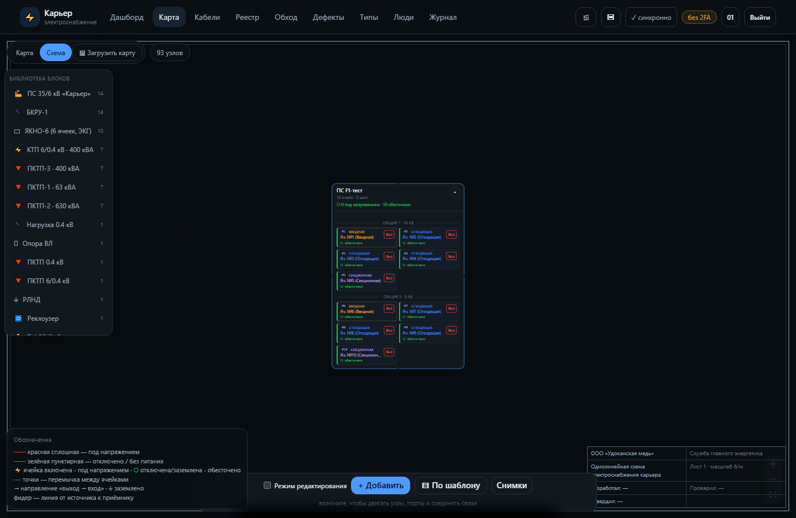
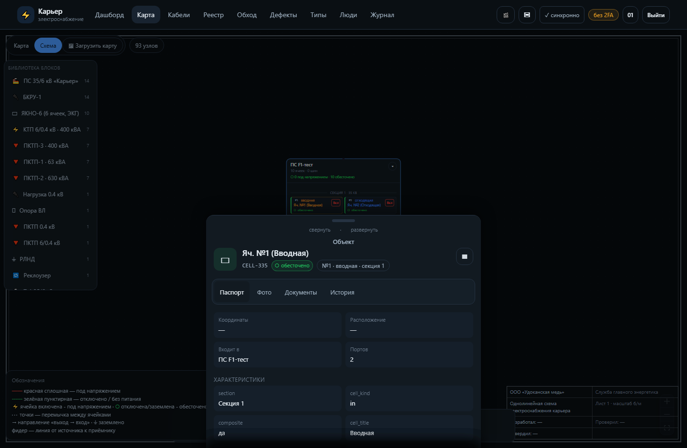
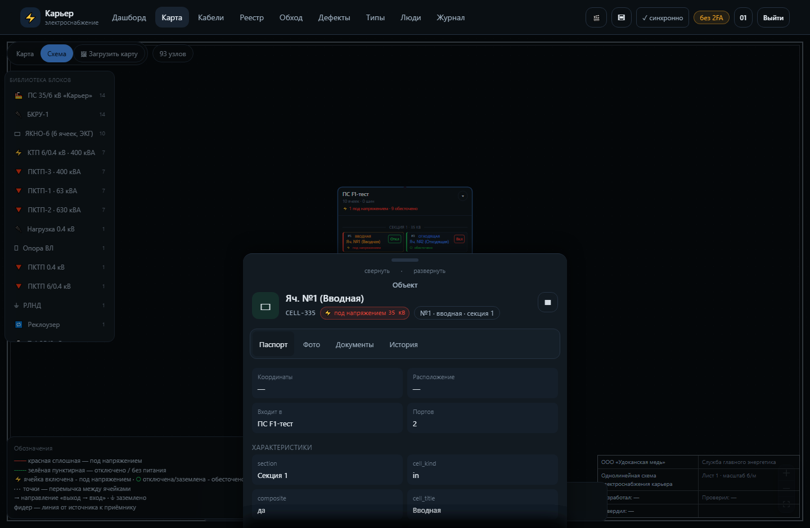
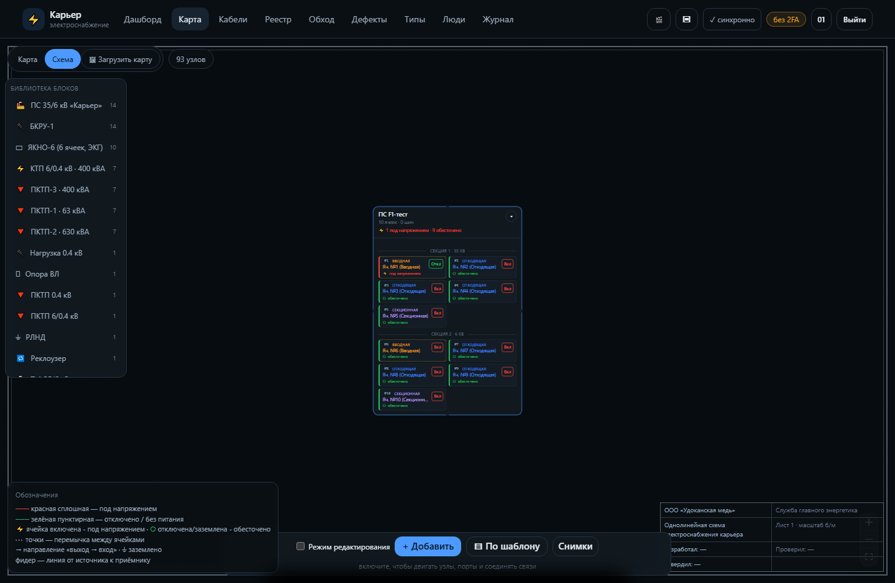
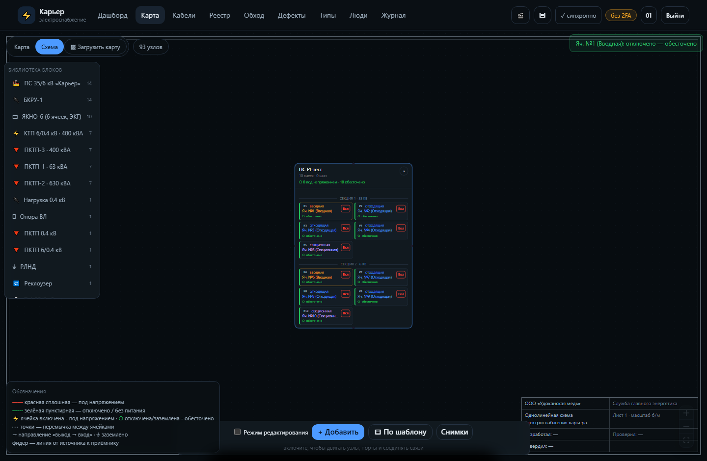

# F1: мгновенная перекраска схемы после toggle из карточки

Дата: 26.11.2026 · статус: **исправлено, проверено** · автор: ui_agent (t5)
Область: `karier/src-v2/src` (frontend). Backend не менялся.

## 1. Что было не так

По итогам приёмки этапа 2 (t4) — дефект **F1**: после «Включить/Отключить» из
**карточки объекта** цвет ячейки на холсте схемы не менялся до перезагрузки страницы.

Причина: `AssetSheet` обновлял только собственное состояние `asset` (бейдж в карточке
перекрашивался), а `MapPage` об этом не узнавал. `SchemaView` красит ячейки блоков по
`assetStates`, который `MapPage` собирает из загруженного реестра `assets`; без обновления
этого списка цвет на холсте оставался прежним. Дополнительный случай: ячейки только что
созданного мастером блока вообще отсутствуют в уже загруженном `assets`, поэтому даже
обновление списка не помогало бы до перезагрузки.

## 2. Что изменено

| Файл | Изменение |
|---|---|
| `src/lib/power.ts` | Чистая функция `applyPowerState(items, update)` + тип `PowerStateUpdate {id, status, grounded}`. Меняет только совпавший объект, возвращает тот же массив, если ничего не изменилось (без лишних перерисовок). |
| `src/lib/power.test.ts` | +4 теста на `applyPowerState`: меняется только выбранная ячейка, заземление даёт зелёный, неизменное состояние возвращает тот же массив, `energized` меняется на лету (красный ↔ зелёный). |
| `src/components/asset/AssetSheet.tsx` | Новый проп `onStateChanged?: (update: PowerStateUpdate) => void`. Вызывается из `StateControls.onChanged` (toggle-API/заземление) **и** из `ChildrenModal.onChanged` (переключение во внутренней схеме блока). Локальный бейдж карточки обновляется как раньше. |
| `src/pages/MapPage.tsx` | `handleStateChanged` прокинут в `AssetSheet` как `onStateChanged`: (1) точечный `powerOverrides` — работает и для ячеек, которых ещё нет в реестре; (2) `applyPowerState` по локальному `assets` (реестр/маркеры карты); (3) тихий `loadGraph()` — обновляет статусы одиночных узлов, камера не сбрасывается (fitView в `SchemaView` выполняется только при первом открытии). `assetStates` = overrides + ячейки из `assets`. |
| `src/components/map/SchemaView.tsx` | После toggle граф перезагружается, и порядок `block.children` от API может меняться — подписи секций и нумерация «прыгали» (секция 1 появлялась повторно). Ячейки составных устройств (`params.composite`/`params.cell_kind`) теперь сортируются по `section_no`, затем по номеру из имени; legacy-блоки отображаются в исходном порядке. |

Поток данных после исправления:

```
StateControls (карточка) ──onChanged(next)──▶ AssetSheet ──onStateChanged({id,status,grounded})──▶ MapPage
                                                                                                  │
                                      setPowerOverrides + applyPowerState(assets) + loadGraph()   │
                                                                                                  ▼
                                                                       assetStates ──▶ SchemaView (mergedCellStates) ──▶ перекраска ячейки
```

`PowerToggleButton` в списках/реестре по-прежнему обновляет строку локально (это отдельный
экран, схема при этом не открыта). В карточке используется `StateControls`, т.к. он же
отвечает за заземление; toggle в нём уже шёл через `POST /api/assets/{id}/toggle`.

## 3. Проверка в браузере (Edge/CDP, production-сборка)

Сценарий: вход `000001/admin` → схема → мастер «По шаблону» → ПС 35/6 (5 ячеек на секцию) →
открыть карточку вводной ячейки → «Включить» в карточке → закрыть карточку → «Откл» на самой
схеме. Прогон: `node C:\karier\.tmp\f1-check.mjs` (Edge headless, static server → API 8003,
изолированная БД `karier_ui_f1_db` — клон `karier_test_db`, чтобы не мешать параллельной
работе db_agent).

Фактические результаты прогона:

| Шаг | Результат |
|---|---|
| Ячейка до toggle из карточки | `data-power="off"` — «○ обесточено» |
| Toggle «Включить» **из карточки** | API 200; ячейка на холсте сразу `data-power="on"` — «⚡ под напряжением» (ожидание `on` получено без перезагрузки) |
| Перезагрузка страницы | `window.__f1Marker` сохранился → **страницы не перезагружалась** |
| Карточка после toggle | бейдж «⚡ под напряжением 35 кВ», номер/вид ячейки, плашка toggle-API |
| Закрытие карточки | на холсте ячейка красная, шапка блока «⚡ 1 под напряжением · 9 обесточено» |
| Toggle **на самой схеме** («Откл») | API 200; ячейка сразу `data-power="off"` — «○ обесточено», шапка «0 под напряжением · 10 обесточено» |
| Камера | `translate(-5612.67px, -391.693px) scale(0.752099)` до и после — **не изменилась** |
| Консоль браузера | `console errors: none` |

Скриншоты (1440×940, `docs/team/34a-f1-shots/`):







## 4. Проверки

Контрактная команда (из `C:\karier\karier\src-v2`):

```
powershell -NoProfile -Command "cd C:\karier\karier\src-v2; npm.cmd run typecheck; npm.cmd run build; npx.cmd vitest run"
```

| Проверка | Результат |
|---|---|
| `npm run typecheck` (`tsc -b --noEmit`) | exit 0, ошибок нет |
| `npm run build` | exit 0, `✓ built in 4.90s` |
| `npx vitest run` | exit 0, **7 файлов / 82 теста passed** (было 78; +4 теста `applyPowerState`) |
| Браузерный сценарий F1 | пройден, `console errors: none`, 5 скриншотов |
| Демо-объекты | блок «ПС F1-тест» и его ячейки удалены; изолированная БД после проверки удалена |

## 5. Файлы и хеши (SHA-256, от `C:\karier\karier`)

| Файл | Размер | SHA-256 |
|---|---|---|
| `src-v2/src/lib/power.ts` | 7084 | `73cdf832b210a9152d173fb77d0452095ff254cf63d4cc6508c5e8d2b6386162` |
| `src-v2/src/lib/power.test.ts` | 6958 | `405518c89f289c85b0206f12d494d5881d2b9dab8e745697bc278463fa2499ab` |
| `src-v2/src/components/asset/AssetSheet.tsx` | 23924 | `1b8250fe337a0043b5cd5dd9b1e70f9f0677061af1dde6b0d1ec84a166dc2b9d` |
| `src-v2/src/components/map/SchemaView.tsx` | 138235 | `a5f80287c19d0073732e05eba8a26b1b1f85bf05f8acedaec91a7e6d1c900e67` |
| `src-v2/src/pages/MapPage.tsx` | 68793 | `d3ed6f1654c143dc05f3e5ce61425e224c0571399ab3642db7fd8cd8c7fcca41` |

Скриншоты:

| Файл | Размер | SHA-256 |
|---|---|---|
| `34a-f1-shots/01-schema-before-card-toggle.png` | 135879 | `c4c699a92af03845aa0e4541194fcd85f96b40b46fb3e541cbe88cd6ac07a68a` |
| `34a-f1-shots/02-card-before-toggle.png` | 116228 | `fa985122819cd1629367fcf4d008b53997c34375b0d6abe9e3290ac2251a880e` |
| `34a-f1-shots/03-card-after-toggle.png` | 117582 | `0c56dcc37c19f17c4c060207746717b0014612ee37f2d54d32bc872ac9369a72` |
| `34a-f1-shots/04-schema-after-card-toggle.png` | 136105 | `94c0c4fdf12ee2a65b460548ac9331089107f65fd4efe09a94adad2b56af40c9` |
| `34a-f1-shots/05-schema-after-schema-toggle.png` | 138478 | `e91daef0b808e74c49c012f4d798f120545ebebe68e70f30ff2db7f6ccd1b79c` |

Не менялись: `backend-v2/**`, `src-v2/src/lib/api.ts`, `src-v2/src/lib/gis.ts`,
`src-v2/src/components/asset/StateControls.tsx` (использован существующий `onChanged`),
`src-v2/src/components/asset/PowerToggleButton.tsx`, рабочая `karier_db` (read-only).

## 6. Как воспроизвести

```powershell
# изолированная БД — клон тестовой (рабочую karier_db не трогаем)
$Bin='C:\karier\.local\pg18\vendor\pgsql\bin'
& "$Bin\psql.exe" -h 127.0.0.1 -U postgres -d postgres -c "create database karier_ui_f1_db owner karier_user encoding 'UTF8' template template0;"
& "$Bin\pg_dump.exe" -h 127.0.0.1 -U postgres -d karier_test_db --no-owner -Fc -f C:\karier\.tmp\karier_test_snapshot.dump
& "$Bin\pg_restore.exe" -h 127.0.0.1 -U postgres -d karier_ui_f1_db --no-owner C:\karier\.tmp\karier_test_snapshot.dump
# выдать права karier_user на все схемы (владелец объектов после --no-owner — postgres)

cd C:\karier\karier\backend-v2
$env:DATABASE_URL = "postgresql+psycopg://karier_user:<пароль>@127.0.0.1:5432/karier_ui_f1_db"
.\venv\Scripts\python.exe -m uvicorn app.main:app --host 127.0.0.1 --port 8003

cd C:\karier\karier\src-v2; npm.cmd run build
$env:KARIER_API='http://127.0.0.1:8003'; $env:KARIER_PORT='5181'; node C:\karier\.tmp\serve-dist.mjs

node C:\karier\.tmp\f1-check.mjs   # скриншоты в docs/team/34a-f1-shots/
```

## 7. Замечания

* Проверка выполнялась на изолированной копии тестовой БД: параллельно db_agent работал с
  `karier_test_db` (F4), и объекты могли исчезать между шагами. Клон и бэкенд на 8003 после
  проверки остановлены/удалены; `karier_test_db` этой задачей не изменялась.
* Сортировка ячеек в `SchemaView` — не косметика, а необходимое следствие F1: карточка теперь
  инициирует перезагрузку графа, а API не гарантирует порядок `children`. Для legacy-блоков
  порядок сохранён, чтобы не менять привычную раскладку.
* Переключение из карточки по-прежнему идёт через `POST /api/assets/{id}/toggle` и пишет аудит
  на backend — фронтенд лишь синхронизирует локальное состояние, сервер остаётся источником правды.
