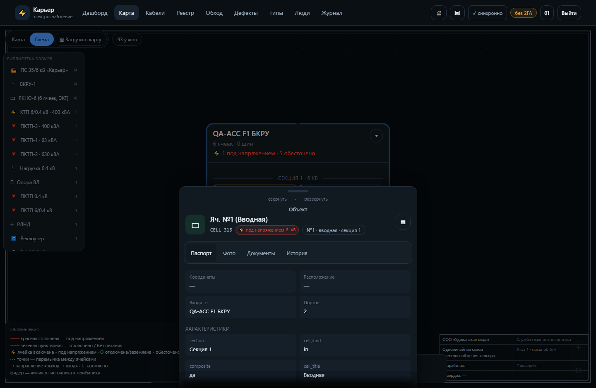
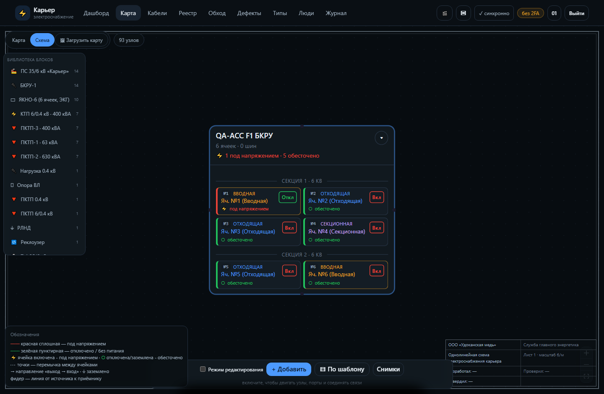
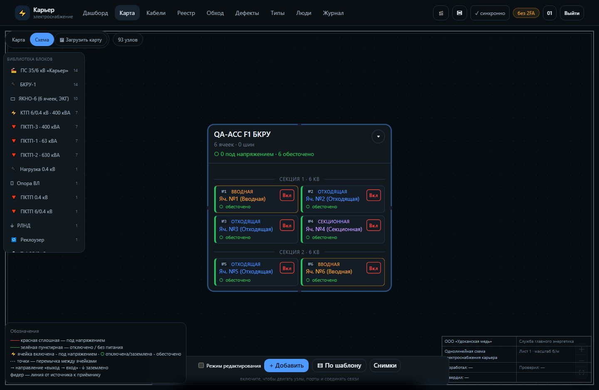

# Приёмка F1+F4 (этап 2): мгновенная перекраска схемы и очистка кабельных полей

Дата: 26.11.2026 · исполнитель: qa_agent (независимая приёмка t8)
Стенд: `karier_test_db` (ревизия `0016_stage2_equipment`) + изолированные сервисы 127.0.0.1:8004/5182
Ничего не исправлялось: `backend-v2/app`, `backend-v2/tests`, `src-v2` не менялись — хеши до/после совпали (§3).
Рабочая `karier_db` — только чтение (head `0016_stage2_equipment`, 12 объектов, `links.cable_asset_id` пуст).

## 1. Вердикт

**PASS.** F1 закрыт: toggle из карточки объекта перекрашивает схему **сразу, без перезагрузки**
(в обе стороны, красный `#F04438` ↔ зелёный `#22C55E`), toggle на самой схеме работает, transform
камеры не меняется. F4 закрыт: `return` кабеля очищает `cable_asset_id`/`cable_mark`/`length_m`/
`cross_section_mm2` у связи, повторный `install` снова заполняет, аудит `cable.returned`
фиксирует очистку; повторный `return` идемпотентен. Регресс не сломан: полный pytest — 227 passed,
0 failed; tsc/build/vitest — зелёные; 0 ошибок консоли/API в браузере.

| # | Критерий приёмки (t8) | Вердикт | Подтверждение |
|---|---|---|---|
| 1 | Полный pytest: 0 failed, passed ≥226 зафиксирован; tsc/build/vitest зелёные; хеши до/после | ✅ | §3 (4 области, 0 изменённых файлов), §4 (**227 passed, 3 skipped, 0 failed**), §5 (exit 0; vitest **82 passed**) |
| 2 | Браузер: toggle из карточки → схема перекрашивается сразу, без перезагрузки (красный↔зелёный); toggle на схеме работает, камера не сбрасывается | ✅ | §6: 17/17 проверок PASS, `marker` жив и `navigation entries = 1` после toggle, transform камеры идентичен на всех шагах; 0 console/API-ошибок |
| 3 | API: return очищает `cable_mark`/`length_m`/`cross_section_mm2` и `cable_asset_id`; install снова заполняет; аудит `cable.returned` | ✅ | §7: 14/14 живых проверок PASS (install→заполнено, return→все `NULL`, аудит `cleared_fields`+`cleared`+актор, повторный return идемпотентен, install снова заполняет, return repair — очищено) |
| 4 | Отчёт `docs/team/34d-f1f4-acceptance.md` с вердиктом и скриншотами | ✅ | этот документ; §6.1 — 7 скриншотов с SHA-256 (`docs/team/34d-f1f4-shots/`) |

## 2. Метод (независимо от отчётов t5/t6/t7)

* хеши всех областей сняты **до** любых действий и повторно после всех прогонов;
* pytest и API-проверки — на `karier_test_db` (guard в `tests/conftest.py`; API-скрипт отдельный,
  созданные объекты удалены);
* фронтенд — контрактные команды (`typecheck`, `build`, `vitest`) на текущем коде t5;
* браузер — **production-сборка** `src-v2/dist`, поднятая статическим сервером с прокси `/api`
  на отдельный backend-процесс с `DATABASE_URL=…karier_test_db`; Edge headless через CDP, кеш и
  ServiceWorker отключены; демо-объекты удалены после смоука;
* «без перезагрузки» доказывается двумя независимыми маркерами: `window.__qaMarker` (сбрасывается
  при reload) и `performance.getEntriesByType('navigation').length === 1`.

## 3. Хеши до/после (SHA-256, от `C:\karier\karier`)

Определение: SHA-256 от строк `"<sha256>  <путь>"` (два пробела, POSIX-путь, сортировка по пути,
`\n` после каждой). Области: `backend-v2/app/**/*.py` (80), `backend-v2/tests/**/*.py` (34),
`src-v2/src/**` (71), конфиги `src-v2` (8). `node_modules/`, `dist/`, `__pycache__` исключены.

| Область | Файлов | Агрегат ДО | Агрегат ПОСЛЕ | Совпал |
|---|---:|---|---|---|
| `backend-v2/app` | 80 | `9999cfd4fc355d98af2745207da6559f6147779e7b0fc202558a65528265a0be` | тот же | ✅ |
| `backend-v2/tests` | 34 | `d528029ab937f06f14f84390f491e93a72b61eadd7186375734e1bb77880954f` | тот же | ✅ |
| `src-v2/src` | 71 | `ed9f98f3f857d693114f3bc60c0bb8a001cf0f1dbf672370f3fee732c367df91` | тот же | ✅ |
| `src-v2` (конфиги) | 8 | `c1d7a4273ab6c4be73af8c6843dbb0132543bf45df914e1f4b8ba84bbdaa46bb` | тот же | ✅ |

Изменённых/добавленных/удалённых файлов — 0. Агрегат `app/` (`9999cfd4…`) соответствует t7
(изменён только `cables.py` из t6 `46ddc79e…`), `tests/` (`d528029a…`) — t7, `src-v2/src`
(`ed9f98f3…`) — t5 (F1: `power.ts`, `AssetSheet.tsx`, `SchemaView.tsx`, `MapPage.tsx`). Значит,
между исправлениями и приёмкой код не дрейфовал. `npm run build` пересобирает `src-v2/dist/`
(артефакт сборки, вне области хеширования).

## 4. Полный backend pytest

```
cd C:\karier\karier\backend-v2
.\venv\Scripts\python.exe -m pytest -q
→ 227 passed, 3 skipped, 638 warnings in 301.07s (0:05:01), exit 0
```

0 failed, passed = **227** (≥226 по критерию). Пропуски (3) — `tests/test_migrations.py`
(`test_single_alembic_head`, `test_upgrade_downgrade_upgrade`, `test_autogenerate_has_only_known_drift`):
нужна отдельная БД в `TEST_MIGRATION_DATABASE_URL` (см. `33d-stage2-acceptance.md` §9 F5).
Лог: `backend-v2/var/qa_t8_full_pytest.log`. После прогона тестовая БД на baseline:
5049/585 объектов, 3788/3737 связей, `links.cable_asset_id IS NOT NULL` = 0.

## 5. Фронтенд: typecheck / build / vitest

```
cd C:\karier\karier\src-v2
npm run typecheck  → exit 0 (tsc -b --noEmit)
npm run build      → exit 0, 516 модулей, ✓ built in 4.95s
npx vitest run     → exit 0, 7 файлов / 82 теста passed
```

`vitest`: `dxf` 3, `equipmentTemplates` 19, **`power` 15** (было 11 — +4 теста `applyPowerState`
из t5), `photo` 3, `assetFields` 23, `DynamicFields` 5, `authProvider` 14 — **82 passed**,
как в отчёте t5 (`34a-f1-fix.md`).

## 6. Браузерный смоук F1 (изолированный стенд)

Стенд: backend `uvicorn` 127.0.0.1:8004 (`DATABASE_URL=…karier_test_db`), статический сервер
production-сборки 127.0.0.1:5182 с прокси `/api`, Edge headless CDP 1440×940, кеш/SW off.
Сценарий: вход `000001/admin` → схема → мастер «По шаблону» → БКРУ (6 ячеек) → карточка ячейки →
«Включить» → «Отключить» → закрыть карточку → toggle на схеме on/off.

**17/17 проверок PASS**, `console errors: none`, **HTTP ≥ 400: 0**.

| # | Проверка | Результат |
|---|---|---|
| 1 | вход `000001/admin` через UI | PASS |
| 2 | БКРУ создан из UI: 6 ячеек | PASS — 6 DOM-ячеек, «6 ячеек · 0 шин» |
| 3 | исходно ячейка зелёная | PASS — `data-power=off`, рамка `rgb(34,197,94)` |
| 4 | карточка открывается со схемы | PASS |
| 5 | в карточке зелёный бейдж «обесточено» | PASS — `rgb(34,197,94)` |
| 6 | **F1: схема перекрасилась сразу после «Включить» в карточке** | PASS — `data-power=on`, рамка `rgb(240,68,56)`, текст «под напряжением»; `__qaMarker='no-reload'`, navigation entries = 1 (перезагрузки нет) |
| 7 | карточка показывает красный бейдж | PASS — `rgb(240,68,56)`, «под напряжением» |
| 8 | переключение не подменило объект | PASS — `cellId` до/после совпал (`999c4d60-…`) |
| 9 | **F1: схема перекрасилась сразу после «Отключить»** | PASS — `off`, `rgb(34,197,94)`, «обесточено», marker жив, entries = 1 |
| 10 | карточка показывает зелёный бейдж | PASS |
| 11 | после закрытия карточки схема зелёная | PASS |
| 12 | toggle на схеме: включение → красная | PASS — `rgb(240,68,56)` |
| 13 | **toggle на схеме: transform камеры не изменился** | PASS — `translate(-10965.1px, -984.859px) scale(1.38778)` до и после |
| 14 | toggle на схеме: обратно → зелёная | PASS |
| 15 | камера не изменилась и после второго toggle | PASS — тот же transform |
| 16 | ошибок консоли нет | PASS — `[]` |
| 17 | ошибок API (HTTP ≥ 400) нет | PASS — `[]` |

Идентичные состояния (зелёная схема до карточки, после возврата и после toggle на схеме) дают
одинаковые transform камеры — это и есть доказательство «камера не сбрасывается».

### 6.1 Скриншоты (`docs/team/34d-f1f4-shots/`, 7 файлов, 1440×940)

| Файл | Что показывает | Размер | SHA-256 |
|---|---|---:|---|
| `01-schema-green-before.png` | БКРУ на схеме до переключения: все ячейки зелёные (обесточено) | 137855 | `ccfbc95316871cc8790a7407c2ece21923063fb2be7c85d272e4273ad7b9c6a4` |
| `02-card-green-before.png` | карточка ячейки: зелёный бейдж «обесточено», CELL-315 | 115246 | `110966f20b1735d0d5c4601a0ff6f73182b8cb2d4d13451e9ef991f7e54e0957` |
| `03-card-on-schema-red.png` | после «Включить» в карточке: красный бейдж «под напряжением 6 кВ»; на схеме за карточкой шапка блока уже «1 под напряжением · 5 обесточено» | 116078 | `fa3fbca7818858e0a3d9f6f53ff3841646d4a939de074e149b4b73c9276b47ea` |
| `04-card-off-schema-green.png` | после «Отключить»: зелёный бейдж «обесточено» | 115246 | `110966f20b1735d0d5c4601a0ff6f73182b8cb2d4d13451e9ef991f7e54e0957` |
| `05-schema-green-after-card.png` | после закрытия карточки: схема зелёная, камера на месте | 137855 | `ccfbc95316871cc8790a7407c2ece21923063fb2be7c85d272e4273ad7b9c6a4` |
| `06-schema-red-after-schema-toggle.png` | toggle на схеме: ячейка №1 красная «⚡ под напряжением», остальные зелёные, камера та же | 138807 | `b146861d5a73af0e548e56e3b1e242bc66820c6377078911312573e405f46aef` |
| `07-schema-green-after-schema-toggle.png` | обратный toggle: снова все зелёные, камера та же | 137855 | `ccfbc95316871cc8790a7407c2ece21923063fb2be7c85d272e4273ad7b9c6a4` |

Совпадение хешей `01 = 05 = 07` и `02 = 04` ожидаемо: состояние и камера возвращаются ровно
в исходные — это дополнительное подтверждение отсутствия сброса камеры/перерисовки с другим
масштабом.





## 7. API-приёмка F4 (живые вызовы, `karier_test_db`)

Скрипт: логин `000001/admin` → БКРУ → toggle → кабель + связь → install/return/return/install/return(repair)
→ проверки БД и `audit.audit_log` → удаление созданного. **14/14 проверок PASS**:

| Проверка | Результат |
|---|---|
| login 000001/admin | PASS |
| composite БКРУ | 201 |
| toggle on | `status=on`, `energized=true`, `voltage_kv=6.0`, `grounded=false`, `nominal_voltage_kv=6.0` |
| toggle off | `status=off`, `energized=false`, `voltage_kv=0.0` |
| кабель + связь | 201/201, кабель `reserve` |
| **install** | связь: `cable_asset_id=<кабель>`, `cable_mark='ПР-0F80D8'`, `length_m=90.0`, `cross_section_mm2=25.0`, `cable_status='in_work'` |
| **return {reserve}** | все четыре поля `NULL`; `link.cable_status='dismounted'`; `cable.lifecycle_status='reserve'` |
| **аудит `cable.returned`** | `cleared_fields=["cable_asset_id","cable_mark","length_m","cross_section_mm2"]`, `cleared=[{link_id, cable_asset_id, cable_mark:'ПР-0F80D8', length_m:90.0, cross_section_mm2:25.0}]`, `from_status=installed→to_status=reserve`, актор `000001`, `detail` содержит «очищены cable_mark/length_m/cross_section_mm2» |
| повторный return | 200, `detached_links=[]`, аудит `links=[]`, `cleared_fields=[]`, `cleared=[]` |
| повторный install | снова заполнены все четыре поля (`90.0`/`25.0`/марка/`cable_asset_id`) |
| return {repair} | все четыре `NULL`, аудит `to_status=repair` с 4 `cleared_fields` |
| очистка демо-объектов | удалены, `ACC-*`/`Кабель приёмки F4` — 0 |

Созданные объекты удалены, БД вернулась к baseline (§4).

## 8. Замечания и оговорки (не блокируют)

1. **F1 подтверждён именно для «новых» ячеек** — это был корневой сценарий бага (ячеек не было
   в загруженном `assets`); в смоуке ячейка создана мастером «По шаблону» и переключалась из
   карточки: схема перекрасилась мгновенно, `cellId` тот же, marker/navigation показывают отсутствие
   перезагрузки.
2. **Тихое обновление графа** (`MapPage.loadGraph`) не сбрасывает камеру: transform
   `translate(-10965.1px, -984.859px) scale(1.38778)` совпал на всех 5 замерах (до карточки,
   после закрытия, после toggle on, после toggle off).
3. **F4-семантика**: у связи после снятия остаётся `cable_status='dismounted'` — это осознанный
   маркер участка (данные кабеля `cable_mark/length_m/cross_section_mm2` очищены); `return
   {"status":"installed"}` — подтверждение установки, связь и денормализация сохраняются
   (зафиксировано тестами t7 `test_cable_return_clears_denormalization_and_audit`).
4. **3 теста миграций пропущены** — нет отдельной БД `TEST_MIGRATION_DATABASE_URL` (известное
   ограничение стенда; цикл 0016 проверялся на `karier_test_db` в приёмке t4 §4).
5. Рабочая `karier_db` сейчас на `0016_stage2_equipment` — эта задача её не меняла (только
   read-only SELECT); миграция рабочей БД выполнена другими работами по выпуску F4 (в t4 она
   была на `0015`).
6. Не проверялось в этой задаче: F4 через браузерный UI (снятие кабеля в UI — вне критериев t8,
   API-сценарий полный), мобильная вёрстка, офлайн-очередь.

## 9. Воспроизведение

```powershell
# 1) хеши до/после — скрипт манифеста (области §3)
python <манифест>.py

# 2) backend-тесты (karier_test_db)
cd C:\karier\karier\backend-v2
.\venv\Scripts\python.exe -m pytest -q

# 3) фронтенд
cd C:\karier\karier\src-v2
npm.cmd run typecheck; npm.cmd run build; npx.cmd vitest run

# 4) API-приёмка F4+toggle (TestClient на karier_test_db)
C:\karier\karier\backend-v2\venv\Scripts\python.exe C:\karier\.tmp\qa_t8_api_check.py

# 5) браузерный смоук F1: backend 8004 + статический сервер dist 5182
cd C:\karier\karier\backend-v2
$env:DATABASE_URL = <DSN karier_test_db>
.\venv\Scripts\python.exe -m uvicorn app.main:app --host 127.0.0.1 --port 8004
node C:\karier\.tmp\qa-serve-f1f4.mjs
node C:\karier\.tmp\qa-f1f4-accept.mjs          # скриншоты → docs/team/34d-f1f4-shots
python C:\karier\.tmp\qa-t8-browser-cleanup.py  # уборка демо-объектов
```

Служебные файлы приёмки: `C:\karier\.tmp\qa-f1f4-accept.mjs`, `qa-serve-f1f4.mjs`,
`qa_t8_api_check.py`, `qa-t8-browser-cleanup.py`, логи `qa-t8-browser.log`, `qa-t8-*.json`;
полный pytest-лог — `backend-v2/var/qa_t8_full_pytest.log`.

## 10. Границы

* ничего не исправлялось: `backend-v2/app`, `backend-v2/tests`, `src-v2` не менялись (хеши §3);
* рабочая `karier_db` — только чтение; миграции/записи не выполнялись;
* все демо-объекты смоука удалены, тестовая БД на baseline (5049/585, 3788/3737, 0 связей с кабелем);
* создан только отчёт и каталог скриншотов `docs/team/34d-f1f4-shots/` (7 PNG);
* сервисы приёмки (8004/5182) остановлены.
